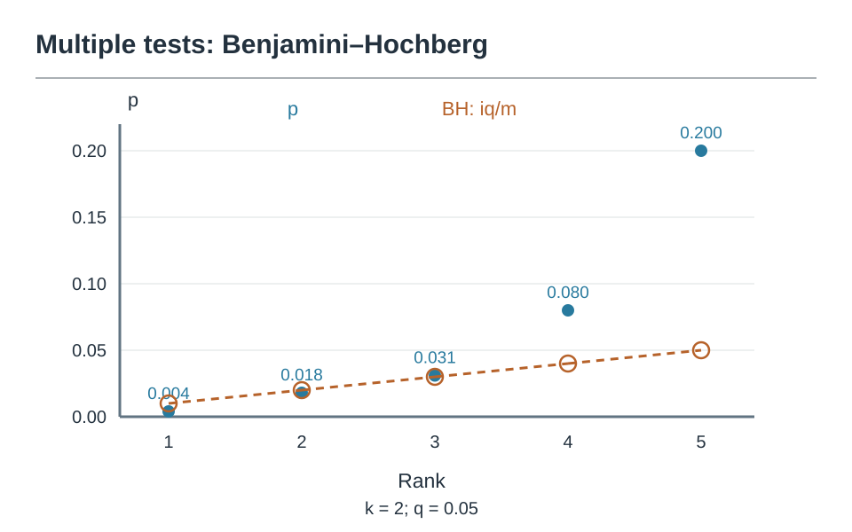

# M27-L2 – Advanced statistical inference {#L2}

**Course area:** M27 – Research Project, Statistics and Thesis

**Level:** Master – research completion

**Prerequisites:** [M27-L1](M27-L1.md).

**Learning objective:** Distinguish effect sizes, confidence intervals and false discovery rate, and apply the Benjamini–Hochberg rule.

## Introduction {#S1}

A research project often investigates several traits or models. A single small p-value is not sufficient evidence of quality. Defining primary endpoints and properly addressing multiple tests are part of the design.

## Principles and model {#S2}

### Effects and uncertainty

An estimated contrast $\hat\theta$ is reported with its standard error and an interval. Under suitable assumptions an approximate 95% interval is $\hat\theta\pm1.96\,SE$. With small samples and estimated variance, a t-distribution or design-appropriate resampling may be necessary. The interval concerns coverage of the procedure under repeated application, not a posterior probability of a fixed parameter. A p-value measures the probability, under the null hypothesis and model assumptions, of a test statistic at least as extreme as the observed one; it is not the probability that the null hypothesis is true.

### Multiple inference

For $m$ ordered p-values $p_{(1)}\le\dots\le p_{(m)}$, the Benjamini–Hochberg rule compares each with $iq/m$, where $q$ is the desired false discovery rate (FDR) level. Select the largest index $k$ for which $p_{(k)}\le kq/m$; reject hypotheses with ranks 1 through $k$. If no such index exists, reject none. FDR is $E[V/\max(R,1)]$, where $V$ is the number of false rejections and $R$ the number of all rejections. The classical guarantee holds for independent tests and certain positive dependencies, not arbitrary dependence. It differs from familywise error probability, the chance of rejecting at least one true null hypothesis. Test families and selection rules should be justified before analysis.

### Model checking

Residual diagnostics, influential observations and sensitivity analysis matter. For hierarchical data, bootstrap resampling must operate at the independent-unit or appropriate block level. Hypotheses developed after exploratory analysis must be explicitly labelled as such.

*Figure: Ordered fictional p-values and BH thresholds for five tests at q=0.05; the first two ranks are rejected.*

## Application {#S3}

Suppose the interaction contrast from L1 is $\hat\theta=4$ cm² with a fictional standard error of 1.5 cm². The normal approximation gives [1.06, 6.94] cm². In addition, five prespecified tests produce p-values 0.004, 0.018, 0.031, 0.080 and 0.200. At $q=0.05$ the thresholds are 0.01, 0.02, 0.03, 0.04 and 0.05. The largest qualifying rank is 2: reject the first two hypotheses. This does not mean that exactly 5% of these two decisions are false.

## Self-assessment {#S4}

### Exercises

1. Calculate the approximate 95% interval for an effect of 3 with SE=0.8.
2. Apply BH at q=0.05 to ordered values 0.009, 0.023, 0.024 and 0.12.
3. Why does a nonsignificant result not establish equivalence?

::: {.lc-solutions data-lc-section="S4"}
1. 3 ± 1.568, or [1.432, 4.568].
2. Thresholds 0.0125, 0.025, 0.0375, 0.05; largest qualifying rank 3, so three rejections.
3. Uncertainty can encompass large effects. Equivalence testing requires a justified prespecified equivalence margin and an appropriate procedure.
:::

## Assumptions and limitations {#S5}

All values are educational examples. The normal approximation is not automatically valid with small samples. An FDR-controlled list replaces neither effect sizes nor independent validation.

## Summary and transition {#S6}

Multiple inference and model checking belong in the research plan. L3 connects planning, resources and quality assurance.

**Further reading:** [M27-L3](M27-L3.md)

## Sources {#S7}

- [Benjamini and Hochberg (1995) – Controlling the False Discovery Rate: A Practical and Powerful Approach to Multiple Testing](https://doi.org/10.1111/j.2517-6161.1995.tb02031.x) · pp. 289–300; indexed abstract and bibliographic record, publisher full text not retrieved · Last accessed: 2026-11-25
- [Benjamini and Yekutieli (2001) – The control of the false discovery rate in multiple testing under dependency](https://doi.org/10.1214/aos/1013699998) · Annals of Statistics 29(4), 1165–1188; indexed abstract, PRDS condition · Last accessed: 2026-11-25
