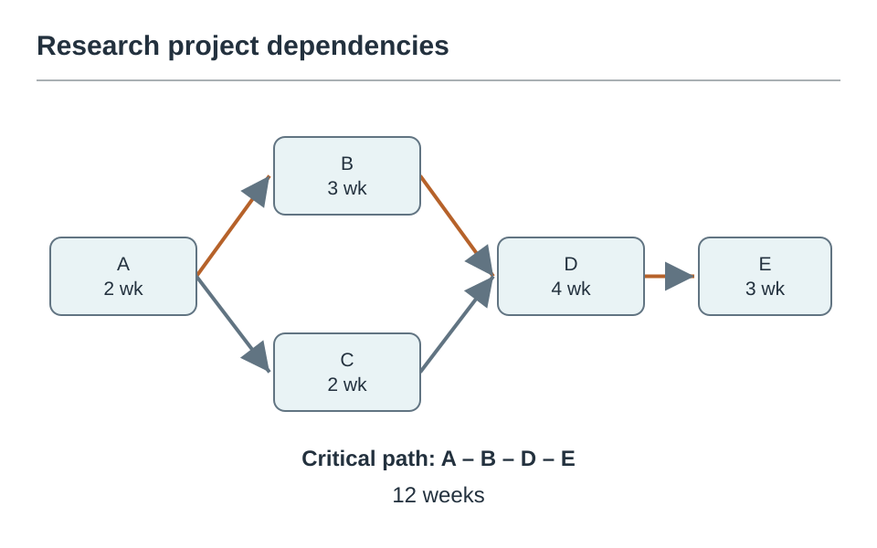

# M27-L3 – Research project and laboratory management {#L3}

**Course area:** M27 – Research Project, Statistics and Thesis

**Level:** Master – research completion

**Prerequisites:** [M27-L2](M27-L2.md).

**Learning objective:** Plan a research project with dependencies, responsibilities, quality gates and realistic schedule reserves.

## Introduction {#S1}

A master’s project must address a verifiable research question within limited time. A project plan connects scientific logic with resources and institutional requirements.

## Principles and model {#S2}

### Work packages and decision points

A work package needs a defined input, a verifiable output, responsibility and acceptance criteria. Project initiation includes literature, feasibility, required approvals, safety induction and data management. Research activities subject to approvals must not begin before those approvals are obtained. A pilot phase can assess suitability of measurements and documentation; it should not silently be reclassified as a confirmatory main study. Endpoints, exclusion rules and analysis methods are fixed before the main dataset is analysed. Changes are recorded with reasons, timing and potential impact.

### Resources and critical path

A dependency graph is acyclic; a task can only begin once its necessary predecessors are complete. Under fixed durations and unlimited resources, the critical path determines minimum total time. The earliest finish of a task is its duration plus the maximum earliest finish among its predecessors. Resource bottlenecks and approval times can extend actual duration. A reserve does not replace risk assessment.

### Quality and team organization

A laboratory project requires traceable sample identities, data storage, equipment and software versions, responsibilities and documented deviations. Assign roles clearly without substituting self-certification for formal review. Risk-bearing biological research is subject to institutional requirements and supervision; this module describes management principles only.

*Figure: Fictional project graph with parallel preparation and a critical path of twelve weeks.*

## Application {#S3}

A purely computational plant project has the following planned durations in weeks: A (plan/approval) 2; B (measurement concept) 3 after A; C (data structure) 2 after A; D (analysis) 4 after B and C; E (report) 3 after D. The critical path A–B–D–E takes 12 weeks. A–C–D–E takes 11 weeks, giving C one week of slack under model assumptions. With a two-week reserve, 14 weeks are allocated. Before analysis, the plan includes a documented check of data structure, measurement concept and analysis plan.

## Self-assessment {#S4}

### Exercises

1. How long is the critical path if C increases to four weeks?
2. What is the earliest finish of D in the original plan?
3. Name two verifiable acceptance criteria for starting analysis.

::: {.lc-solutions data-lc-section="S4"}
1. 2 + 4 + 4 + 3 = 13 weeks; the critical path switches to A–C–D–E.
2. 2 + max(3, 2) + 4 = 9 weeks.
3. For example, unique unit IDs and a documented, versioned analysis plan with defined endpoints.
:::

## Assumptions and limitations {#S5}

All durations are fictional. Approval timelines are not guaranteed. The graph does not account for competing personnel demands or unexpected failures.

## Summary and transition {#S6}

A project plan makes dependencies and responsibilities verifiable. L4 examines the provenance of data, code and sources.

**Further reading:** [M27-L4](M27-L4.md)

## Sources {#S7}

- [DFG – Code of Conduct](https://www.wissenschaftliche-integritaet.de/en/code) · Guidelines 4, 7–14, 17; official overview retrieved, individual guidelines not independently retrieved in this pass · Last accessed: 2026-11-25
