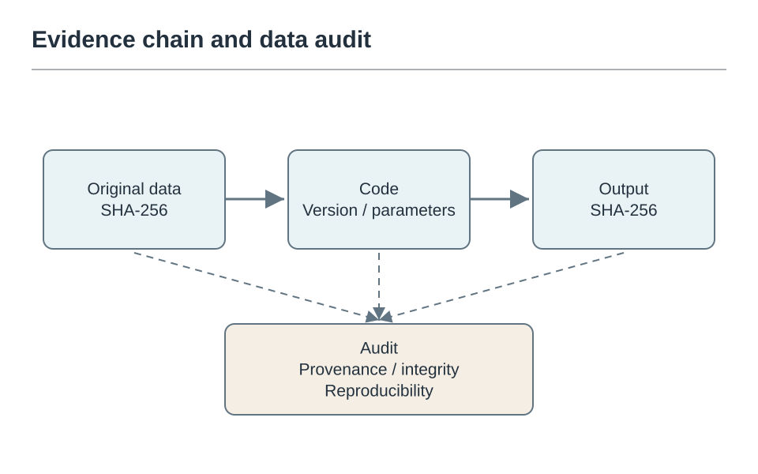

# M27-L4 – Data and source audit {#L4}

**Course area:** M27 – Research Project, Statistics and Thesis

**Level:** Master – research completion

**Prerequisites:** [M27-L3](M27-L3.md).

**Learning objective:** Connect data provenance, checksums, source evidence and reproducibility in a documented audit.

## Introduction {#S1}

A reproducible figure is insufficient if the data origin is unclear. An audit examines whether results can be traced to uniquely identifiable data, transformations and evidence.

## Principles and model {#S2}

### Data provenance and FAIR

Preserve original data unchanged and document each derivative as a new file with origin, timestamp, code version and parameters. A data dictionary defines variables, units, permitted values, missing values and mappings to independent units. FAIR calls for findable, accessible, interoperable and reusable data and metadata. Accessibility need not mean unrestricted access to confidential data: controlled access may be necessary. Persistent resolvable identifiers, clear rights and standard formats support reuse.

### Integrity and reproducibility

SHA-256 produces a fingerprint for a particular byte sequence. Comparing with a reference hash stored in a trusted location can detect changes. An identical hash does not demonstrate that a measurement is correct, a dataset complete or a source true. An independent rerun should reconstruct the expected results using documented software environments, random seeds and numerical tolerances. When results differ, investigate the difference instead of overwriting the reference value.

### Source audit

An evidence matrix connects each substantive claim to an appropriate source location, source type and retrieval date. An original study may support a specific effect; a review may contextualize the state of research. Check that population, method and scope actually match the claim. A DOI alone guarantees neither quality nor full-text access. Record missing evidence, contradictory findings and corrections explicitly.



*Figure: From unchanged originals through documented code to an output file; a separate audit checks provenance, integrity and reproducibility.*

## Application {#S3}

A fictional project contains 25 expected unit IDs. The audit finds 24 distinct IDs and one repeated ID in 25 rows. Completeness of distinct expected IDs is 24/25=96%, assuming all observed IDs belong to the expected set. Do not automatically delete the repeated row: first check whether it represents a genuine repeated measurement, a transcription error or a missing record. The following Python demonstration uses synthetic data only:

```python
import hashlib
raw = b"id,value\nA,4\nB,7\n"
reference = hashlib.sha256(raw).hexdigest()
assert hashlib.sha256(raw).hexdigest() == reference
changed = raw.replace(b"B,7", b"B,8")
assert hashlib.sha256(changed).hexdigest() != reference
```

In a real project the reference hash is stored separately in a trusted location; the demonstration illustrates byte integrity only.

## Self-assessment {#S4}

### Exercises

1. Of 40 expected IDs, 38 distinct expected IDs are found. Calculate coverage.
2. What can a matching SHA-256 value not demonstrate?
3. What must be documented for a table calculated from a dataset?

::: {.lc-solutions data-lc-section="S4"}
1. 38/40 = 0.95 or 95%.
2. For example, scientific correctness, completeness of collection or reliable interpretation of sources.
3. Input provenance and version, code version, parameters, units, exclusion rules and any random seed, as well as output and verification result.
:::

## Assumptions and limitations {#S5}

The coverage ratio is not a universal quality measure. The checksum example replaces neither access control nor scientific data review. Data release depends on rights, privacy and institutional requirements.

## Summary and transition {#S6}

An audit establishes a traceable evidence chain. L5 brings these records together in a scientific thesis.

**Further reading:** [M27-L5](M27-L5.md)

## Sources {#S7}

- [Wilkinson et al. (2016), The FAIR Guiding Principles for scientific data management and stewardship](https://doi.org/10.1038/sdata.2016.18) · Findability, accessibility, interoperability and reusability; indexed article text · Last accessed: 2026-11-25
- [DFG – Code of Conduct](https://www.wissenschaftliche-integritaet.de/en/code) · Guidelines 4, 7–14, 17; official overview retrieved, individual guidelines not independently retrieved in this pass · Last accessed: 2026-11-25
