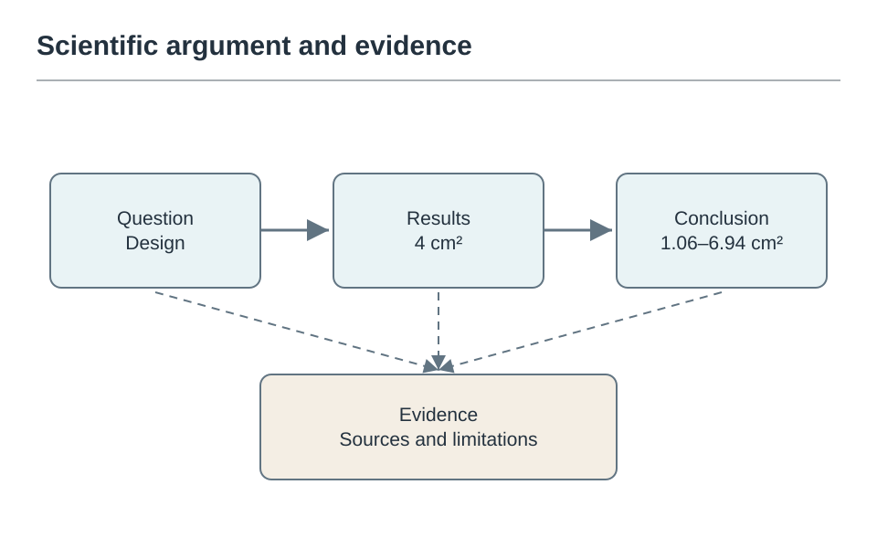

# M27-L5 – Scientific publication and master’s thesis {#L5}

**Course area:** M27 – Research Project, Statistics and Thesis

**Level:** Master – research completion

**Prerequisites:** [M27-L4](M27-L4.md).

**Learning objective:** Construct a master’s thesis as a verifiable scientific argument and justify publication and authorship decisions.

## Introduction {#S1}

A master’s thesis combines a research question, background, methods, results and interpretation into a coherent argument. Scientific quality also depends on reporting uncertain and negative results transparently.

## Principles and model {#S2}

### Argument structure

Introduction: describe current knowledge, the specific gap and research question. Methods: document design, independent units, endpoints, data preparation, statistical models, approvals and deviations. Results: present observations and estimates with uncertainty; distinguish them from interpretation. Discussion: answer the question, compare findings with suitable literature and explain alternative explanations, limitations and useful follow-up questions. The abstract states the main findings and limitations without introducing new claims. A clear figure requires understandable axes, units, sample sizes and definitions of error bars.

### Transparency, contribution and publication

DFG guidelines distinguish documentation, public access, authorship, publication medium and archiving. The CRediT taxonomy identifies contributions such as methodology, data curation, formal analysis, software and writing. It is not an automatic rule for determining authorship. Contributions, authorship and consent are clarified transparently under applicable standards. Publishing a thesis requires consideration of rights, confidentiality, data permissions and institutional requirements. A negative result does not justify retrospective manipulation of endpoints. Exploratory analyses remain valuable when identified as such.

### Defence and self-review

A defence should explain the question, design, main finding, uncertainty and scope of inference. Connect each major claim to a table, figure or literature location. Reproducibility, methodological appropriateness and evidential strength are distinct review dimensions.

*Figure: From research problem through design and results to a bounded conclusion; every claim remains connected to its evidence.*

## Application {#S3}

For the fictional project from L1–L4 an appropriate result statement is: “The estimated additive interaction contrast was 4 cm² (approximate 95% interval: 1.06 to 6.94 cm²).” A cautious discussion adds that the numbers are simulated and permit no real conclusions about plant lines. In a real project the result would apply only to the investigated conditions until further data supported generalization. Suppose four of five main claims have specific evidence locations and one is unchecked: evidence coverage is 80%. The fifth claim must be supported, qualified or removed before the thesis can be described as fully reviewed.

## Self-assessment {#S4}

### Exercises

1. Why is “The environmental condition improves plants generally” not supported by the interaction contrast alone?
2. Seven of eight main claims are linked to verified evidence. Calculate coverage.
3. What role does CRediT play in authorship decisions?

::: {.lc-solutions data-lc-section="S4"}
1. The contrast describes differences in condition effects between two lines on a particular scale; it does not support a general claim about all plants or conditions.
2. 7/8 = 87.5%. The unverified claim remains unresolved.
3. CRediT makes contributions transparent but does not by itself determine who meets authorship criteria.
:::

## Assumptions and limitations {#S5}

The example thesis is not a real research record and replaces neither supervision, assessment, ethics approval nor a university qualification. Institution-specific length and assessment requirements must be followed separately.

## Summary and transition {#S6}

This concludes the master’s research pathway. Use the [study path](pages/study-path.md) for targeted revision and the [source list](pages/sources.md) for further reading.

## Sources {#S7}

- [DFG – Code of Conduct](https://www.wissenschaftliche-integritaet.de/en/code) · Guidelines 4, 7–14, 17; official overview retrieved, individual guidelines not independently retrieved in this pass · Last accessed: 2026-11-25
- [NISO – CRediT role descriptors](https://credit.niso.org/contributor-roles-defined/) · 14 contributor roles; distinction between contribution and authorship; retrieved text · Last accessed: 2026-11-25
