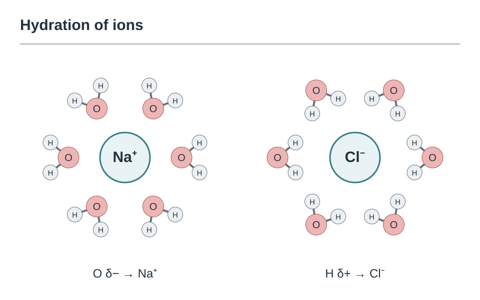

# M3-L1 – Chemical bonds and aqueous solutions {#L1}

**Course area:** M3 – Chemical and Physical Foundations

**Level:** Bachelor

**Prerequisites:** School chemistry: atoms, ions and amount of substance; [M2-L1](M2-L1.md): quantitative relationships.

**Learning objective:** Distinguish bonding types and quantitatively explain concentration, dilution and hydration.

## Introduction {#S1}

Cytoplasm is not a pure liquid. It contains dissolved ions, small molecules, proteins and larger structures. Their interactions determine which reactions and transport processes are possible.

## Principles and model {#S2}

### Bonds and interactions

Covalent bonds involve shared electron density between atoms. Unequal electronegativity gives rise to a polar bond. Ions form through electron loss or gain; opposite charges attract. A hydrogen bond is a directional interaction between a suitable donor and acceptor, not an additional covalent O–H bond. Dispersion forces also act between nonpolar groups. Many individually weak contacts can collectively stabilize protein structure.

Water has a dipole moment because of its bent geometry and polar bonds. In a cation's hydration shell, water preferentially points its oxygen side toward the ion; near anions, its hydrogen side predominates. Hydrophobic molecular groups tend to associate in water because under suitable conditions this lowers the free energy of the entire system. This does not imply formation of a new chemical bond.

### Amount of substance and concentration

Amount concentration is $c=n/V$, with amount $n$ in mol and volume $V$ in L. Mass is $m=nM$, where $M$ is molar mass. For dilution without solute loss, $c_1V_1=c_2V_2$. Osmolarity accounts for the number of dissolved particles per volume; charge, activity and membrane permeability are considered separately later.

*Figure: Water dipoles around sodium and chloride ions, schematic, not to scale.*

## Application {#S3}

A fictional calculation considers 10 mL of 0.20 mol/L NaCl solution and a final volume of 50 mL. The amount is $0.20\cdot0.010=0.0020$ mol. Final concentration is $0.0020/0.050=0.040$ mol/L. Ideal complete dissociation gives approximately 0.080 osmol/L. This does not determine tonicity across a particular cell membrane.

## Self-assessment {#S4}

### Exercises

1. Why is the hydration shell of Na+ oriented differently from that of Cl−?
2. Calculate the amount in 25 mL of a 0.10 mol/L solution.
3. What happens to concentration if volume doubles without solute loss?

::: {.lc-solutions data-lc-section="S4"}
1. The partially negative O side preferentially faces Na+; the partially positive H side faces Cl−.
2. $0.025\cdot0.10=0.0025$ mol.
3. It halves because the amount of solute remains constant.
:::

## Assumptions and limitations {#S5}

Concentration is not an exact substitute for activity in nonideal solutions. Hydration shells are dynamic rather than rigid. Osmolarity and tonicity are not equivalent.

## Summary and transition {#S6}

Bonding, solvation and concentration connect molecular structure to aqueous system properties. M3-L2 examines their energetic direction.

**Continue:** [M3-L2](M3-L2.md)

## Sources {#S7}

- [OpenStax – Biology 2e, 2.2 Water](https://openstax.org/books/biology-2e/pages/2-2-water) · Polarity, hydrogen bonding, solvent properties · Last accessed: 2026-11-25

