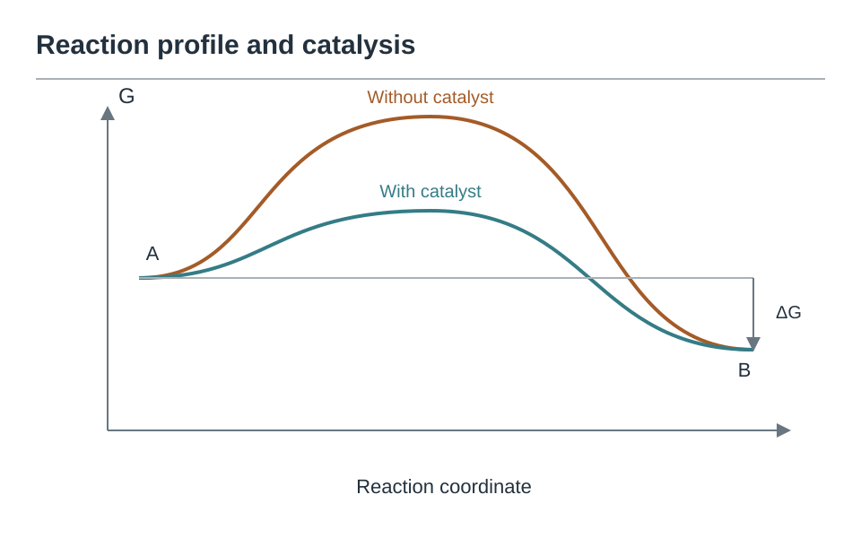

# M3-L2 – Reaction equilibrium and thermodynamics {#L2}

**Course area:** M3 – Chemical and Physical Foundations

**Level:** Bachelor

**Prerequisites:** [M3-L1](M3-L1.md): concentration and interactions.

**Learning objective:** Distinguish Gibbs energy, reaction quotient, equilibrium and kinetic barriers.

## Introduction {#S1}

A cell maintains its organization through exchange of matter and energy with its surroundings. Thermodynamics explains possible changes of state, but not their speed.

## Principles and model {#S2}

### Energy, entropy and Gibbs energy

The first law accounts for energy: with work on the system taken as positive, $\Delta U=q+w$. The second law requires a positive entropy change of system plus surroundings for spontaneous processes. Local order can arise if the overall balance satisfies this condition. At constant temperature and pressure, Gibbs energy $G=H-TS$ provides a criterion: $\Delta G=\Delta H-T\Delta S$. Negative $\Delta G$ favours the direction considered; positive values favour the reverse.

### Chemical equilibrium

For $A\rightleftharpoons B$, $Q=a_B/a_A$, with dimensionless activities $a$. More generally, activities enter with stoichiometric exponents. The relationship is $\Delta_r G=\Delta_r G^\circ+RT\ln Q$; at equilibrium $Q=K$ and $\Delta_r G=0$, hence $\Delta_r G^\circ=-RT\ln K$. When $Q<K$, the forward direction is thermodynamically favoured. At dynamic equilibrium, forward and reverse reactions occur at equal rates. An enzyme lowers the activation barrier without changing $K$ or reaction Gibbs energy under identical conditions. Coupling to an exergonic reaction can enable an otherwise unfavourable overall process.

*Figure: Schematic Gibbs energy along the reaction coordinate; identical endpoints with and without a catalyst.*

## Application {#S3}

Suppose $K=10$ at 298 K in a model. With $R=8.314\,\mathrm{J\,mol^{-1}K^{-1}}$, $\Delta_r G^\circ=-5.70$ kJ/mol. At $Q=0.1$, $\Delta_r G=RT\ln(Q/K)=-11.41$ kJ/mol. The forward direction is favoured, but the reaction time cannot be calculated without knowing the barrier.

## Self-assessment {#S4}

### Exercises

1. Which direction is favoured when $Q=100$ and $K=10$?
2. Can a catalyst change $K$?
3. Two coupled steps have reaction Gibbs energies of +8 and −15 kJ/mol. What is the total?

::: {.lc-solutions data-lc-section="S4"}
1. Reverse, because $Q>K$ and $\Delta_r G>0$.
2. No; under unchanged thermodynamic conditions it accelerates approach to equilibrium.
3. −7 kJ/mol, provided the two steps are actually coupled.
:::

## Assumptions and limitations {#S5}

Standard and actual states must be distinguished. Real cells often operate in nonequilibrium steady states. A favourable total energy balance does not prove mechanistic coupling.

## Summary and transition {#S6}

Thermodynamics gives direction and equilibrium; kinetics gives time behaviour. The next lesson examines reactive molecular groups.

**Continue:** [M3-L3](M3-L3.md)

## Sources {#S7}

- [OpenStax – Biology 2e, 6.3 The Laws of Thermodynamics](https://openstax.org/books/biology-2e/pages/6-3-the-laws-of-thermodynamics) · Open systems; first and second laws · Last accessed: 2026-11-25
- [OpenStax – Chemistry 2e, 13.2 Equilibrium Constants](https://openstax.org/books/chemistry-2e/pages/13-2-equilibrium-constants) · Equilibrium constant and reaction quotient · Last accessed: 2026-11-25

