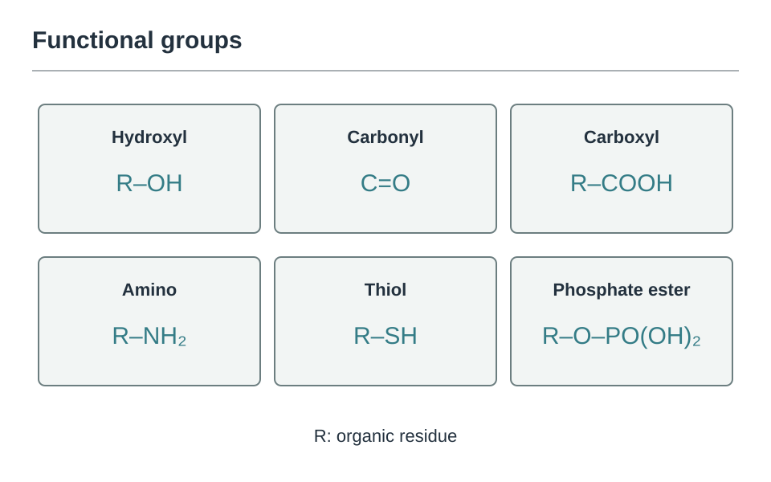

# M3-L3 – Organic functional groups {#L3}

**Course area:** M3 – Chemical and Physical Foundations

**Level:** Bachelor

**Prerequisites:** [M3-L1](M3-L1.md): covalent bonds and polarity.

**Learning objective:** Recognize functional groups and predict their contributions to reactivity, charge and solubility.

## Introduction {#S1}

Sugars, fatty acids and amino acids possess carbon skeletons but differ in the groups attached to them. These determine many possible reactions.

## Principles and model {#S2}

Carbon can form four bonds and produce chains, rings and branched skeletons. Double bonds restrict rotation. Constitutional isomers have the same molecular formula but different connectivity; stereoisomers differ in spatial arrangement with unchanged connectivity. Chirality is important in enzyme recognition of substrates.

| Group | Representation | Typical significance |
|---|---|---|
| Hydroxyl | R–OH | polar, hydrogen bonding |
| Carbonyl | C=O | electrophilic carbon; aldehyde or ketone |
| Carboxyl | R–COOH | weak acid; often R–COO− at neutral pH |
| Amino | R–NH₂ | can be protonated |
| Thiol | R–SH | redox reactions, disulfide bonds |
| Phosphate ester | R–O–PO(OH)₂ | often negatively charged in water |

R denotes a variable organic residue. Neighbouring groups influence acidity and reactivity. Esters can formally be described as forming from a carboxylic acid and alcohol with loss of water; amide bonds connect carbonyl carbon and nitrogen. Cells often form such bonds through activated intermediates rather than simply mixing reactants in water.

*Figure: Six functional groups in simplified structural formulas.*

## Application {#S3}

Lactic acid has the structure CH₃–CH(OH)–COOH. It contains hydroxyl and carboxyl groups and a stereogenic carbon atom. At pH 7 its carboxyl group is predominantly carboxylate. Ethanol CH₃–CH₂–OH has no carboxyl group. Comparing properties solely by carbon atom count would miss this difference.

## Self-assessment {#S4}

### Exercises

1. Which group distinguishes acetic acid from ethanol with respect to acidity?
2. How do constitutional isomers and enantiomers differ?
3. Which groups of an amino acid may be ionized in water?

::: {.lc-solutions data-lc-section="S4"}
1. Acetic acid's carboxyl group, which can release a proton.
2. Constitutional isomers differ in connectivity; enantiomers are nonsuperimposable mirror images with the same connectivity.
3. Carboxyl and amino groups; depending on the side chain, additional groups.
:::

## Assumptions and limitations {#S5}

A functional group does not determine properties in isolation: environment, pH, charge distribution and molecular geometry act together. The drawings are simplified structural formulas.

## Summary and transition {#S6}

Organic groups explain molecular interactions and underpin biochemistry. M3-L4 turns to physical transport models.

**Continue:** [M3-L4](M3-L4.md)

## Sources {#S7}

- [OpenStax – Biology 2e, 2.3 Carbon](https://openstax.org/books/biology-2e/pages/2-3-carbon) · Functional groups and isomers · Last accessed: 2026-11-25

