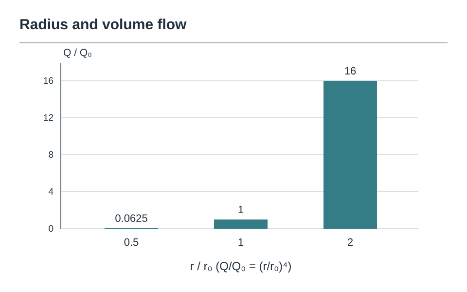

# M3-L4 – Optics, mechanics and transport processes {#L4}

**Course area:** M3 – Chemical and Physical Foundations

**Level:** Bachelor

**Prerequisites:** [M2-L1](M2-L1.md): functions; [M3-L1](M3-L1.md): aqueous solutions.

**Learning objective:** Estimate optical resolution, mechanical forces and the influence of geometric parameters on transport.

## Introduction {#S1}

Microscopy reveals spatial structures; transport models explain how substances reach them. Both are subject to physical limitations.

## Principles and model {#S2}

### Optics and mechanics

Magnification describes the image-to-object size ratio; resolution is the ability to distinguish adjacent details. For a diffraction-limited optical system, the Rayleigh criterion gives the approximate lateral separation $d=0.61\lambda/NA$, where $NA=n\sin\theta$ is numerical aperture and $\lambda$ denotes vacuum wavelength. More magnification alone does not improve resolution. Fluorescence adds contrast through selective light emission from appropriate labels.

Force $F$ and pressure $p=F/A$ are different quantities. Pressure differences drive volume flow. For steady laminar flow of a Newtonian fluid in a rigid cylindrical tube, $Q=\pi r^4\Delta p/(8\eta l)$, with radius $r$, length $l$ and dynamic viscosity $\eta$. Radius is therefore particularly influential. Diffusion instead arises from thermal motion; in simple Fickian diffusion the net flux follows the concentration gradient: $J=-D\,dc/dx$. A characteristic one-dimensional diffusion distance is $\sqrt{2Dt}$.

*Figure: Relative Poiseuille volume flow at constant pressure difference, length and viscosity.*

## Application {#S3}

At $\lambda=550$ nm and $NA=1.25$, $d\approx268$ nm. Two points 100 nm apart cannot be conventionally resolved under these model conditions. With pressure difference, viscosity and length fixed, doubling radius increases laminar volume flow by $2^4=16$. For $D=100\,\mathrm{\mu m^2/s}$ and $t=2$ s, the characteristic diffusion distance is 20 µm. These are model calculations, not measurements.

## Self-assessment {#S4}

### Exercises

1. What does the Rayleigh model predict if wavelength is halved at constant aperture?
2. How does tube flow change if radius is halved?
3. By what factor does characteristic diffusion distance increase when time quadruples?

::: {.lc-solutions data-lc-section="S4"}
1. The minimum resolvable separation halves.
2. It falls to $1/16$ of its original value.
3. By a factor of two, because distance is proportional to $\sqrt{t}$.
:::

## Assumptions and limitations {#S5}

Resolution criteria differ by imaging modality; scattering, aberrations and contrast affect real images. Blood vessels are not rigid; blood is not Newtonian under all conditions. Diffusion in heterogeneous tissues can depart from the simple model.

## Summary and transition {#S6}

Physical models quantify measurement and transport limitations. M3-L5 considers uncertainty in such measurements.

**Continue:** [M3-L5](M3-L5.md)

## Sources {#S7}

- [OpenStax – Biology 2e, 4.1 Studying Cells](https://openstax.org/books/biology-2e/pages/4-1-studying-cells) · Microscopy and resolution · Last accessed: 2026-11-25
- [OpenStax – University Physics Volume 1, 14.7 Viscosity and Turbulence](https://openstax.org/books/university-physics-volume-1/pages/14-7-viscosity-and-turbulence) · Laminar flow and Poiseuille model · Last accessed: 2026-11-25
- [OpenStax – College Physics, 12.7 Molecular Transport Phenomena](https://openstax.org/books/college-physics/pages/12-7-molecular-transport-phenomena-diffusion-osmosis-and-related-processes) · Root-mean-square diffusion distance · Last accessed: 2026-11-25
- [OpenStax – University Physics Volume 3, 4.5 Circular Apertures and Resolution](https://openstax.org/books/university-physics-volume-3/pages/4-5-circular-apertures-and-resolution) · Rayleigh criterion and numerical aperture · Last accessed: 2026-11-25

