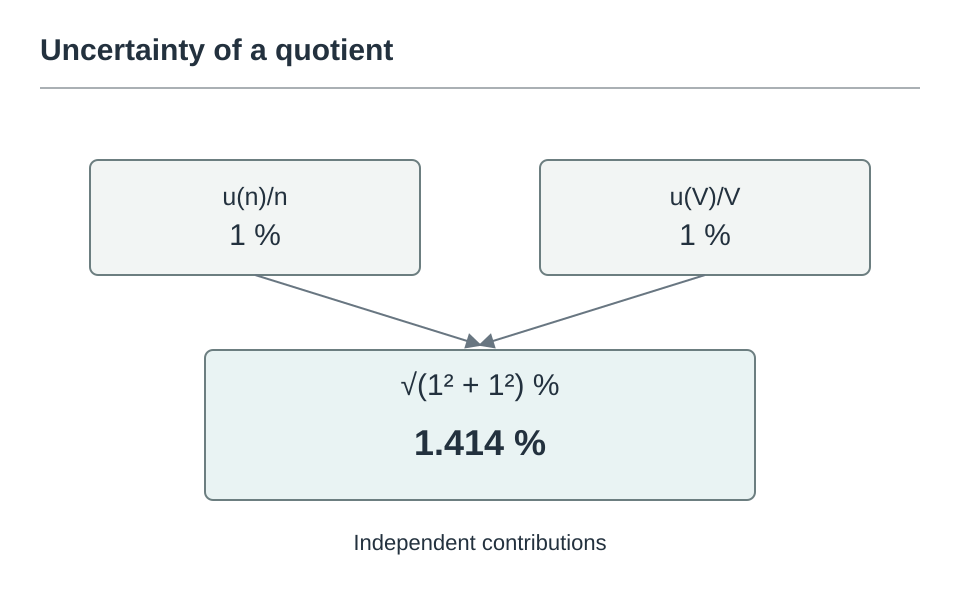

# M3-L5 – Measurement and uncertainty {#L5}

**Course area:** M3 – Chemical and Physical Foundations

**Level:** Bachelor

**Prerequisites:** [M2-L3](M2-L3.md): variability; [M3-L1](M3-L1.md): concentration.

**Learning objective:** Distinguish calibration, systematic deviation and standard uncertainty and propagate independent uncertainties.

## Introduction {#S1}

An instrument can repeatedly display almost the same value yet measure systematically incorrectly. Biological interpretation requires a description of measurement quality as well as the value.

## Principles and model {#S2}

### Measurement model

The measurand is the intended physical quantity, such as leaf area in cm². Calibration establishes the relationship between indications and reference values; it is not automatically adjustment. Precision describes agreement between repeated measurements. Systematic deviations can arise, for example, from an incorrect zero correction. Known relevant deviations are corrected; remaining incomplete knowledge contributes to uncertainty.

Standard uncertainties $u(x)$ have the unit of the quantity and correspond to a standard deviation in the uncertainty model. Type A is evaluated statistically from observations; Type B is evaluated from other information such as calibration certificates. This is not a classification into random and systematic errors. For independent inputs and sufficiently linear behaviour, $u_c^2(y)\approx\sum_i(\partial f/\partial x_i)^2u^2(x_i)$ for $y=f(x_1,\ldots,x_n)$. Correlation requires covariance terms. For a quotient $c=n/V$, independent uncertainties give approximately $u(c)/|c|=\sqrt{(u(n)/n)^2+(u(V)/V)^2}$.

*Figure: Two independent relative uncertainties of 1 percent each combine to 1.414 percent.*

## Application {#S3}

Fictional values: $n=2.00\pm0.02$ mmol and $V=50.0\pm0.5$ mL; the stated uncertainties are standard uncertainties. $c=40.0$ mmol/L. Both relative contributions are 1%. Combined, they give 1.414% and $u(c)\approx0.57$ mmol/L. Report the result as $(40.0\pm0.6)$ mmol/L with $k=1$. This is not automatically a 95% interval.

## Self-assessment {#S4}

### Exercises

1. Two independent length measurements with standard uncertainties of 0.3 and 0.4 mm are added. What is $u_c$?
2. What remains in the presence of a constant zero error despite many repetitions?
3. Can independence be automatically assumed with a common calibration standard?

::: {.lc-solutions data-lc-section="S4"}
1. $\sqrt{0.3^2+0.4^2}=0.5$ mm.
2. The systematic offset; averaging does not remove it.
3. No; uncertainties may be correlated and the measurement model must account for this.
:::

## Assumptions and limitations {#S5}

Linear propagation may be unsuitable for large uncertainties or highly nonlinear relationships. Biological variability between individuals and instrumental measurement uncertainty must be modelled separately.

## Summary and transition {#S6}

Measurement uncertainty makes results comparable and limits exaggerated precision claims. M3-L6 applies concentration and equilibrium models to buffers.

**Continue:** [M3-L6](M3-L6.md)

## Sources {#S7}

- [NIST TN 1297, 5. Combined Standard Uncertainty](https://www.nist.gov/pml/nist-technical-note-1297/nist-tn-1297-5-combined-standard-uncertainty) · Propagation of standard uncertainties · Last accessed: 2026-11-25

