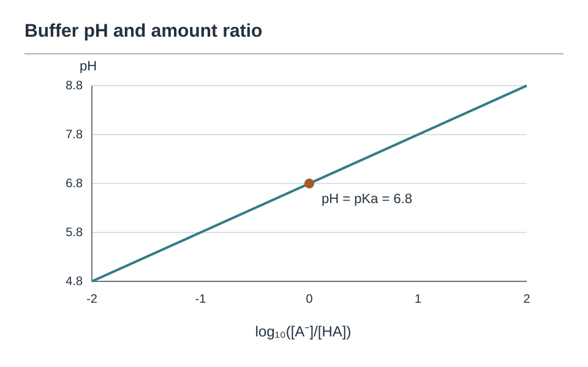

# M3-L6 – Acid–base equilibria and buffers {#L6}

**Course area:** M3 – Chemical and Physical Foundations

**Level:** Bachelor

**Prerequisites:** [M3-L1](M3-L1.md): concentration; [M3-L2](M3-L2.md): equilibrium.

**Learning objective:** Explain acid–base equilibria, calculate buffer pH and distinguish buffer capacity from pH.

## Introduction {#S1}

Proteins and membranes respond to changes in proton activity. Cells therefore possess buffer systems and active regulatory mechanisms that maintain pH within suitable limits.

## Principles and model {#S2}

### Proton transfer and equilibrium

In the Brønsted model, an acid donates a proton and a base accepts one. A weak acid follows $HA+H_2O\rightleftharpoons H_3O^++A^-$. The acid dissociation constant $K_a$ describes equilibrium; $pK_a=-\log_{10}K_a$. pH is $-\log_{10}a_{H^+}$, not simply proton concentration. Concentrations are approximations in dilute solutions. At 25 °C pure water has a neutral pH of approximately 7; neutrality means equal hydronium and hydroxide activities, not exactly pH 7 at every temperature.

### Buffers

A buffer contains a conjugate acid–base pair. Added protons are partly bound by the base; added base partly consumes the acid. The equilibrium relationship gives the approximate Henderson–Hasselbalch equation $pH=pK_a+\log_{10}([A^-]/[HA])$. Equal concentrations give pH equal to $pK_a$. The ratio approximately determines pH; total amount influences buffer capacity. Phosphate and protein groups contribute to biological buffers; open physiological systems additionally involve transport and regulation.

*Figure: Henderson–Hasselbalch model: pH versus logarithmic A−/HA ratio at pKa 6.8.*

## Application {#S3}

In a fictional closed buffer model, let $pK_a=6.8$ and initial amounts be 10 mmol each of HA and A−. A theoretical addition of 2 mmol strong acid shifts the amounts to 12 mmol HA and 8 mmol A− under simplified complete neutralization. At a common final volume, $pH=6.8+\log_{10}(8/12)\approx6.62$. This is a theoretical calculation, not a laboratory protocol.

## Self-assessment {#S4}

### Exercises

1. What pH results from $pK_a=6.8$ and ratio A−/HA = 10?
2. Two buffers have the same ratio but different total amounts in equal volumes. Which has greater capacity in the model?
3. Why can a buffer not neutralize an arbitrarily large amount of acid?

::: {.lc-solutions data-lc-section="S4"}
1. pH = 7.8.
2. The buffer with the greater total amount, all else equal.
3. The conjugate base is consumed; the ratio changes strongly once its reserve is exhausted.
:::

## Assumptions and limitations {#S5}

The approximation requires suitable equilibrium, known activity ratios and sufficient quantities of both partners. Temperature, ionic strength and coupled equilibria affect pH. Physiological regulation cannot be fully described by a closed single-buffer model.

## Summary and transition {#S6}

The chemical and physical foundations of M3 prepare for membrane transport, metabolism and cellular regulation in M4–M6.

**Continue:** [M4-L1](M4-L1.md)

## Sources {#S7}

- [OpenStax – Biology 2e, 2.2 Water](https://openstax.org/books/biology-2e/pages/2-2-water) · Polarity, hydrogen bonding, solvent properties · Last accessed: 2026-11-25
- [OpenStax – Chemistry 2e, 14.6 Buffers](https://openstax.org/books/chemistry-2e/pages/14-6-buffers) · Conjugate acid/base, Henderson–Hasselbalch equation, capacity · Last accessed: 2026-11-25
- [OpenStax – Chemistry 2e, 13.2 Equilibrium Constants](https://openstax.org/books/chemistry-2e/pages/13-2-equilibrium-constants) · Equilibrium constant and reaction quotient · Last accessed: 2026-11-25

