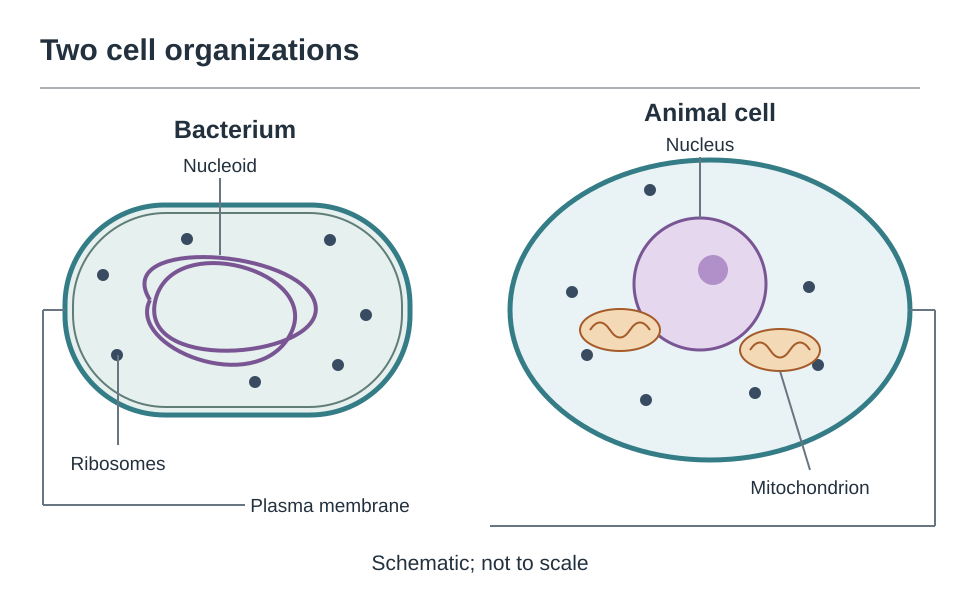

# M4-L1 – Prokaryotic and eukaryotic cells {#L1}

**Course area:** M4 – Cell Biology and Membranes

**Level:** Bachelor

**Prerequisites:** [M3-L1](M3-L1.md): interactions; [M3-L4](M3-L4.md): microscopy and diffusion.

**Learning objective:** Compare cell types by organization, explain limitations of microscopic identification and calculate the surface-area-to-volume ratio.

## Introduction {#S1}

A cell is an open, spatially bounded system exchanging matter and energy with its surroundings. Not every cell performs all life functions independently: a mature mammalian erythrocyte, for example, has no nucleus. A single visible feature is therefore not always sufficient to classify an organism.

## Principles and model {#S2}

### Organization and evolutionary relationships

Bacteria and archaea lack genetic material enclosed by a nuclear envelope. Their main chromosome is often located in a nucleoid. Plasmids may also be present. The two groups differ in membrane chemistry, cell walls and molecular information systems; peptidoglycan characterizes many bacteria but not archaea. Prokaryotic cells can have specialized internal structures. Eukaryotes typically have a nucleus and membrane-bound organelles; nuclear genetic information usually occupies multiple linear chromosomes. Ribosomes, genetic information, a plasma membrane and an aqueous interior are fundamental features shared by cellular life.

Plant cells typically have a cellulose-containing wall and a large vacuole; photosynthetically active cells contain chloroplasts. Animal cells lack a cellulose wall. Fungi are eukaryotes with a differently composed cell wall. Mitochondria and plastids evolved from bacterial ancestors. Their own genomes and gene relationships with bacteria support this explanation; most of their proteins, however, are now encoded by nuclear genes. Viruses are not cells and depend on suitable host cells for replication.

### Geometric constraints

For a spherical model cell of radius $r$, $A=4\pi r^2$ and $V=4\pi r^3/3$. The ratio $A/V=3/r$ has units of inverse length. Increasing radius reduces exchange area per unit volume. Surface folds, elongated shapes, intracellular transport and specialized metabolic compartments can partially compensate. The ratio alone cannot determine the quantity actually transported; permeability and gradients are also required.

*Figure: Schematic comparison of a bacterium and a typical nucleated animal cell; sizes not to scale.*

## Application {#S3}

Compare idealized spheres with radii 1 and 10 µm. Their surface-area-to-volume ratios are 3 and 0.3 per µm. The second sphere has one hundred times the area but one thousand times the volume. At equal flux per unit area, its exchange rate per unit volume is ten times lower. Nevertheless, size differences in a micrograph alone cannot reliably distinguish bacteria from eukaryotes.

## Self-assessment {#S4}

### Exercises

1. State two shared features and two typical differences between bacterial and animal cells.
2. Calculate $A/V$ for a model cell of radius 4 µm.
3. Explain why a mature mammalian erythrocyte without a nucleus is not classified as a bacterium.

::: {.lc-solutions data-lc-section="S4"}
1. Both possess, for example, a plasma membrane and ribosomes. A typical animal cell has a nuclear envelope and mitochondria; bacteria lack both.
2. $3/4=0.75$ per µm.
3. It develops by differentiation of a eukaryotic precursor cell. Evolutionary origin and developmental context determine classification.
:::

## Assumptions and limitations {#S5}

Size ranges overlap. The sphere is a geometric model, not a scale drawing of actual cell types. Cell walls, capsules and organelles are not present in every representative of a group. Prokaryote describes a form of organization, not a single natural lineage.

## Summary and transition {#S6}

Cell organization depends on boundaries, information processing and exchange. The next lesson examines the membrane as a selective interface.

**Continue:** [M4-L2](M4-L2.md)

## Sources {#S7}

- [OpenStax – Biology 2e, 4.2 Prokaryotic Cells](https://openstax.org/books/biology-2e/pages/4-2-prokaryotic-cells) · Cell organization; surface-area-to-volume relationship · Last accessed: 2026-11-25
- [OpenStax – Biology 2e, 4.3 Eukaryotic Cells](https://openstax.org/books/biology-2e/pages/4-3-eukaryotic-cells) · Nucleus, mitochondria, chloroplasts, plant and animal cells · Last accessed: 2026-11-25

