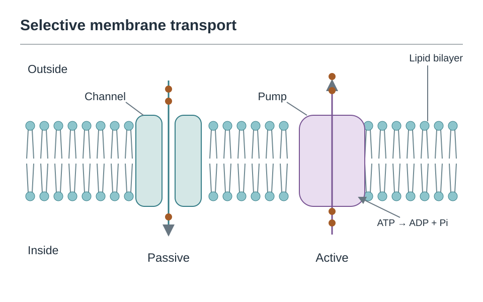

# M4-L2 – Biological membranes and transport {#L2}

**Course area:** M4 – Cell Biology and Membranes

**Level:** Bachelor

**Prerequisites:** [M3-L2](M3-L2.md): Gibbs energy; [M4-L1](M4-L1.md): cell boundaries.

**Learning objective:** Explain membrane structure, transport mechanisms and osmosis, and calculate and interpret an ion equilibrium potential.

## Introduction {#S1}

A membrane must both maintain concentration differences and permit controlled exchange. Lipids, proteins and the energetic coupling of transport reconcile these apparently opposing requirements.

## Principles and model {#S2}

### Selectivity and dynamics

In water, amphiphilic lipids form a bilayer with hydrophilic heads facing the aqueous surroundings and a hydrophobic interior. The two leaflets may have different compositions. Lipids and many proteins move laterally, although interactions and anchoring restrict their mobility. Sterols modify fluidity depending on temperature and lipid composition. Small nonpolar molecules can often diffuse directly across a membrane; ions generally require suitable proteins.

Passive transport decreases free energy. Channels permit selective passage and can be regulated. Carriers change conformation; their transport rates may saturate at high substrate concentrations. Primary active pumps couple transport to energy sources such as ATP hydrolysis. Secondary active transporters use energetically favourable movement of one substance to accumulate another; symport denotes movement in the same direction and antiport in opposite directions. For example, the Na+/K+-ATPase moves three Na+ out and two K+ in per ATP hydrolysed.

### Osmosis and electrochemical potential

Osmosis is net water movement along a water potential gradient. In an idealized situation without a pressure difference, water moves towards the side with a higher concentration of osmotically effective solutes. Poorly permeating solutes are especially important for the long-term volume effect (tonicity). Plant cells can develop turgor pressure against their walls; animal cells can swell in hypotonic surroundings.

For an ion of charge number $z$, the free energy for movement from outside to inside is approximately $\Delta G=RT\ln(c_i/c_o)+zF V_m$, where $V_m=\psi_i-\psi_o$. $R$ is the gas constant, $T$ absolute temperature and $F$ the Faraday constant. At equilibrium $\Delta G=0$, giving $E=RT/(zF)\ln(c_o/c_i)$. Concentrations approximate activities here. The Nernst potential refers to one ion; several permeant ion species jointly determine the actual membrane potential.

*Figure: Lipid bilayer with a passive channel and ATP-driven pump; arrows show example flux directions.*

## Application {#S3}

A teaching model contains 140 mmol/L K+ inside and 5 mmol/L outside at 310 K. With $R=8.314$ J/(mol K) and $F=96485$ C/mol, $E_K=0.02671\ln(5/140)=-0.0890$ V. At $V_m=-0.060$ V, net outward movement through an open selective K+ channel is energetically favoured. A negative equilibrium potential does not mean that all potassium ions occupy one side of the membrane.

## Self-assessment {#S4}

### Exercises

1. Distinguish a channel, an ATP-driven pump and a secondary active symporter.
2. Calculate the equilibrium potential for a monovalent cation at 310 K with equal concentrations on both sides.
3. Explain why equal osmolarity of two external solutions need not imply equal tonicity.

::: {.lc-solutions data-lc-section="S4"}
1. A channel enables passive flux; the pump directly couples transport to ATP hydrolysis; the symporter couples co-directional fluxes, using one energetically favourable flux to drive the other.
2. $\ln(1)=0$, hence 0 V.
3. Solutes may have different membrane permeabilities. Permeant solutes need not produce a sustained osmotic volume effect.
:::

## Assumptions and limitations {#S5}

The model assumes ideal activities and a fixed temperature. Real channels are selective, regulated and sensitive to their electrical environment. The direction of net ion movement cannot be inferred from concentration alone. Transport equilibrium differs from an energy-maintained steady state.

## Summary and transition {#S6}

Membranes create controllable chemical and electrical differences. Compartments exploit these differences for specialized functions.

**Continue:** [M4-L3](M4-L3.md)

## Sources {#S7}

- [OpenStax – Biology 2e, 5.1 Components and Structure](https://openstax.org/books/biology-2e/pages/5-1-components-and-structure) · Membrane components and fluidity · Last accessed: 2026-11-25
- [OpenStax – Biology 2e, 5.2 Passive Transport](https://openstax.org/books/biology-2e/pages/5-2-passive-transport) · Diffusion, facilitated diffusion, osmosis and tonicity · Last accessed: 2026-11-25
- [OpenStax – Biology 2e, 5.3 Active Transport](https://openstax.org/books/biology-2e/pages/5-3-active-transport) · Electrochemical gradients; primary and secondary active transport · Last accessed: 2026-11-25
- [Alberts et al. – Molecular Biology of the Cell, 4th ed., Ion Channels and the Electrical Properties of Membranes](https://www.ncbi.nlm.nih.gov/books/NBK26910/) · Ion selectivity, equilibrium potential and limitations of single-ion models · Last accessed: 2026-11-25

