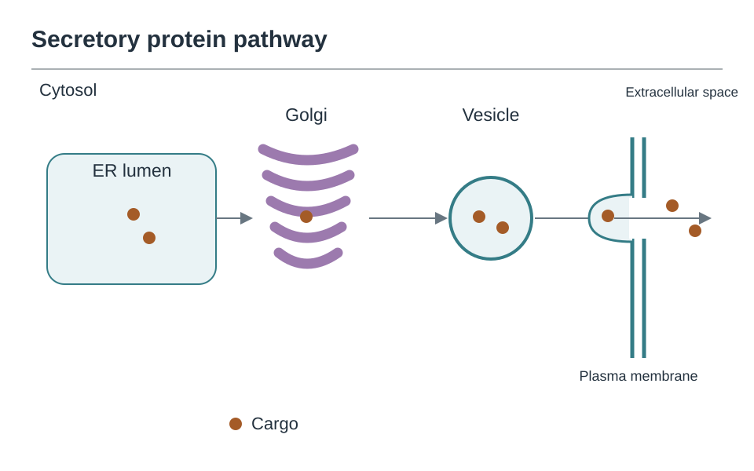

# M4-L3 – Organelles and compartmentalization {#L3}

**Course area:** M4 – Cell Biology and Membranes

**Level:** Bachelor

**Prerequisites:** [M4-L1](M4-L1.md): cell types; [M4-L2](M4-L2.md): membranes and transport.

**Learning objective:** Distinguish organelles by function and topology, explain protein trafficking and interpret a hypothetical labelling study.

## Introduction {#S1}

Many cellular reactions require conditions that would be difficult to sustain simultaneously in one aqueous space. Membranes can stabilize different pH values, ion compositions and enzyme concentrations. Compartmentalization is therefore more than spatial order: it enables controlled reaction sequences.

## Principles and model {#S2}

### Protein targeting and membrane traffic

A double nuclear envelope separates the nucleus. Nuclear pores regulate exchange of proteins and RNA. The rough endoplasmic reticulum (ER) carries ribosomes on its cytosolic side. Signal sequences in nascent proteins can direct translation to the ER, where proteins are inserted into its membrane or released into its lumen. Not all proteins follow this route: many remain in the cytosol or are imported into other organelles after synthesis.

Depending on cell type, the smooth ER contributes to lipid metabolism and calcium homeostasis. Vesicles carry selected material between membrane systems. The Golgi apparatus can modify and sort proteins and lipids and distribute them to destinations. When a secretory vesicle fuses with the plasma membrane, its lumen becomes continuous with the extracellular space. In animal cells, lysosomes degrade many macromolecules using acid hydrolases; plant lytic vacuoles perform related functions. Endocytosis and recycling provide return routes from the plasma membrane.

### Energetically and functionally distinct spaces

Mitochondria have an outer and a folded inner membrane. The inner membrane separates the matrix from the intermembrane space and permits a proton gradient. Plastids have additional specialized membranes; in chloroplasts the thylakoid membrane is central to light-dependent reactions. Peroxisomes contain enzymes involved in oxidative reactions and hydrogen peroxide degradation, among other functions. These organelles are not simply stations in the conventional ER–Golgi secretory pathway. Their protein targeting follows different mechanisms.

*Figure: Schematic ER–Golgi–vesicle pathway preserving membrane orientation and releasing soluble cargo.*

## Application {#S3}

A fictional pulse-chase dataset tracks a newly labelled secretory protein. Of 100 arbitrary fluorescence units at each time, after 5 min 75 are in the ER, 20 in the Golgi and 5 outside; after 25 min the values are 10, 35 and 55. The data are consistent with an ER–Golgi secretory pathway. They do not prove it: degradation, detection efficiency and marker overlap require controls. Comparing a variant lacking a functional ER signal sequence could test the targeting hypothesis.

## Self-assessment {#S4}

### Exercises

1. Why does the luminal side of a secretory membrane protein face outward after vesicle fusion?
2. Calculate the increase in extracellular signal between 5 and 25 min in percentage points.
3. Why does a mitochondrial targeting signal not necessarily direct a protein to the Golgi?

::: {.lc-solutions data-lc-section="S4"}
1. Vesicle formation and fusion preserve membrane orientation. The vesicle lumen becomes continuous with extracellular space.
2. $55-5=50$ percentage points, because each measurement was normalized to 100 units.
3. Mitochondria have dedicated import mechanisms; a suitable mitochondrial targeting signal is recognized by different transport machinery from an ER signal.
:::

## Assumptions and limitations {#S5}

The example data are simulated. Without calibration, fluorescence intensity is not a direct molecule count. Compartments are dynamic and differ between cell types. A static image alone cannot establish a temporal sequence.

## Summary and transition {#S6}

Protein targeting and membrane traffic coordinate separate reaction spaces. Directed movement of vesicles and organelles requires a cytoskeleton.

**Continue:** [M4-L4](M4-L4.md)

## Sources {#S7}

- [OpenStax – Biology 2e, 4.3 Eukaryotic Cells](https://openstax.org/books/biology-2e/pages/4-3-eukaryotic-cells) · Nucleus, mitochondria, chloroplasts, plant and animal cells · Last accessed: 2026-11-25
- [OpenStax – Biology 2e, 4.4 The Endomembrane System and Proteins](https://openstax.org/books/biology-2e/pages/4-4-the-endomembrane-system-and-proteins) · ER, Golgi, vesicles and lysosomes · Last accessed: 2026-11-25

