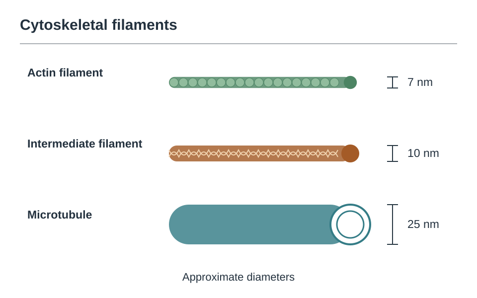

# M4-L4 – Cytoskeleton and motility {#L4}

**Course area:** M4 – Cell Biology and Membranes

**Level:** Bachelor

**Prerequisites:** [M4-L3](M4-L3.md): vesicles and compartments; [M3-L4](M3-L4.md): diffusion.

**Learning objective:** Distinguish actin filaments, intermediate filaments and microtubules by structure and function, and compare directed transport with diffusion.

## Introduction {#S1}

A cell is mechanically organized yet can change shape. A dynamic network of protein filaments combines stability with motion. This architecture becomes especially important when intracellular distances are too large for rapid purely diffusive transport.

## Principles and model {#S2}

### Filament classes and motors

Actin filaments are about 7 nm wide and consist of polymerized actin subunits. Their ends are structurally different. Actin remodelling can push membrane protrusions forward; myosins couple chemical energy to motion along actin. During muscle contraction, filaments slide past each other rather than shortening correspondingly. In cytokinesis of many animal cells, actin and myosin form a contractile ring.

Intermediate filaments (typically about 10 nm) form tension-resistant networks, for example keratins in epithelial cells or lamins at the nuclear envelope. Unlike actin and microtubules, they lack comparable directional structural polarity for motor transport. Microtubules (about 25 nm) are tubular tubulin polymers. GTP-dependent polymer dynamics enable rapid growth and shrinkage. Many kinesins move towards the plus end, cytoplasmic dynein towards the minus end. Movement in cellular space depends on microtubule orientation.

### Motion at different scales

Motile eukaryotic cilia often have a 9+2 microtubule arrangement; axonemal dynein drives relative sliding that mechanical connections convert into bending. Bacterial flagella operate quite differently as rotating structures powered by a membrane motor. Prokaryotes also possess structural protein polymers, such as FtsZ in many bacterial division processes.

For one-dimensional free diffusion, mean squared displacement is $\langle x^2\rangle=2Dt$, where $D$ is the diffusion coefficient. With constant directed velocity, $x=vt$. Diffusion distributes particles statistically, whereas a bound motor enables directed transport. Motors consume energy and may pause or detach.

*Figure: Three filament classes with approximate diameters; cross-sectional widths proportional, molecular structure simplified.*

## Application {#S3}

Simulated vesicle motion over 20 µm at $v=1$ µm/s takes 20 s. For one-dimensional free diffusion with $D=0.1$ µm²/s, reaching the same root mean squared displacement takes $t=20^2/(2\cdot0.1)=2000$ s. These 2000 s are not a guaranteed arrival time for an individual particle. The model illustrates the different scaling of directed movement and diffusion.

## Self-assessment {#S4}

### Exercises

1. Assign the typical diameters 7, 10 and 25 nm to the filament classes.
2. Calculate directed transport time over 12 µm at 0.5 µm/s.
3. How might a position–time trace indicate a switch between diffusion and directed transport?

::: {.lc-solutions data-lc-section="S4"}
1. Actin filaments 7 nm, intermediate filaments 10 nm, microtubules 25 nm.
2. $12/0.5=24$ s.
3. Sustained displacement with a roughly constant slope suggests directed motion; nondirectional fluctuations are consistent with diffusion. Multiple trajectories and quantitative analysis are needed.
:::

## Assumptions and limitations {#S5}

Diameters and speeds are approximate and depend on the system. The diffusion model assumes a homogeneous, unbounded space; cytoplasm can be viscoelastic and spatially constrained. A single trajectory does not identify a particular molecular motor.

## Summary and transition {#S6}

The cytoskeleton combines mechanical stability with spatially organized transport and chromosome segregation. The next lesson considers cell division and its regulation.

**Continue:** [M4-L5](M4-L5.md)

## Sources {#S7}

- [OpenStax – Biology 2e, 4.5 The Cytoskeleton](https://openstax.org/books/biology-2e/pages/4-5-the-cytoskeleton) · Filament classes, movement, cilia and flagella · Last accessed: 2026-11-25

