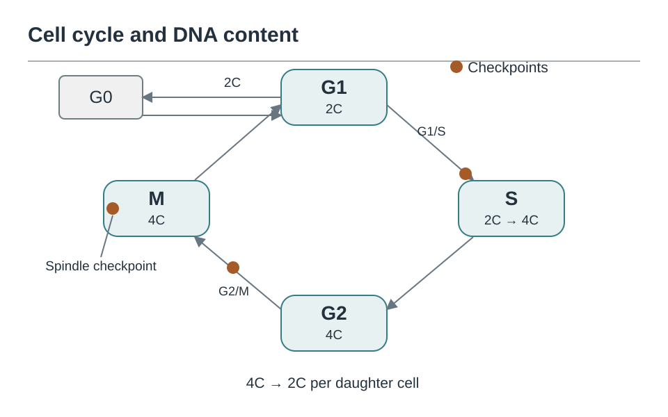

# M4-L5 – Cell cycle and signalling {#L5}

**Course area:** M4 – Cell Biology and Membranes

**Level:** Bachelor

**Prerequisites:** [M4-L2](M4-L2.md): membrane proteins; [M4-L4](M4-L4.md): microtubules; [M2-L3](M2-L3.md): relative frequencies.

**Learning objective:** Connect cell-cycle phases, control mechanisms and signal transduction, and interpret DNA content in a cell population correctly.

## Introduction {#S1}

A cell must not divide merely because nutrients are available. DNA must be fully replicated and correctly segregated; damage and environmental signals influence whether a new cycle begins. Regulation links molecular states to whole-cell behaviour.

## Principles and model {#S2}

### Cell cycle and chromosomes

During G1 many cells grow and prepare for replication. DNA doubles in S phase; each replicated chromosome then consists of two sister chromatids. G2 provides further preparation and checks. During mitosis, chromosomes condense, spindle microtubules attach to kinetochores, chromosomes align and sister chromatids separate. Cytokinesis divides the cell body. Plant cells form a cell plate; many animal cells form a cleavage furrow. Cells may exit the active cycle into a G0 state.

For an initially diploid cell, 2n denotes the number of chromosome sets and 2C the DNA amount before replication. After S, the cell remains 2n until sister chromatids separate but contains 4C DNA. Each of the two normal daughter cells receives 2n and 2C. Mitosis and meiosis are distinct processes; reduction in chromosome set number is not the purpose of mitosis.

### Controls and signals

Cyclins and cyclin-dependent kinases (CDKs) form regulated complexes that phosphorylate target proteins. Control mechanisms may delay entry into S phase, entry into mitosis or sister chromatid separation. The spindle checkpoint monitors, in particular, whether kinetochore attachment is adequate for separation; the APC/C complex supports orderly initiation of anaphase. Damage can induce repair, arrest, senescence or programmed cell death, depending on context.

Signals can act locally, through contact or over greater distances. A suitable receptor binds a ligand and triggers an intracellular response, for example through phosphorylation cascades or second messengers such as cAMP. Cascades can amplify signals; phosphatases, receptor regulation and messenger degradation limit them. Mitogenic signals may promote cycle entry but do not replace internal controls. Dysregulation can contribute to tumour formation but alone is not a diagnostic finding.

*Figure: Cell cycle of a diploid model cell with G0 branch, DNA contents and three control transitions; phase durations not to scale.*

## Application {#S3}

In a synthetic DNA-content dataset of 1000 diploid cells, 580 are at 2C, 250 between 2C and 4C, and 170 at 4C. Under the simplifying assumption of a homogeneous population without polyploidy, these groups approximately correspond to G0/G1 (58%), S (25%) and G2/M (17%). DNA content alone cannot distinguish G0 from G1 or G2 from M. Additional markers or observations would be necessary for phase assignment.

## Self-assessment {#S4}

### Exercises

1. What DNA content does a diploid cell have immediately after S, and how many chromosome sets does it possess before anaphase?
2. Calculate the fraction of 4C cells in a sample of 800 cells with 120 at 4C.
3. Why is observing a 4C peak insufficient to prove mitotic arrest?

::: {.lc-solutions data-lc-section="S4"}
1. 4C DNA, still with 2n chromosome sets.
2. $120/800=0.15$, or 15%.
3. G2 cells also have 4C. Polyploidy, cell aggregates and measurement artefacts may also affect assignment; additional criteria are needed.
:::

## Assumptions and limitations {#S5}

The numerical example describes a snapshot, not exact phase durations. In a growing population, phase frequencies cannot be equated with time fractions without model assumptions. Control mechanisms are not binary, infallible switches; cell type, developmental state and signalling context influence the response.

## Summary and transition {#S6}

Cell division results from coordinated genome replication, mechanics and signal regulation. M5 develops the biochemical foundations of the molecules and energy conversions involved.

**Continue:** [M5-L1](M5-L1.md)

## Sources {#S7}

- [OpenStax – Biology 2e, 10.2 The Cell Cycle](https://openstax.org/books/biology-2e/pages/10-2-the-cell-cycle) · Interphase, mitosis and cytokinesis · Last accessed: 2026-11-25
- [OpenStax – Biology 2e, 10.3 Control of the Cell Cycle](https://openstax.org/books/biology-2e/pages/10-3-control-of-the-cell-cycle) · Checkpoints, cyclins and CDKs · Last accessed: 2026-11-25
- [OpenStax – Biology 2e, 9.1 Signaling Molecules and Cellular Receptors](https://openstax.org/books/biology-2e/pages/9-1-signaling-molecules-and-cellular-receptors) · Receptor classes and signalling distance · Last accessed: 2026-11-25
- [OpenStax – Biology 2e, 9.2 Propagation of the Signal](https://openstax.org/books/biology-2e/pages/9-2-propagation-of-the-signal) · Phosphorylation cascades and second messengers · Last accessed: 2026-11-25

