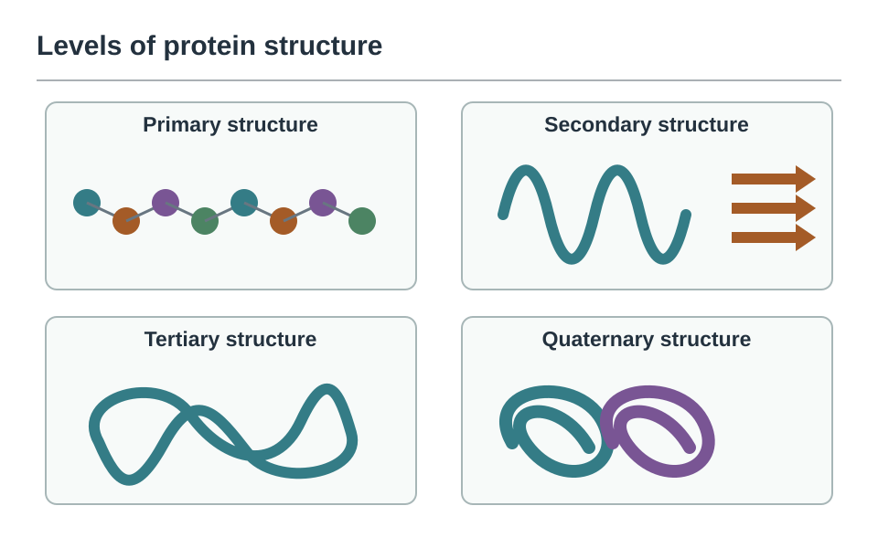

# M5-L1 – Amino acids and protein structure {#L1}

**Course area:** M5 – Biochemistry and Bioenergetics

**Level:** Bachelor

**Prerequisites:** [M3-L3](M3-L3.md): functional groups; [M3-L6](M3-L6.md): acid–base equilibria; [M4-L3](M4-L3.md): compartments.

**Learning objective:** Classify amino acids by side-chain properties, explain levels of protein structure and estimate the pH-dependent charge of a simple model amino acid.

## Introduction {#S1}

A protein is not a rigid building block. Its amino acid sequence and environment jointly determine the accessible conformations. Spatial organization affects binding, catalysis, transport and mechanical properties.

## Principles and model {#S2}

### Amino acids and peptide bonds

Proteinogenic α-amino acids have a central carbon atom attached to an amino group, a carboxyl group, hydrogen and a variable side chain R. Glycine is achiral; most amino acids used in ribosomal protein synthesis have the L configuration. Nonpolar side chains such as valine often favour sheltered regions of water-soluble proteins. Serine has a polar hydroxyl group; aspartate and lysine have negatively and positively charged side chains, respectively, under many physiological conditions. These classifications depend on local pH and environment.

A peptide bond is an amide bond between a carboxyl and an amino group. Formally, linkage involves the removal of water; ribosomal synthesis uses energetically activated aminoacyl-tRNAs. Partial double-bond character makes the peptide group approximately planar. Sequences are read from the N terminus to the C terminus. Free terminal groups and ionizable side chains together determine net charge.

### Levels of structure and stability

Primary structure is the sequence; secondary structure describes local backbone arrangements such as α-helices and β-sheets, whose hydrogen bonds typically link peptide groups. Tertiary structure describes the spatial organization of a polypeptide chain; quaternary structure results from association of multiple chains. Not every protein has a stable global fold or multiple subunits. The hydrophobic effect, hydrogen bonds, electrostatic interactions, van der Waals contacts and sometimes disulfide bonds contribute to stability. Chaperones assist folding without rewriting the amino acid sequence.

Denaturation alters the native structure, for instance through heat or extreme pH; peptide bonds often remain intact. Aggregation can prevent refolding. A sequence change can therefore be neutral, alter stability or affect a binding site; the substitution alone does not imply a general loss of function.

*Figure: Schematic sequence, local helix, folded single chain and two associated subunits; not a real protein structure.*

## Application {#S3}

For free glycine in an idealized model, let the pKₐ values be 2.34 (carboxyl group) and 9.60 (ammonium group). At pH 7 the carboxyl group is predominantly deprotonated and the amino group predominantly protonated: the zwitterion dominates. The isoelectric point is approximately $(2.34+9.60)/2=5.97$. At this point the mean net charge, not the number of charges, is zero. Above this point the mean charge is more negative. In proteins, local interactions can shift pKₐ values.

## Self-assessment {#S4}

### Exercises

1. Calculate the isoelectric point of a free amino acid without an ionizable side chain, with pKₐ values of 2.2 and 9.8.
2. Which structural level distinguishes two proteins with identical sequences but different spatial arrangements of their single chains?
3. Explain why denaturation does not automatically imply hydrolysis of all peptide bonds.

::: {.lc-solutions data-lc-section="S4"}
1. $(2.2+9.8)/2=6.0$.
2. Tertiary structure; local differences may also affect secondary structure.
3. The native fold largely depends on interactions that can change without cleavage of the covalent backbone.
:::

## Assumptions and limitations {#S5}

The pI averaging rule applies here only to a simple system with two relevant ionizable groups. Further groups require a net-charge balance. The figure shows structural levels schematically, not a real protein structure. Not every helix is an α-helix, and not every mutation has a detectable effect.

## Summary and transition {#S6}

Amino acid chemistry links sequence, spatial organization and function. M5-L2 explores how proteins and other biocatalysts affect reaction rates.

**Continue:** [M5-L2](M5-L2.md)

## Sources {#S7}

- [OpenStax – Biology 2e, 3.4 Proteins](https://openstax.org/books/biology-2e/pages/3-4-proteins) · Amino acids, peptide bonds and levels of protein structure · Last accessed: 2026-11-25

