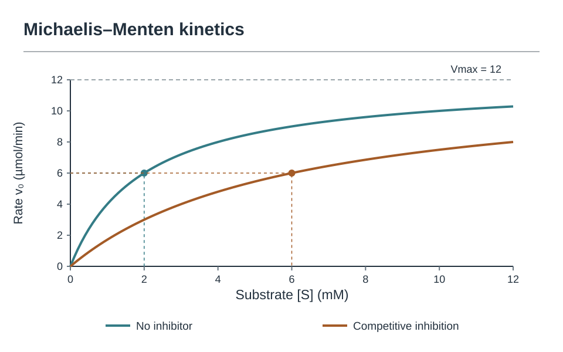

# M5-L2 – Enzyme kinetics {#L2}

**Course area:** M5 – Biochemistry and Bioenergetics

**Level:** Bachelor

**Prerequisites:** [M3-L2](M3-L2.md): equilibrium and free energy; [M5-L1](M5-L1.md): protein structure; [M2-L1](M2-L1.md): functions.

**Learning objective:** Distinguish enzyme catalysis from reaction thermodynamics, calculate initial velocities using Michaelis–Menten kinetics and compare inhibition types through parameter changes.

## Introduction {#S1}

Many thermodynamically possible reactions are too slow for a living organism without catalysis. Enzymes accelerate specific reactions by providing a pathway with a lower activation barrier. Catalytic RNA also exists. A catalyst does not shift thermodynamic equilibrium.

## Principles and model {#S2}

### Steady-state model

The simple scheme $E+S\rightleftharpoons ES\rightarrow E+P$ describes enzyme E, substrate S, the complex ES and product P. For initial velocities with negligible reverse reaction from product, substrate excess and approximately steady-state ES,

$$v_0=\frac{V_{\max}[S]}{K_m+[S]},\qquad V_{\max}=k_{cat}[E]_T.$$

$K_m$ has concentration units and is the substrate concentration at half the maximum velocity in this model. $k_{cat}$ is the maximum turnover rate per active enzyme unit (inverse time). $K_m=(k_{-1}+k_{cat})/k_1$ is generally not the dissociation constant. At low substrate concentrations $v_0$ is approximately proportional to [S]; at very high concentrations the rate approaches $V_{\max}$. The slope near the origin is $V_{\max}/K_m$.

### Inhibition and regulation

In ideal reversible competitive inhibition, an inhibitor competes with S for binding to free E. Apparent $K_m$ increases by the factor $\alpha=1+[I]/K_i$, while $V_{\max}$ is unchanged. Pure noncompetitive inhibition decreases $V_{\max}$ with unchanged $K_m$; mixed inhibition changes both. In the ideal model, uncompetitive inhibition binds only ES and reduces both parameters by the same factor. Allosteric enzymes may display sigmoidal rather than hyperbolic curves. Cofactors, pH, temperature and reversible modifications affect catalytic activity.

Parameter estimation benefits from multiple substrate concentrations, replicates, controlled conditions and direct nonlinear fitting of initial rates. Reciprocal transformations can distort the error structure. Parameter differences alone are not conclusive evidence for a molecular inhibition mechanism.

*Figure: Simulated saturation curves with Vmax 12 µmol/min and Km 2 or 6 mM; at 6 mM the rates are 9 and 6 µmol/min.*

## Application {#S3}

Simulated enzyme: $V_{\max}=12$ µmol/min and $K_m=2$ mM. At [S] = 2 mM, the initial velocity is $12\cdot2/(2+2)=6$ µmol/min; at 6 mM it is 9 µmol/min. With ideal competitive inhibition and $\alpha=3$, $K_{m,app}=6$ mM. At 6 mM the velocity is now 6 µmol/min. The figure displays both theoretical curves.

## Self-assessment {#S4}

### Exercises

1. Calculate the uninhibited velocity at [S] = 10 mM.
2. What is the velocity at [S] = 2 mM under the same competitive inhibition?
3. What happens to the equilibrium of a reversible reaction when a catalyst is added?

::: {.lc-solutions data-lc-section="S4"}
1. $12\cdot10/12=10$ µmol/min.
2. $12\cdot2/8=3$ µmol/min.
3. It remains unchanged under the same thermodynamic conditions; forward and reverse reactions are accelerated.
:::

## Assumptions and limitations {#S5}

The model assumes a simple reaction, stable enzyme amount and defined initial conditions. Substrate or product inhibition, multiple substrates, cooperativity or inactivation may cause deviations. The curves are simulated; they are not experimental measurements.

## Summary and transition {#S6}

Enzymes control metabolic flux through specific reactions. M5-L3 introduces carbohydrates and lipids as major substrates, stores and structural materials.

**Continue:** [M5-L3](M5-L3.md)

## Sources {#S7}

- [OpenStax – Biology 2e, 6.5 Enzymes](https://openstax.org/books/biology-2e/pages/6-5-enzymes) · Catalysis, regulation and cofactors · Last accessed: 2026-11-25
- [StatPearls – Biochemistry, Proteins Enzymes](https://www.ncbi.nlm.nih.gov/sites/books/NBK554481/?report=classic) · Michaelis–Menten kinetics and types of inhibition · Last accessed: 2026-11-25

