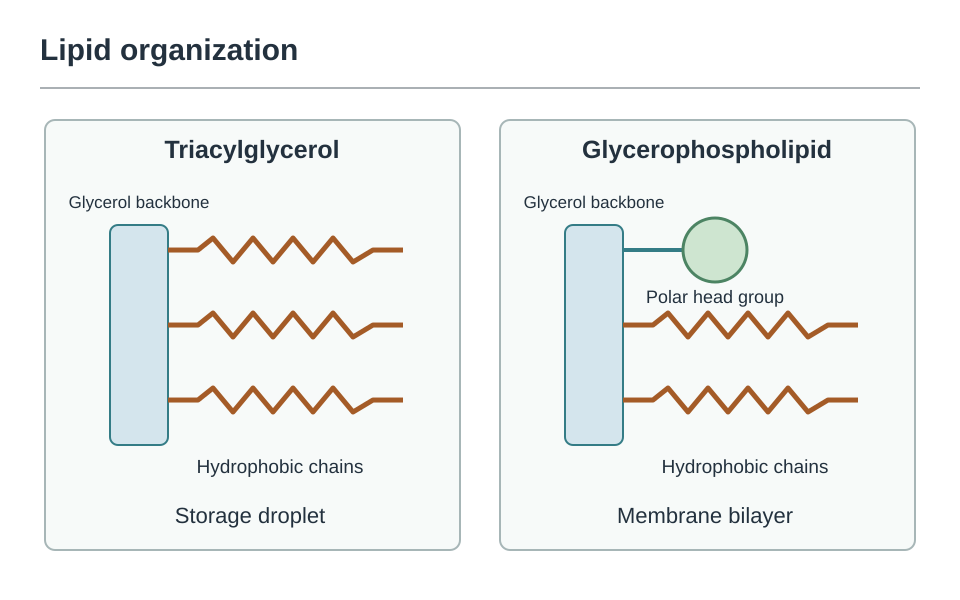

# M5-L3 – Carbohydrates and lipids {#L3}

**Course area:** M5 – Biochemistry and Bioenergetics

**Level:** Bachelor

**Prerequisites:** [M3-L3](M3-L3.md): organic groups; [M4-L2](M4-L2.md): membrane structure.

**Learning objective:** Distinguish carbohydrate and lipid classes by linkages, polarity and function and calculate a condensation balance for a linear polysaccharide.

## Introduction {#S1}

Starch and cellulose both consist of glucose units but have very different material properties. The spatial configuration of their linkages helps determine structure, degradability and biological function. Lipids likewise do not form a single polymer class.

## Principles and model {#S2}

### Carbohydrates

Monosaccharides are polyhydroxy aldehydes or ketones or their derivatives. Many sugars form rings in water. Ring closure of glucose produces an anomeric centre; α- and β-glucose differ in configuration at this centre. A glycosidic bond links a sugar through its anomeric centre to an appropriate group on a partner. The notation 1→4 identifies the participating carbon atoms.

Amylose has predominantly α(1→4) linkages; amylopectin and glycogen also have α(1→6) branches. Cellulose consists of β(1→4)-linked glucose units. Aligned chains form stable fibrous assemblies. Many animals cannot cleave cellulose with their own digestive enzymes, although some use symbiotic microorganisms. Branched storage polymers provide numerous sites for degrading enzymes. Sugar chains also serve molecular recognition and form components of glycoproteins and glycolipids.

### Lipids

Fatty acids have a carboxyl group and a hydrocarbon chain. Saturated chains have no C=C double bonds; cis double bonds can disrupt regular packing. Triacylglycerols consist of glycerol and three fatty acids attached through ester bonds. They are hydrophobic energy stores. Glycerophospholipids typically possess two hydrophobic chains and a polar phosphate-containing head group. This amphiphilicity allows membrane structures to form in water. Sterols have a ring system and influence membrane organization, among other functions. Not every lipid contains fatty acids.

Due to their high degree of reduction, lipids typically yield more energy per mass upon complete oxidation than carbohydrates. Hydrophobic stores also associate with little water. Biological availability and actual energy turnover nevertheless depend on degradation pathways and physiological state.

*Figure: Schematic comparison of three fatty acid chains in triacylglycerol and two chains plus a polar head group in glycerophospholipid.*

## Application {#S3}

A linear unbranched model polysaccharide consisting of 100 glucose units has 99 glycosidic bonds. In the formal condensation balance, 99 water molecules are removed. With rounded molar masses of 180 g/mol for glucose and 18 g/mol for water, the model molecule has a molar mass of $100\cdot180-99\cdot18=16218$ g/mol. Biological synthesis usually uses activated sugars as building blocks; the formal balance does not describe the enzymatic synthesis pathway.

## Self-assessment {#S4}

### Exercises

1. How many bonds and what formal molar mass does the corresponding linear model of ten glucose units have?
2. Which linkage distinguishes cellulose from amylose?
3. Why do triacylglycerols not form the same typical bilayer as glycerophospholipids?

::: {.lc-solutions data-lc-section="S4"}
1. Nine bonds; $10\cdot180-9\cdot18=1638$ g/mol.
2. β(1→4) instead of predominantly α(1→4).
3. Triacylglycerols lack a pronounced polar head group; they tend to assemble as hydrophobic storage droplets.
:::

## Assumptions and limitations {#S5}

The molar masses are rounded teaching values for a defined unmodified molecule. Natural polymers often exhibit a distribution of chain lengths. The schematic lipid figure is not a complete chemical structural formula; chain length, head group and double-bond position vary.

## Summary and transition {#S6}

Carbohydrates and lipids link structure with storage and metabolism. M5-L4 follows glucose degradation and its coupling to ATP synthesis.

**Continue:** [M5-L4](M5-L4.md)

## Sources {#S7}

- [OpenStax – Biology 2e, 3.2 Carbohydrates](https://openstax.org/books/biology-2e/pages/3-2-carbohydrates) · Monosaccharides and glycosidic bonds; polysaccharides · Last accessed: 2026-11-25
- [OpenStax – Biology 2e, 3.3 Lipids](https://openstax.org/books/biology-2e/pages/3-3-lipids) · Fatty acids, triacylglycerols, phospholipids and steroids · Last accessed: 2026-11-25

