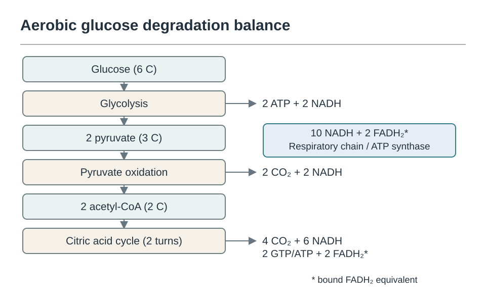

# M5-L4 – Glycolysis, citric acid cycle and respiratory chain {#L4}

**Course area:** M5 – Biochemistry and Bioenergetics

**Level:** Bachelor

**Prerequisites:** [M3-L2](M3-L2.md): free energy; [M4-L2](M4-L2.md): electrochemical gradients; [M5-L2](M5-L2.md): enzymes.

**Learning objective:** Distinguish carbon, electron and ATP balances in aerobic glucose degradation, explain chemiosmotic coupling and calculate a model ATP yield.

## Introduction {#S1}

During degradation of organic molecules, chemical free energy is distributed among several carriers. NADH and other reduced cofactors transfer electrons; ATP couples exergonic and endergonic processes. Energy transfer proceeds in steps rather than in a single combustion reaction.

## Principles and model {#S2}

### Glycolysis and the citric acid cycle

In the cytosol, one glucose (6 C) is converted to two pyruvates (3 C each). Hexokinase and phosphofructokinase initially consume two ATP. Cleavage of a hexose phosphate provides two triose phosphates for the payoff phase, which produces four ATP by substrate-level phosphorylation and two NADH in total. The net yield per glucose is two ATP and two NADH. Glycolysis does not directly require molecular oxygen. When respiratory regeneration of NAD⁺ is insufficient, fermentation (such as lactate formation) can reoxidize NADH and sustain glycolysis.

In many eukaryotes pyruvate undergoes oxidative decarboxylation in the mitochondrial matrix: each pyruvate yields acetyl-CoA (2 C), CO₂ and NADH. The acetyl group condenses with oxaloacetate (4 C) to form citrate (6 C). Oxidations and two decarboxylations occur during the citric acid cycle; oxaloacetate is regenerated. Each acetyl-CoA yields three NADH, one FADH₂ equivalent (bound to succinate dehydrogenase), one GTP or ATP and two CO₂. The carbon atoms released immediately as CO₂ need not be the newly introduced acetyl carbons during the first turn.

### Electron transport and coupling

NADH transfers electrons to complex I; succinate dehydrogenase (complex II) feeds electrons into the ubiquinone pool. Via complex III, cytochrome c and complex IV they ultimately reach oxygen, which is reduced to water. I, III and IV contribute to proton transport across the inner mitochondrial membrane, whereas II does not. Proton flow back into the matrix through ATP synthase drives ATP formation from ADP and phosphate. Proton-motive force includes electrical and chemical components. Uncoupling can separate electron transport from ATP synthesis and release energy as heat.

Metabolic flux is regulated by substrate supply, redox state and energy demand. Phosphofructokinase, for example, responds to energy carriers and other metabolites. The citric acid cycle also supplies biosynthetic precursors; withdrawal requires replenishment through anaplerotic reactions.

*Figure: Balance per glucose: glycolysis, pyruvate oxidation and the citric acid cycle together yield 6 CO₂, 4 ATP/GTP, 10 NADH and 2 FADH₂ equivalents; reduced carriers feed the respiratory chain.*

## Application {#S3}

For one completely oxidized glucose, the simplified balance model yields a total of 4 ATP/GTP by substrate-level phosphorylation, 10 NADH (including 2 cytosolic NADH) and 2 FADH₂ equivalents. Using model values of 2.5 ATP per NADH and 1.5 per FADH₂ equivalent yields $4+10\cdot2.5+2\cdot1.5=32$ ATP equivalents. If transfer of electrons from the two cytosolic NADH instead yields 1.5 ATP each, the total is 30. These are rounded model values, not universal cellular measurements.

## Self-assessment {#S4}

### Exercises

1. How many CO₂ are accounted for when one glucose is completely degraded through pyruvate oxidation and the citric acid cycle?
2. Calculate ATP equivalents for 4 ATP/GTP, 8 NADH at 2.5 each and 4 electron pairs yielding 1.5 ATP each.
3. Why does oxygen deprivation inhibit oxidative phosphorylation even though oxygen is not a direct substrate of glycolysis?

::: {.lc-solutions data-lc-section="S4"}
1. Two from pyruvate oxidation and four from the citric acid cycle, six in total.
2. $4+8\cdot2.5+4\cdot1.5=30$.
3. Without the terminal electron acceptor the mitochondrial electron transport chain stalls; generation of the proton gradient and respiratory reoxidation of reduced cofactors are restricted.
:::

## Assumptions and limitations {#S5}

The balance assumes complete aerobic oxidation and idealized coupling ratios. Proton leak, transport costs, shuttle systems, biosynthesis and the organism affect actual yields. Prokaryotes use different spatial arrangements and sometimes different terminal electron acceptors. The figure is a balance overview, not a complete reaction mechanism.

## Summary and transition {#S6}

Cellular respiration couples oxidation of organic molecules to an electrochemical gradient. M5-L5 examines light-driven formation of reduced carbon compounds.

**Continue:** [M5-L5](M5-L5.md)

## Sources {#S7}

- [OpenStax – Biology 2e, 7.2 Glycolysis](https://openstax.org/books/biology-2e/pages/7-2-glycolysis) · Investment and payoff phases · Last accessed: 2026-11-25
- [OpenStax – Biology 2e, 7.3 Oxidation of Pyruvate and the Citric Acid Cycle](https://openstax.org/books/biology-2e/pages/7-3-oxidation-of-pyruvate-and-the-citric-acid-cycle) · Pyruvate oxidation, cycle products · Last accessed: 2026-11-25
- [OpenStax – Biology 2e, 7.4 Oxidative Phosphorylation](https://openstax.org/books/biology-2e/pages/7-4-oxidative-phosphorylation) · Electron transport and chemiosmosis · Last accessed: 2026-11-25
- [OpenStax – Biology 2e, 7.7 Regulation of Cellular Respiration](https://openstax.org/books/biology-2e/pages/7-7-regulation-of-cellular-respiration) · Regulation of respiratory pathways · Last accessed: 2026-11-25
- [Chandel – Mitochondria (2021)](https://pmc.ncbi.nlm.nih.gov/articles/PMC7919390/) · Complete oxidation of glucose and approximate ATP yields · Last accessed: 2026-11-25

