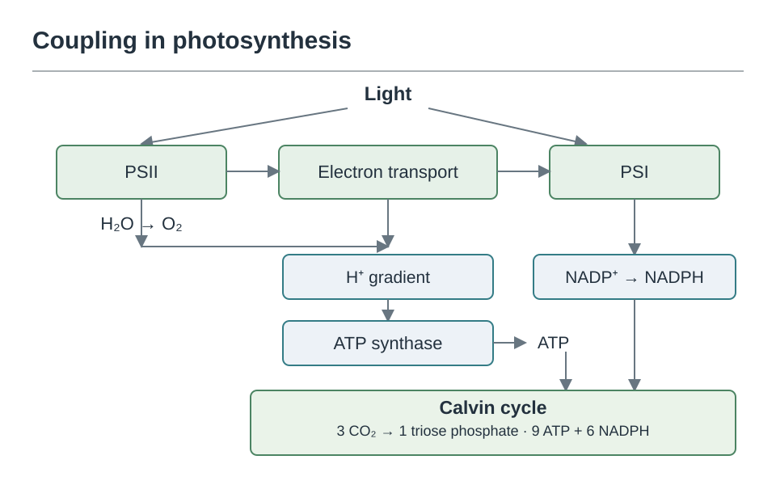

# M5-L5 – Photosynthesis and energy metabolism {#L5}

**Course area:** M5 – Biochemistry and Bioenergetics

**Level:** Bachelor

**Prerequisites:** [M4-L2](M4-L2.md): membranes; [M5-L4](M5-L4.md): chemiosmosis and redox reactions.

**Learning objective:** Connect light reactions and the Calvin–Benson cycle functionally, calculate ATP and NADPH requirements and distinguish C3, C4 and CAM strategies.

## Introduction {#S1}

Oxygenic photosynthesis converts radiant energy into chemical free energy. It supplies both reduced carbon compounds and oxygen. The oxygen molecule originates from water, not from carbon dioxide used in assimilation. Photosynthetically active plants also perform cellular respiration.

## Principles and model {#S2}

### Light reactions

In chloroplasts, pigment–protein complexes are located in thylakoid membranes. Antenna pigments transfer excitation energy to reaction centres. Photosystem II (PSII) removes electrons from water; transfer of four electrons produces one O₂. Via plastoquinone, cytochrome b₆f and plastocyanin, electrons reach photosystem I (PSI). Further light excitation enables transfer to ferredoxin and then via ferredoxin–NADP⁺ reductase to NADP⁺, which is reduced to NADPH. Water splitting and electron transport contribute to proton accumulation in the thylakoid lumen. Protons flow back to the stroma through ATP synthase, where ATP is formed.

Cyclic electron transport around PSI can generate additional proton-motive force without directly producing NADPH or O₂. This allows the ATP-to-NADPH ratio to be adjusted to metabolic demand. Chlorophyll does not absorb all wavelengths equally; energy not used in photochemistry may be released as heat or fluorescence, among other pathways.

### Carbon fixation and adaptation

In the stroma, Rubisco catalyses addition of CO₂ to ribulose-1,5-bisphosphate (RuBP). The unstable six-carbon product splits into two 3-phosphoglycerate molecules. ATP and NADPH enable reduction to triose phosphates; a portion is used to regenerate RuBP. For three fixed CO₂, net output is one triose phosphate (3 C) at a cost of nine ATP and six NADPH. Triose phosphates can be used to produce sucrose and starch, among other products. These reactions do not directly require light but in living chloroplasts are closely coupled to light reactions and regulation.

Rubisco can also react with O₂. Photorespiration then requires an energy-consuming recovery pathway that releases some previously fixed carbon. C4 plants typically concentrate CO₂ through spatial separation of processes; CAM plants separate initial CO₂ uptake and subsequent supply to Rubisco in time. Both strategies can provide advantages under certain warm or dry conditions, but impose additional energetic costs.

*Figure: Functional diagram: light drives PSII and PSI; electron transport and water splitting generate a proton gradient, and NADPH and ATP supply the Calvin cycle.*

## Application {#S3}

In the idealized Calvin cycle, net output of two triose phosphates requires six CO₂, 18 ATP and 12 NADPH. Producing 12 NADPH from water by linear electron transport requires 24 electrons; one O₂ is formed for every four electrons, giving a balance of six O₂. This describes an ideal coupling of the redox balance, not the measured net gas exchange of a leaf undergoing simultaneous respiration and photorespiration.

## Self-assessment {#S4}

### Exercises

1. How many ATP and NADPH does the idealized Calvin cycle require for twelve fixed CO₂?
2. In which chloroplast compartment is ATP formed during photophosphorylation?
3. Why can stomatal closure reduce both water loss and CO₂ fixation?

::: {.lc-solutions data-lc-section="S4"}
1. 36 ATP and 24 NADPH.
2. On the stromal side of the thylakoid membrane, through proton flow back from the lumen.
3. Gas exchange is restricted; water vapour escapes more slowly, while less CO₂ can enter the leaf.
:::

## Assumptions and limitations {#S5}

The stoichiometric figures apply to the idealized Calvin cycle without additional metabolic costs. Actual net assimilation depends on light, temperature, CO₂ supply, stomatal conductance and respiration, among other factors. Linear electron transport is only one possible electron pathway. The figure shows functional coupling, not an atomically resolved photosystem structure.

## Summary and transition {#S6}

Photosynthesis and respiration both use electron transport, proton gradients and ATP synthases. Their energy sources and net material fluxes differ. M6 builds on these foundations to explore molecular information processing in cells.

**Continue:** [M6-L1](M6-L1.md)

## Sources {#S7}

- [OpenStax – Biology 2e, 8.2 The Light-Dependent Reactions of Photosynthesis](https://openstax.org/books/biology-2e/pages/8-2-the-light-dependent-reactions-of-photosynthesis) · Photosystems and electron transport · Last accessed: 2026-11-25
- [OpenStax – Biology 2e, 8.3 Using Light Energy to Make Organic Molecules](https://openstax.org/books/biology-2e/pages/8-3-using-light-energy-to-make-organic-molecules) · Calvin cycle, photorespiration and carbon fixation adaptations · Last accessed: 2026-11-25
- [OpenStax – Biology 2e, 7.4 Oxidative Phosphorylation](https://openstax.org/books/biology-2e/pages/7-4-oxidative-phosphorylation) · Electron transport and chemiosmosis · Last accessed: 2026-11-25

