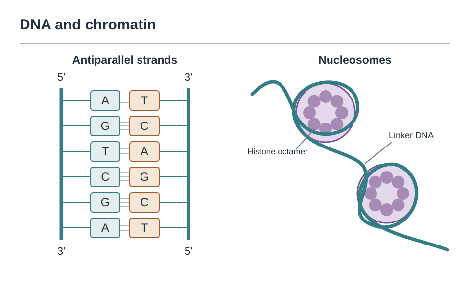

# M6-L1 – DNA and chromatin {#L1}

**Course area:** M6 – Molecular Genetics and Gene Regulation

**Level:** Bachelor

**Prerequisites:** [M3-L3](M3-L3.md): functional groups; [M4-L1](M4-L1.md): cell types; [M5-L1](M5-L1.md): protein structure.

**Learning objective:** Orient DNA strands, determine complementary sequences and explain eukaryotic genome packaging as a dynamic organisation.

## Introduction {#S1}

A chromosome must protect hereditary information while keeping it available for copying and selective access. DNA chemistry and its spatial organisation address different parts of this challenge.

## Principles and model {#S2}

### Molecular architecture

A deoxyribonucleotide contains deoxyribose, phosphate and a base (adenine, thymine, guanine or cytosine). Phosphodiester bonds connect the 3′ oxygen of one sugar through phosphate to the next sugar's 5′ end. Backbone polarity defines a reading direction. The two strands are antiparallel. A pairs with T and G with C; base pairing and stacking interactions contribute to double-helix stability. Major and minor grooves expose chemical features of bases to proteins. Negatively charged phosphates interact with ions and basic proteins.

### Chromatin and accessibility

In eukaryotic nuclei, approximately 147 base pairs wrap around a histone octamer containing two copies each of H2A, H2B, H3 and H4. Linker DNA between nucleosomes varies in length. Histone H1 can assist linker organisation but is not part of the core octamer. Chromatin forms variable contacts, loops and domains rather than a rigid universal packaging hierarchy. ATP-dependent remodelers can reposition nucleosomes. Accessible regions are frequently associated with gene activity, but accessibility alone does not ensure transcription.

Bacterial chromosomes are organised through supercoiling and DNA-binding proteins. Archaea and organelles exhibit further forms of organisation. Not all DNA is contained in linear, histone-packaged nuclear chromosomes.

*Figure: Base pairing with opposite strand polarity and schematic DNA packaging around histone octamers; not to scale.*

## Application {#S3}

A model sequence is 5′-AGTCGA-3′. Its opposite strand is 3′-TCAGCT-5′; in its own 5′→3′ direction it reads 5′-TCGACT-3′. Three of six base pairs are G/C pairs, giving 50%. For 1,000 bp of extended B-DNA, an approximate rise of 0.34 nm per base pair gives a contour length of 340 nm. This is not the diameter of the corresponding chromatin region.

## Self-assessment {#S4}

### Exercises

1. Determine the reverse complement of 5′-ATGCC-3′.
2. Estimate the contour length of 3,000 bp of B-DNA.
3. Why does the presence of nucleosomes alone not determine gene activity?

::: {.lc-solutions data-lc-section="S4"}
1. 5′-GGCAT-3′.
2. $3000\cdot0.34=1020$ nm, or 1.02 µm.
3. Positioning, modifications, regulatory proteins and cellular context influence accessibility and transcription.
:::

## Assumptions and limitations {#S5}

The figure is schematic and not to scale. Other DNA conformations and local distortions differ from idealised B-DNA. Sequence composition alone determines neither melting temperature nor chromatin state completely.

## Summary and transition {#S6}

Complementarity enables DNA copying; spatial organisation influences its use. M6-L2 covers copying and maintenance of the genome.

**Continue:** [M6-L2](M6-L2.md)

## Sources {#S7}

- [OpenStax – Biology 2e, 14.2 DNA Structure and Sequencing](https://openstax.org/books/biology-2e/pages/14-2-dna-structure-and-sequencing) · DNA structure and packaging · Last accessed: 2026-11-25
- [OpenStax – Biology 2e, 16.3 Eukaryotic Epigenetic Gene Regulation](https://openstax.org/books/biology-2e/pages/16-3-eukaryotic-epigenetic-gene-regulation) · Chromatin accessibility · Last accessed: 2026-11-25

