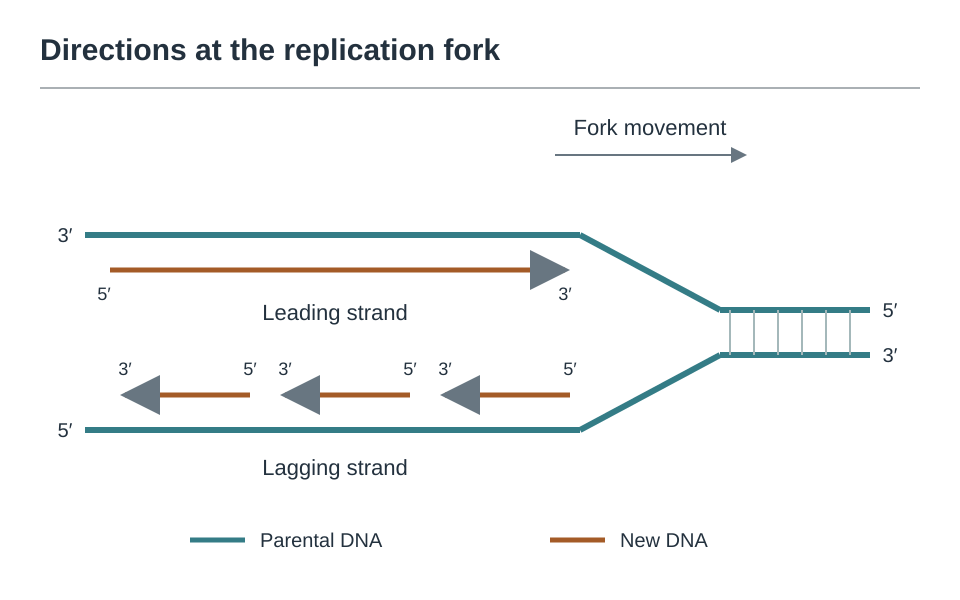

# M6-L2 – Replication, repair and recombination {#L2}

**Course area:** M6 – Molecular Genetics and Gene Regulation

**Level:** Bachelor

**Prerequisites:** [M6-L1](M6-L1.md): DNA polarity; [M4-L5](M4-L5.md): cell cycle.

**Learning objective:** Derive replication directions and distinguish proofreading, repair and homologous recombination.

## Introduction {#S1}

A cell must duplicate its DNA before division. Copying accuracy and restoration of damaged molecules are separate but coupled tasks.

## Principles and model {#S2}

### Replication

Semiconservative replication produces duplexes containing one old and one newly formed strand each. At origins, helicases open the duplex, topoisomerases relieve torsional stress and single-strand-binding proteins stabilise exposed DNA. DNA polymerases extend an existing 3′-OH end and thus require a primer. Synthesis always proceeds 5′→3′. At a moving fork, the leading strand grows towards the fork, while the lagging strand grows in separate Okazaki fragments away from it. Primers are removed and replaced; ligase seals remaining backbone nicks.

Eukaryotic chromosomes use many regulated origins. Linear chromosome ends require specialised maintenance mechanisms; telomerase can extend telomeric DNA in appropriate cells. Its activity depends on cell type.

### Genome maintenance

Proofreading removes some incorrect nucleotides during synthesis. Mismatch repair corrects escaped mismatches. Base excision repair replaces certain chemically altered bases; nucleotide excision repair removes a short segment containing particular helix-distorting lesions. Double-strand breaks may be repaired by homologous recombination using a homologous template or by end joining. Recombination also allows exchange of homologous chromosome segments in meiosis. These pathways differ in template requirements and potential errors; none is universally error-free.

*Figure: At a rightward-moving fork, the leading strand is synthesised rightwards and lagging-strand fragments leftwards.*

## Application {#S3}

A simplified labelling experiment begins with fully heavy-labelled DNA and changes to a medium containing only light precursor. After one complete replication cycle all duplexes are hybrids. After two cycles, half are hybrids and half fully light. After three cycles, the hybrid fraction is 1/4. The two originally heavy single strands persist while total duplex number doubles each cycle.

## Self-assessment {#S4}

### Exercises

1. In which direction does DNA polymerase extend a strand?
2. What hybrid fraction follows after four cycles in the model?
3. Why is a homologous template useful for double-strand break repair?

::: {.lc-solutions data-lc-section="S4"}
1. 5′→3′ by extending the 3′ end.
2. $2/16=1/8=12.5\%$.
3. Its matching sequence can supply information to restore the damaged segment.
:::

## Assumptions and limitations {#S5}

The labelling model assumes synchronous complete replication without exchange of labelled bases. The diagram shows a single fork; the actual composition of the replication complex varies among organisms. Repair pathways are covered mechanistically, not as laboratory protocols.

## Summary and transition {#S6}

Replication duplicates DNA; transcription uses selected regions as templates for RNA.

**Continue:** [M6-L3](M6-L3.md)

## Sources {#S7}

- [OpenStax – Biology 2e, 14.4 DNA Replication in Prokaryotes](https://openstax.org/books/biology-2e/pages/14-4-dna-replication-in-prokaryotes) · Replication fork, primers and strand synthesis · Last accessed: 2026-11-25
- [OpenStax – Biology 2e, 14.5 DNA Replication in Eukaryotes](https://openstax.org/books/biology-2e/pages/14-5-dna-replication-in-eukaryotes) · Origins and telomeres · Last accessed: 2026-11-25
- [OpenStax – Biology 2e, 14.6 DNA Repair](https://openstax.org/books/biology-2e/pages/14-6-dna-repair) · Proofreading and repair pathways · Last accessed: 2026-11-25
- [NHGRI – Talking Glossary of Genetic Terms](https://www.genome.gov/genetics-glossary) · Homologous recombination and genetic variation · Last accessed: 2026-11-25

