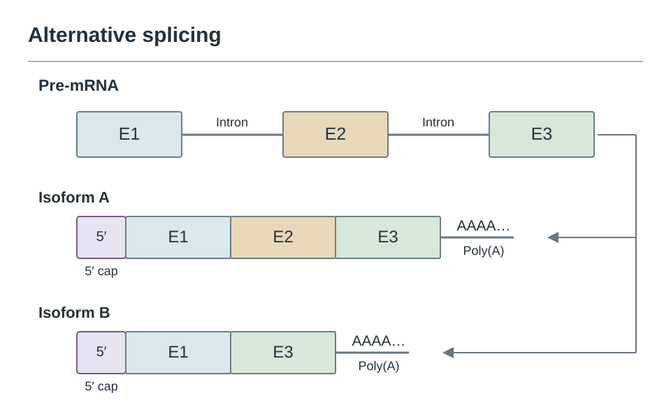

# M6-L3 – Transcription and RNA processing {#L3}

**Course area:** M6 – Molecular Genetics and Gene Regulation

**Level:** Bachelor

**Prerequisites:** [M6-L1](M6-L1.md): sequence and chromatin; [M6-L2](M6-L2.md): template principle.

**Learning objective:** Distinguish template and coding strands and explain eukaryotic RNA processing and alternative splice forms.

## Introduction {#S1}

Gene expression often starts with production of an RNA molecule. The RNA can perform a function itself or serve as an intermediate in protein synthesis.

## Principles and model {#S2}

### Transcription

RNA polymerases read the DNA template strand 3′→5′ and synthesise RNA 5′→3′ without a DNA primer. RNA uses uracil instead of thymine. For the same region, the RNA sequence matches the coding DNA strand with U replacing T. Which DNA strand is used as the template depends on the gene. Promoters and regulatory factors determine initiation. Elongation extends the transcript; termination ends the process. In eukaryotes RNA polymerase II mainly produces pre-mRNA, while polymerases I and III produce various ribosomal and transfer RNAs, among other products.

### Maturation and isoforms

Many eukaryotic pre-mRNAs acquire a modified 5′ cap supporting stability, export and translation. The spliceosome removes introns and joins exons. At the 3′ end the transcript is frequently cleaved and given a poly(A) tail, which is not simply a copy of a long DNA A sequence. Alternative splice-site selection can produce different mature transcripts from one gene. Not every exon encodes protein: untranslated regions can also be exonic. Control mechanisms influence RNA export and degradation. Bacteria lack many typical eukaryotic pre-mRNA maturation steps; transcription and translation can be spatially coupled.

*Figure: Three exons in pre-mRNA; isoform A retains all three, isoform B skips E2. Both mature transcripts are shown schematically with cap and poly(A).*

## Application {#S3}

A fictional transcript contains exons E1 = 120 nt, E2 = 90 nt, E3 = 150 nt and two introns totalling 700 nt. Excluding cap and poly(A), the pre-mRNA is 1,060 nt. Isoform A contains E1–E2–E3 and measures 360 nt; isoform B skips E2 and measures 270 nt. Protein length cannot be inferred from this alone because exons can include untranslated sequences.

## Self-assessment {#S4}

### Exercises

1. Write the RNA corresponding to template 3′-TACGGT-5′.
2. How long would the mature RNA be if only E1 and E2 remained?
3. Why do distinct RNA isoforms not prove that distinct stable proteins exist?

::: {.lc-solutions data-lc-section="S4"}
1. 5′-AUGCCA-3′.
2. $120+90=210$ nt, excluding cap and poly(A).
3. Reading frame, translation, RNA stability and protein degradation can differ; some isoforms are noncoding.
:::

## Assumptions and limitations {#S5}

The numbers are invented and the diagram is simplified. Not all RNA types are processed identically; not every eukaryotic gene contains introns. Transcript quantities alone do not directly establish protein activity.

## Summary and transition {#S6}

Mature RNA can serve as a template for the ribosome. M6-L4 explains polypeptide production.

**Continue:** [M6-L4](M6-L4.md)

## Sources {#S7}

- [OpenStax – Biology 2e, 15.3 Eukaryotic Transcription](https://openstax.org/books/biology-2e/pages/15-3-eukaryotic-transcription) · RNA polymerases and transcription · Last accessed: 2026-11-25
- [OpenStax – Biology 2e, 15.4 RNA Processing in Eukaryotes](https://openstax.org/books/biology-2e/pages/15-4-rna-processing-in-eukaryotes) · Capping, splicing and polyadenylation · Last accessed: 2026-11-25

