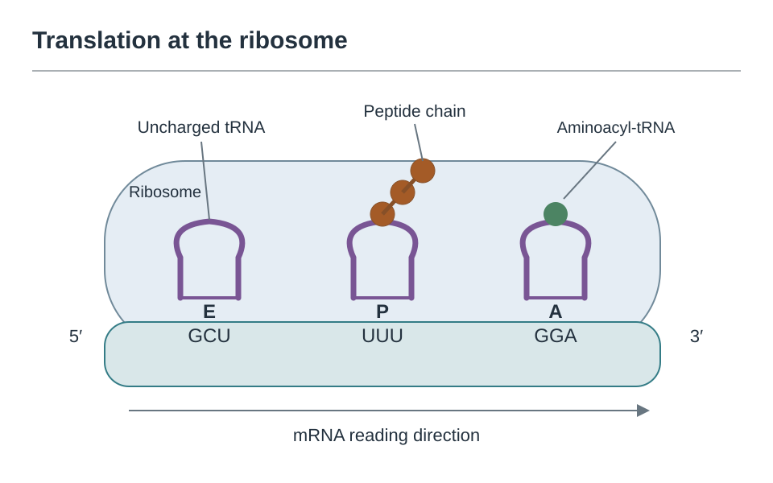

# M6-L4 – Translation and protein regulation {#L4}

**Course area:** M6 – Molecular Genetics and Gene Regulation

**Level:** Bachelor

**Prerequisites:** [M6-L3](M6-L3.md): RNA; [M5-L1](M5-L1.md): proteins; [M5-L2](M5-L2.md): enzymes.

**Learning objective:** Translate a short mRNA using the standard code and explain the steps from ribosome to regulated protein.

## Introduction {#S1}

An mRNA sequence does not supply a ready-made protein structure. The cell must convert a nucleotide language into an amino acid sequence, then fold, localise and sometimes modify the product.

## Principles and model {#S2}

### The genetic code

Every three nucleotides form a codon in the defined reading frame. The standard code has 64 codons: 61 specify amino acids and three signal termination (UAA, UAG, UGA). Several codons can specify the same amino acid, but in the usual context a codon does not arbitrarily specify multiple amino acids. AUG specifies methionine and frequently serves as a start codon. The initiation site establishes the reading frame. Organelles and some organisms have variant codes; special signals can change the meaning of individual stop codons, among other effects.

### Translation and maturation

Aminoacyl-tRNA synthetases attach appropriate amino acids to tRNAs using ATP. In the ribosome, codon and anticodon are checked in antiparallel orientation. The A site usually accepts a new aminoacyl-tRNA, the P site holds the growing chain and the E site allows uncharged tRNA to exit. Ribosomal RNA catalyses peptide-bond formation; the chain grows from its N to C terminus. Elongation factors and GTP support selection and translocation. At a stop codon, release factors mediate polypeptide release. The small and large subunits can be reused.

Chaperones, targeting signals and post-translational modifications control folding, transport and activity. Phosphorylation can activate or inhibit a protein; ubiquitin tags may direct proteasomal degradation, among other functions. Protein concentration and functional activity are not equivalent.

*Figure: Schematic state before peptide-bond formation, with uncharged tRNA at E, peptidyl-tRNA at P and aminoacyl-tRNA at A.*

## Application {#S3}

For artificial mRNA 5′-AUG GCU UUU GGA UAA-3′, the standard code yields Met–Ala–Phe–Gly, then stop. Four amino acids are connected by three peptide bonds. A highly simplified energy budget per additional amino acid comprises two ATP equivalents for tRNA charging (ATP to AMP) and about two GTP for elongation steps. Initiation, termination and quality control require additional energy.

## Self-assessment {#S4}

### Exercises

1. How many amino acids does AUG GCU UAA yield in the standard code with initiation at AUG?
2. How many peptide bonds occur in an unbranched 100-amino-acid polypeptide?
3. Why might protein activity decline even if its concentration is constant?

::: {.lc-solutions data-lc-section="S4"}
1. Two: methionine and alanine.
2. 99.
3. For example, an inhibitory modification, conformational change or loss of a required cofactor.
:::

## Assumptions and limitations {#S5}

The diagram depicts an idealised elongation state, not atomic structure. The short model sequence is invented. The calculation excludes removal of initiating methionine and subsequent processing; energy expenditure depends on the system.

## Summary and transition {#S6}

The effects of DNA changes depend on the reading frame, RNA and protein function. M6-L5 addresses these variants.

**Continue:** [M6-L5](M6-L5.md)

## Sources {#S7}

- [OpenStax – Biology 2e, 15.1 The Genetic Code](https://openstax.org/books/biology-2e/pages/15-1-the-genetic-code) · Codons and reading frames · Last accessed: 2026-11-25
- [OpenStax – Biology 2e, 15.5 Ribosomes and Protein Synthesis](https://openstax.org/books/biology-2e/pages/15-5-ribosomes-and-protein-synthesis) · Translation and ribosomes · Last accessed: 2026-11-25
- [OpenStax – Biology 2e, 16.6 Eukaryotic Translational and Post-translational Gene Regulation](https://openstax.org/books/biology-2e/pages/16-6-eukaryotic-translational-and-post-translational-gene-regulation) · Protein regulation · Last accessed: 2026-11-25

