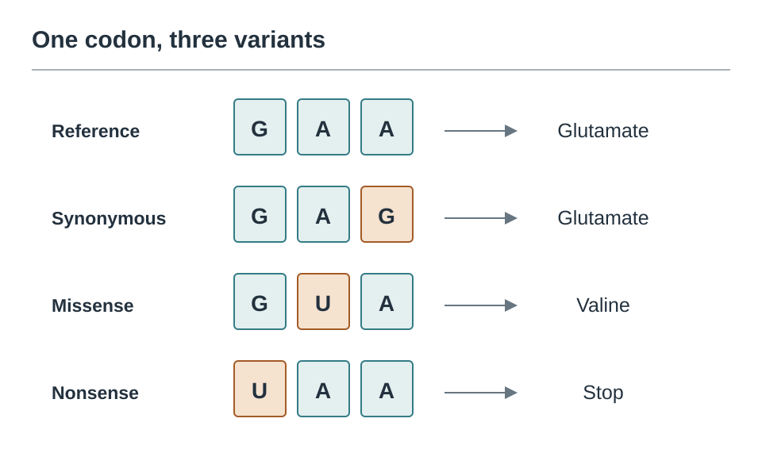

# M6-L5 – Mutations and genetic variation {#L5}

**Course area:** M6 – Molecular Genetics and Gene Regulation

**Level:** Bachelor

**Prerequisites:** [M6-L2](M6-L2.md): repair; [M6-L4](M6-L4.md): genetic code; [M2-L3](M2-L3.md): proportions.

**Learning objective:** Classify genetic variants by sequence change and potential functional effect, and distinguish allele frequencies from disease risks.

## Introduction {#S1}

Variation underlies biological diversity. A change relative to a reference sequence is not automatically harmful; its effect depends on location, biological context and environment.

## Principles and model {#S2}

### Types and origins

A substitution replaces a base. Transitions exchange purine for purine (A/G) or pyrimidine for pyrimidine (C/T); transversions exchange bases between the classes. Insertions and deletions change sequence length. Other variants affect larger segments, including duplications, inversions, translocations or copy-number changes. DNA damage initially comprises chemical or structural alterations; permanently fixed sequence changes constitute mutations. Mutations can arise from replication errors, spontaneous chemical processes or damaging influences. They do not occur specifically because an organism needs an adaptation.

### Function and inheritance

In protein-coding sequence a substitution can be synonymous, specify another amino acid (missense) or produce a premature stop codon (nonsense). Indels with lengths not divisible by three shift the reading frame in coding regions. Even synonymous variants can influence RNA processing or translation. Noncoding variants may alter promoters, splice sites or regulatory RNAs. A germline change can be transmitted to offspring; somatic variants mainly pass through the affected cell lineage. In plants and other organisms the germline–soma distinction does not always follow the animal pattern.

Functional classification requires consideration of segregation, population frequency, molecular data and experimental evidence together. A reference allele is not necessarily the most common or functionally optimal allele.

*Figure: GAA specifies glutamate; GAG is synonymous, GUA specifies valine, and UAA terminates translation in the standard code.*

## Application {#S3}

In model mRNA codon 5′-GAA-3′, the standard code specifies glutamate. GAG is synonymous, GUA gives valine and UAA is a stop signal. A second fictional example considers 50 diploid individuals with 30 AA, 15 Aa and 5 aa. The frequency of a is $(15+2\cdot5)/(2\cdot50)=0.25$. The aa genotype frequency, however, is 5/50 = 10%. Neither quantity gives disease probability without phenotype information.

## Self-assessment {#S4}

### Exercises

1. Does a three-nucleotide deletion in a coding region necessarily shift the reading frame?
2. Calculate the frequency of A in the model.
3. Why might a noncoding variant have a functional effect?

::: {.lc-solutions data-lc-section="S4"}
1. No; it changes sequence but does not permanently shift the downstream reading frame.
2. $(2\cdot30+15)/100=0.75$.
3. It may change transcription rate, RNA stability or splice sites, for example.
:::

## Assumptions and limitations {#S5}

The examples are artificial and cannot be interpreted clinically. Effects may depend on cell type, gene interactions and environment. Small samples and sequence comparisons alone cannot establish a reliable functional or risk classification.

## Summary and transition {#S6}

M6-L6 examines differences in gene activity that do not necessarily require a DNA sequence change.

**Continue:** [M6-L6](M6-L6.md)

## Sources {#S7}

- [NHGRI – Mutation](https://www.genome.gov/genetics-glossary/Mutation) · Sequence changes, somatic and germline variation · Last accessed: 2026-11-25
- [OpenStax – Biology 2e, 15.1 The Genetic Code](https://openstax.org/books/biology-2e/pages/15-1-the-genetic-code) · Codons and reading frames · Last accessed: 2026-11-25
- [OpenStax – Biology 2e, 14.6 DNA Repair](https://openstax.org/books/biology-2e/pages/14-6-dna-repair) · Proofreading and repair pathways · Last accessed: 2026-11-25

