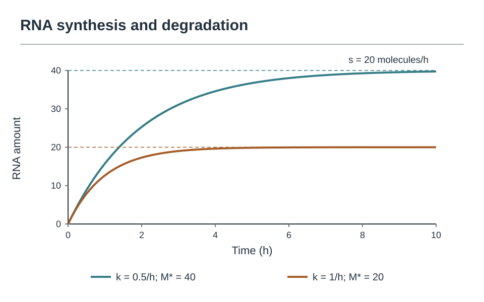

# M6-L6 – Gene regulation and epigenetics {#L6}

**Course area:** M6 – Molecular Genetics and Gene Regulation

**Level:** Bachelor

**Prerequisites:** [M6-L1](M6-L1.md): chromatin; [M6-L3](M6-L3.md): RNA; [M6-L4](M6-L4.md): translation.

**Learning objective:** Distinguish regulatory levels and separate epigenetic observations from DNA variation and evidence of causation.

## Introduction {#S1}

Muscle and nerve cells of the same organism possess largely the same DNA, but produce different RNA and protein quantities. Their specialisation depends in part on stable and reversible regulatory processes.

## Principles and model {#S2}

### Regulatory levels

In bacteria, operons enable coordinated transcription of multiple genes. Repressors may reduce initiation, while activators may promote it; metabolites may affect these factors. Eukaryotic genes are regulated through promoters, enhancers, silencers and transcription factors, among other mechanisms. Enhancers can influence distant promoters through spatial contacts. Chromatin remodelers alter accessibility; RNA splicing, RNA degradation and translation determine subsequent quantities. MicroRNAs can affect translation and stability of matching RNAs through protein complexes.

### Epigenetics and stability

DNA methylation, histone modifications and chromatin organisation may stabilise regulatory states. In mammals, methylation of certain CpG-rich promoter regions is frequently associated with reduced transcription, but not all DNA methylation has the same effect. Histone acetylation is often associated with more accessible chromatin. Histone methylation has different associations depending on the position. Some states persist through mitotic divisions. Transmission across generations is distinct; many marks are reset during mammalian germ-cell development and early embryogenesis. Epigenetic differences are not general proof that acquired experiences are inherited.

### Measurement and interpretation

RNA amounts, chromatin accessibility and modifications measure different levels. A statistical association between a mark and expression leaves open cause, consequence and common influences. Time series, controlled comparisons and targeted functional tests can assess competing explanations.

*Figure: Simulated approach to steady-state RNA abundance from M(0)=0 at equal synthesis rate and two degradation constants.*

## Application {#S3}

In a teaching model for mRNA amount M, $dM/dt=s-kM$, where s is a synthesis rate and k a degradation constant. With constant parameters the steady state is $M^*=s/k$. For s = 20 molecules/h and k = 0.5/h, the mean is 40 molecules. Doubling k at constant s reduces the steady state to 20. The half-life without new synthesis is $\ln(2)/k\approx1.39$ h for k = 0.5/h.

## Self-assessment {#S4}

### Exercises

1. Calculate M* for s = 30/h and k = 0.5/h.
2. Why can the same RNA amount result from different synthesis and degradation rates?
3. Does a negative correlation between promoter methylation and RNA abundance establish direct inhibition?

::: {.lc-solutions data-lc-section="S4"}
1. 60 molecules.
2. The ratio s/k may be equal for different absolute rates.
3. No. Alternative causes, cell composition and reverse causality must be considered.
:::

## Assumptions and limitations {#S5}

The continuous model describes mean amounts, not individual discrete molecules. It ignores feedback, cell division and time-varying synthesis. Epigenetic mechanisms depend on organism and location; a universal activation or repression symbol would mislead.

## Summary and transition {#S6}

Gene activity explains part of trait variation. M6-L7 connects molecular alleles to their statistical distribution in offspring.

**Continue:** [M6-L7](M6-L7.md)

## Sources {#S7}

- [OpenStax – Biology 2e, 16.1 Regulation of Gene Expression](https://openstax.org/books/biology-2e/pages/16-1-regulation-of-gene-expression) · Regulatory levels · Last accessed: 2026-11-25
- [OpenStax – Biology 2e, 16.3 Eukaryotic Epigenetic Gene Regulation](https://openstax.org/books/biology-2e/pages/16-3-eukaryotic-epigenetic-gene-regulation) · Chromatin accessibility · Last accessed: 2026-11-25
- [NHGRI – Epigenetics](https://www.genome.gov/genetics-glossary/Epigenetics) · Epigenome and inheritance · Last accessed: 2026-11-25
- [OpenStax – Biology 2e, 16.6 Eukaryotic Translational and Post-translational Gene Regulation](https://openstax.org/books/biology-2e/pages/16-6-eukaryotic-translational-and-post-translational-gene-regulation) · Protein regulation · Last accessed: 2026-11-25

