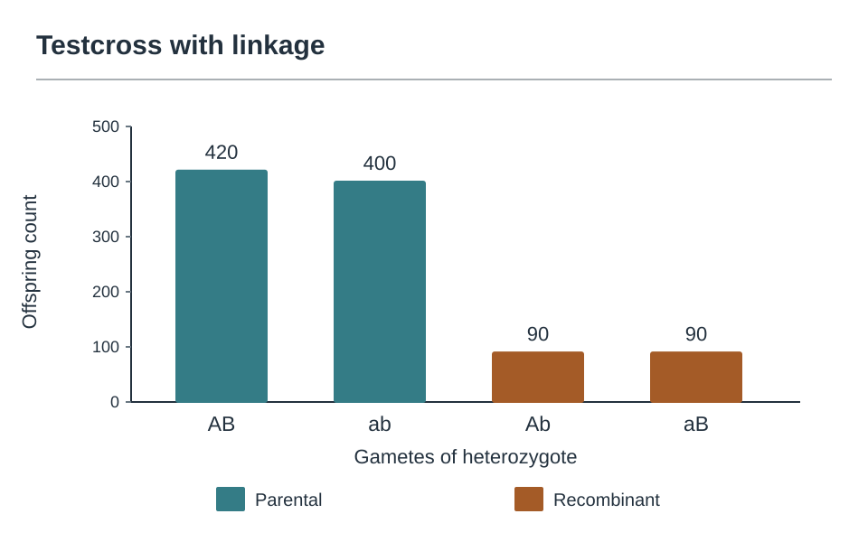

# M6-L7 – Mendelian inheritance and linkage {#L7}

**Course area:** M6 – Molecular Genetics and Gene Regulation

**Level:** Bachelor

**Prerequisites:** [M6-L2](M6-L2.md): recombination; [M6-L5](M6-L5.md): alleles; [M2-L2](M2-L2.md): probability.

**Learning objective:** Calculate genotype probabilities for simple crosses and recognise linked genes from recombinant offspring.

## Introduction {#S1}

Molecular genetics explains the physical basis of alleles. Classical genetics additionally asks how likely these alleles and associated traits are to occur in offspring.

## Principles and model {#S2}

### Segregation and traits

Diploid organisms typically possess two alleles at an autosomal locus. During regular meiosis homologous chromosomes separate; in the simple model a heterozygous Aa individual produces A and a gametes in equal proportions. Random fertilisation between two heterozygotes yields AA, Aa and aa in a 1:2:1 ratio. With complete dominance of A, three quarters exhibit the dominant phenotype. With incomplete dominance or codominance, the heterozygous phenotype may be distinct. Dominance describes the phenotype of a heterozygote, not allele frequency or evolutionary value. Penetrance is the fraction of genotype carriers displaying a defined phenotype; expressivity describes its manifestation.

### Linkage and recombination

Independent assortment holds in the simple model for unlinked loci. Two loci on the same chromosome can be transmitted together. Crossing over between homologous chromatids can form new allele combinations. In a double heterozygote AB/ab, AB and ab are parental and Ab and aB are recombinant. A testcross with ab/ab reveals gamete types of the heterozygous parent under idealised conditions. The recombination fraction r is the fraction of recombinant offspring and ranges from 0 to 0.5 in the usual model. For short distances, 100r approximates map distance in centimorgans. Multiple crossovers may go undetected; physical and genetic distances are not proportional. Epistasis can also alter phenotype ratios without changing allele segregation itself.

*Figure: Simulated testcross: 420 AB, 400 ab, 90 Ab and 90 aB; the recombination fraction is 0.18.*

## Application {#S3}

An artificial testcross yields offspring AB: 420, ab: 400, Ab: 90 and aB: 90. Of 1,000 offspring, 180 are recombinant; $r=180/1000=0.18$. A short-distance approximation gives 18 cM. This approximation may underestimate genetic distance when multiple crossovers occur. The figure shows absolute counts, not measured chromosome lengths.

## Self-assessment {#S4}

### Exercises

1. What is the probability of aa from Aa × Aa under the stated assumptions?
2. Calculate r for 60 recombinants among 500 offspring.
3. Can r = 0.5 prove that two genes lie on different chromosomes?

::: {.lc-solutions data-lc-section="S4"}
1. $1/2\cdot1/2=1/4$.
2. $60/500=0.12$, approximately 12 cM for a short distance.
3. No. Distant loci on the same chromosome can also appear to assort almost independently.
:::

## Assumptions and limitations {#S5}

The testcross is theoretical. It assumes equal viability, reliable genotype classification and regular segregation. Sex-linked, mitochondrial and polygenic inheritance require further models; most human traits cannot be explained by simple dominance schemes.

## Summary and transition {#S6}

The molecular and classical foundations of M6 recur in population genetics and evolution. M7 introduces plant organisation and diversity.

**Continue:** [M7-L1](M7-L1.md)

## Sources {#S7}

- [OpenStax – Biology 2e, 12.3 Laws of Inheritance](https://openstax.org/books/biology-2e/pages/12-3-laws-of-inheritance) · Segregation, independent assortment, linkage and epistasis · Last accessed: 2026-11-25
- [NHGRI – Talking Glossary of Genetic Terms](https://www.genome.gov/genetics-glossary) · Homologous recombination and genetic variation · Last accessed: 2026-11-25

