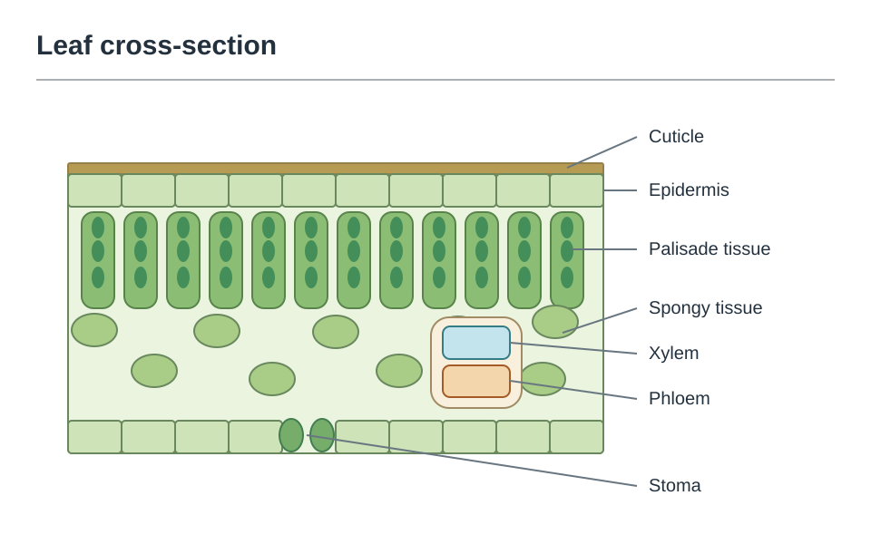

# M7-L1 – Plant cells and tissues {#L1}

**Course area:** M7 – Botany and Plant Diversity

**Level:** Bachelor

**Prerequisites:** [M4-L1](M4-L1.md): cell organisation; [M4-L3](M4-L3.md): organelles; [M5-L3](M5-L3.md): polysaccharides.

**Learning objective:** Distinguish plant cell types and tissue systems by structure and function and explain primary and secondary growth.

## Introduction {#S1}

A leaf is simultaneously a light-collecting surface, a gas-exchange organ and a hydraulic system. Its tissue arrangement enables these functions.

## Principles and model {#S2}

### From cells to tissues

A typical plant cell wall contains cellulose microfibrils embedded in a matrix of other polysaccharides. The primary wall allows growth; additional secondary walls can be reinforced by lignin. A central vacuole contributes to storage, degradation and turgor. Plasmodesmata connect neighbouring cells across their walls. Chloroplasts specialise in photosynthesis, but not all plant cells contain them: many root cells contain other plastids. Mitochondria provide energy metabolism in photosynthetically active cells as well.

Meristems contain cells capable of division. Apical meristems at shoot and root tips permit growth in length. In many woody plants, the vascular cambium produces secondary xylem inward and secondary phloem outward; cork cambium contributes to the protective periderm. This is not a universal body plan for all plants.

### Three tissue systems

Dermal tissue forms the boundary; cuticle reduces water loss, stomata regulate gas exchange and root hairs increase absorptive area. Ground tissue includes parenchyma (metabolism and storage), collenchyma (flexible support) and sclerenchyma (often strongly thickened walls). Vascular tissues connect organs. Xylem transports mainly water and mineral nutrients; many of its conducting elements are dead at functional maturity. Phloem distributes assimilates from sources to sinks; in angiosperms, living sieve tube elements cooperate with companion cells. Spatial arrangement varies with organ and lineage.

*Figure: Schematic leaf cross-section showing dermal, ground and vascular tissues; not to scale.*

## Application {#S3}

A simulated microscopic image of a leaf section includes a 50 µm scale bar that is 100 pixels long. A cell is 72 pixels wide: $72/100\cdot50=36$ µm. The same conversion applies to a second image only if its calibration is identical. Widths from 20 cells can form a distribution, but multiple cells from the same leaf are not automatically independent biological replicates.

## Self-assessment {#S4}

### Exercises

1. A structure measures 150 pixels and a 100-pixel bar represents 50 µm. What is its length?
2. Why can xylem conduct despite many conducting cells being dead?
3. Which tissues does a vascular cambium produce and in which directions?

::: {.lc-solutions data-lc-section="S4"}
1. 75 µm.
2. Stable hollow or permeably connected walls form transport paths; conduction there does not require a living protoplast.
3. Secondary xylem inward and secondary phloem outward.
:::

## Assumptions and limitations {#S5}

The figure is a simplified leaf cross-section, not to scale. Not every species has distinct palisade and spongy mesophyll. The example calibration does not apply to the teaching diagram.

## Summary and transition {#S6}

Cell characteristics enable specialised tissue functions. M7-L2 connects this organisation with organs and life cycles.

**Continue:** [M7-L2](M7-L2.md)

## Sources {#S7}

- [OpenStax – Biology 2e, 30.1 The Plant Body](https://openstax.org/books/biology-2e/pages/30-1-the-plant-body) · Tissue systems and meristems · Last accessed: 2026-11-25
- [OpenStax – Biology 2e, 30.2 Stems](https://openstax.org/books/biology-2e/pages/30-2-stems) · Primary and secondary growth · Last accessed: 2026-11-25

