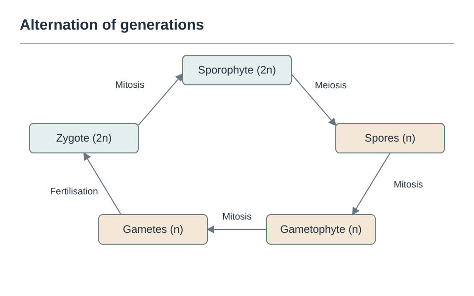

# M7-L2 – Body plan and reproduction {#L2}

**Course area:** M7 – Botany and Plant Diversity

**Level:** Bachelor

**Prerequisites:** [M7-L1](M7-L1.md): tissues; [M6-L7](M6-L7.md): meiosis and inheritance.

**Learning objective:** Relate roots, shoots, leaves and flowers to their functions and trace alternation of generations with correct ploidy.

## Introduction {#S1}

The visible plant is only one phase of a life cycle. Which cells produce spores and which produce gametes?

## Principles and model {#S2}

### Organs and propagation

Roots anchor plants, take up water and ions and may store reserves. Shoots support leaves and position them in light. Leaves couple carbon uptake and water loss. Modified organs such as rhizomes and storage roots illustrate why function alone cannot determine organ origin. Buds and meristems support modular growth. Vegetative propagation, for example through runners, produces offspring without gamete fusion; somatic mutations can nevertheless distinguish clones.

### Alternation of generations

A diploid sporophyte (2n) produces haploid spores (n) through meiosis in sporangia. Spores develop mitotically into gametophytes. Gametes arise by mitosis in haploid gametophytes; their fusion restores diploidy. In many mosses the gametophyte is conspicuous, whereas in ferns and seed plants the sporophyte predominates. Pollen is the male gametophyte of seed plants, not an individual sperm cell.

In angiosperms, pollen reaches the stigma. A pollen tube delivers sperm cells to the ovule. Typically one sperm fuses with the egg to form a zygote; the other fuses with the central cell, usually giving rise to triploid endosperm. The ovule develops into a seed, and the ovary often develops into a fruit. Additional floral structures may contribute to fruits. Pollination alone is not fertilisation.

*Figure: Meiosis produces spores; fertilisation unites gametes into a zygote.*

## Application {#S3}

A model species is diploid with 2n = 18. Its regular spores contain n = 9 chromosomes, as do its gametes. A zygote again contains 18. In typical double fertilisation with two haploid polar nuclei and one haploid sperm, the primary endosperm nucleus contains 27 chromosomes. Chromosome number is distinct from DNA content across the cell cycle.

## Self-assessment {#S4}

### Exercises

1. A diploid species has 2n = 24. How many chromosomes do regular spores contain?
2. At which transition does ploidy decrease?
3. Why is a pollen grain not equivalent to a gamete?

::: {.lc-solutions data-lc-section="S4"}
1. 12.
2. During meiosis from diploid sporophyte to haploid spores.
3. It represents a reduced male gametophyte that produces or contains sperm cells.
:::

## Assumptions and limitations {#S5}

The diagram represents the general land-plant model. Special ploidy patterns, apomixis and variable endosperm development are omitted.

## Summary and transition {#S6}

Alternation of generations is a shared organisational principle of land plants. M7-L3 classifies their diversity.

**Continue:** [M7-L3](M7-L3.md)

## Sources {#S7}

- [OpenStax – Biology 2e, 32.1 Reproductive Development and Structure](https://openstax.org/books/biology-2e/pages/32-1-reproductive-development-and-structure) · Life cycles and angiosperm reproduction · Last accessed: 2026-11-25
- [OpenStax – Biology 2e, 25.1 Early Plant Life](https://openstax.org/books/biology-2e/pages/25-1-early-plant-life) · Land colonisation and alternation of generations · Last accessed: 2026-11-25

