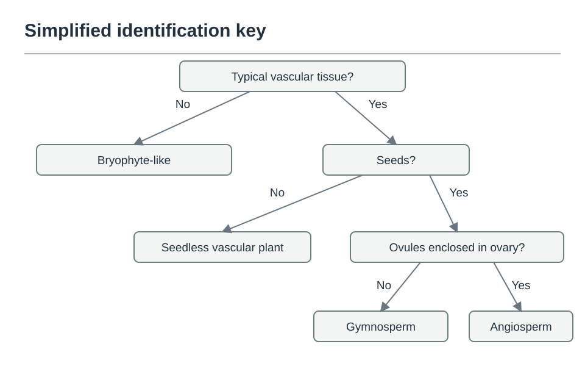

# M7-L3 – Plant systematics {#L3}

**Course area:** M7 – Botany and Plant Diversity

**Level:** Bachelor

**Prerequisites:** [M7-L2](M7-L2.md): life cycles; [M6-L5](M6-L5.md): variation.

**Learning objective:** Distinguish taxonomy, nomenclature and phylogeny and use plant traits in a reasoned classification.

## Introduction {#S1}

Two plants may look alike without being closely related. Naming, identification and ancestry address different tasks.

## Principles and model {#S2}

### Names and relationships

Taxonomy describes and circumscribes taxa; nomenclature governs their naming. A species name consists of a genus name and specific epithet, such as *Arabidopsis thaliana*. The epithet alone is not a complete species name. A nomenclatural type anchors the application of a name, not every biological property of a species. Synonyms may refer to the same taxonomic concept. Kew's World Checklist of Vascular Plants provides a documented taxonomic reference; accepted names can change with scientific revisions. Record the name, source, access date and, where possible, stable identifier in datasets.

### Traits and classification

Mosses, liverworts and hornworts are land plants without the typical vascular system of tracheophytes. Among vascular plants, lycophytes and the fern lineage including horsetails are important seedless groups. Seed plants include gymnosperms and angiosperms. Gymnosperms do not enclose ovules within an ovary; angiosperms have flowers and produce fruits. Monocots and eudicots are major angiosperm groups, not all flowering plants. Cotyledon number, venation and floral features provide clues, but exceptions and convergence require trait combinations and molecular evidence.

An identification key supports identification, whereas a phylogenetic tree expresses a hypothesis about ancestry. Shared derived characters can support clades; similarity driven by similar environmental demands is insufficient evidence of relatedness.

*Figure: Decision tree for four supplied groups; not a phylogenetic tree.*

## Application {#S3}

A teaching key distinguishes four supplied specimens: A has neither seeds nor typical vascular tissue; B has vascular tissue without seeds; C has ovules not enclosed in an ovary; D has flowers with enclosed ovules. They correspond to a bryophyte-like land plant, a seedless vascular plant, a gymnosperm and an angiosperm. This model does not identify species. A sample of 40 records contains eight synonyms of already recorded accepted names: after confirmed matching, 32 distinct names remain, provided there are no further duplicates.

## Self-assessment {#S4}

### Exercises

1. Why is an identification key not a phylogenetic tree?
2. How many records remain from 60 after removing 12 confirmed redundant names?
3. Does parallel leaf venation alone establish that a plant is a monocot?

::: {.lc-solutions data-lc-section="S4"}
1. It separates specimens using practical characters whose order need not reflect ancestry.
2. 48 under the stated assumption.
3. No. Further characters and possibly molecular data are necessary.
:::

## Assumptions and limitations {#S5}

The key is a teaching selection, not an actual flora. Hybrids, cryptic species and taxonomic revisions can complicate assignment. Name counts are not biodiversity measures without taxonomic validation.

## Summary and transition {#S6}

Systematics connects observed diversity with testable relationship hypotheses. M7-L4 explores the origins of major traits.

**Continue:** [M7-L4](M7-L4.md)

## Sources {#S7}

- [Kew Science – Plants of the World Online: About WCVP](https://powo.science.kew.org/about-wcvp) · Taxonomic backbone, accepted names and synonyms · Last accessed: 2026-11-25
- [OpenStax – Biology 2e, 26.3 Angiosperms](https://openstax.org/books/biology-2e/pages/26-3-angiosperms) · Angiosperm diversity · Last accessed: 2026-11-25
- [OpenStax – Biology 2e, 25.4 Seedless Vascular Plants](https://openstax.org/books/biology-2e/pages/25-4-seedless-vascular-plants) · Vascular tissues and fern life cycle · Last accessed: 2026-11-25

