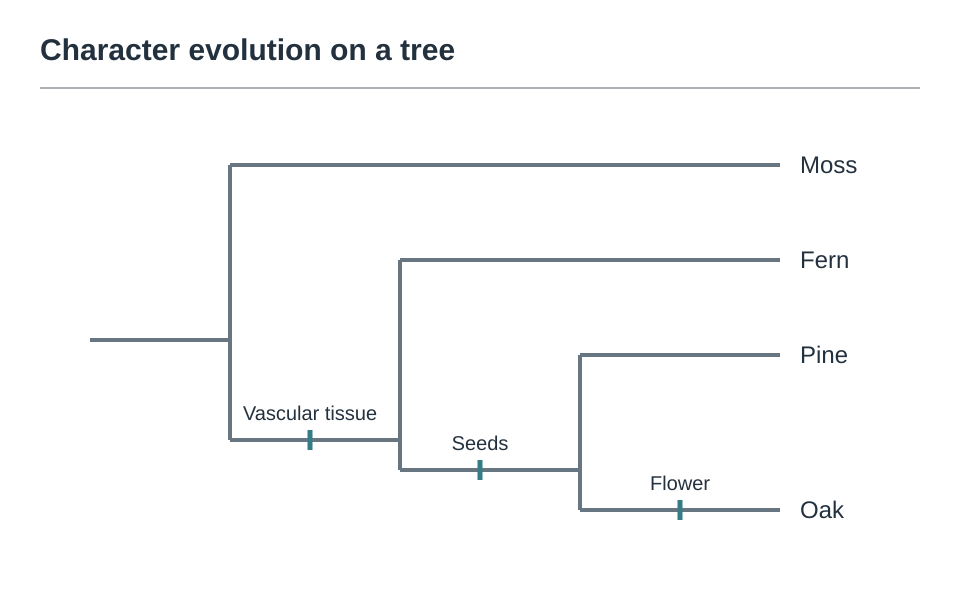

# M7-L4 – Plant evolution {#L4}

**Course area:** M7 – Botany and Plant Diversity

**Level:** Bachelor

**Prerequisites:** [M7-L2](M7-L2.md): alternation of generations; [M7-L3](M7-L3.md): plant groups.

**Learning objective:** Explain land plant evolution using derived characters and distinguish the origin of traits from present-day species diversity.

## Introduction {#S1}

The traits of living plants result from branching evolutionary history. Comparing their distributions permits testable hypotheses.

## Principles and model {#S2}

### Transition to life on land

Land plants belong to streptophytes; their closest living algal relatives are the Zygnematophyceae. Their common ancestor was not a living algal species. On land, mechanical demands, water availability and dispersal conditions change. Embryo protection within maternal tissue, resistant spore walls and apically organised development are key features. Cuticles and regulated gas exchange structures are important adaptations whose expression varies across lineages. Not all land plants possess stomata.

### Vascular tissues, seeds and flowers

Lignified conducting and support elements permit larger bodies and longer transport distances in vascular plants. Seedless vascular plants disperse via spores; in many of them, motile sperm require free water for fertilisation. Heterospory refers to production of distinct microspores and megaspores. In seed plants, gametophytes are highly reduced, and pollen permits transport of the male germline without an external film of water. Seeds protect embryos and in many cases permit delayed germination. Flowers and fruits influence pollination and seed dispersal; animal pollination is only one of several strategies.

Evolution is branching. Living mosses are not intermediate stages leading to living ferns, and living ferns are not ancestors of living seed plants. Fossils, morphology and sequence data illuminate different aspects of ancestry. Traits can be lost, evolve independently or acquire new functions.

*Figure: Four selected land plants; marked traits are simplified state changes.*

## Application {#S3}

In a simplified character comparison, states for vascular tissue, seeds and flowers are 000 for A (moss), 100 for B (fern), 110 for C (pine) and 111 for D (oak). For the depicted tree, a simple model with equally weighted changes requires at least three state changes. Alternative groupings may require more. This calculation is not a date estimate and cannot replace a comprehensive phylogenetic analysis.

## Self-assessment {#S4}

### Exercises

1. Which two of the four specimens share seeds?
2. Why should living mosses not be described as ancestors of living ferns?
3. Which evidence could complement a morphology-based hypothesis?

::: {.lc-solutions data-lc-section="S4"}
1. C and D (pine and oak).
2. They belong to distinct extant lineages with shared extinct ancestors.
3. Comparison of homologous DNA sequences, fossils or further independent anatomical traits.
:::

## Assumptions and limitations {#S5}

The tree shows only four selected representatives and three traits; branch lengths represent neither time nor genetic distance. Other land plant groups are omitted.

## Summary and transition {#S6}

Evolution explains the distribution of biological traits without a ladder of progress. M7-L5 treats fungi as a distinct eukaryotic lineage.

**Continue:** [M7-L5](M7-L5.md)

## Sources {#S7}

- [OpenStax – Biology 2e, 25.1 Early Plant Life](https://openstax.org/books/biology-2e/pages/25-1-early-plant-life) · Land colonisation and alternation of generations · Last accessed: 2026-11-25
- [OpenStax – Biology 2e, 25.4 Seedless Vascular Plants](https://openstax.org/books/biology-2e/pages/25-4-seedless-vascular-plants) · Vascular tissues and fern life cycle · Last accessed: 2026-11-25
- [OpenStax – Biology 2e, 26.1 Evolution of Seed Plants](https://openstax.org/books/biology-2e/pages/26-1-evolution-of-seed-plants) · Evolution of pollen and seeds · Last accessed: 2026-11-25
- [OpenStax – Biology 2e, 26.3 Angiosperms](https://openstax.org/books/biology-2e/pages/26-3-angiosperms) · Angiosperm diversity · Last accessed: 2026-11-25
- [Bierenbroodspot et al. – A deep genetic structure phylogenomically frames the closest algal relatives of land plants (2026)](https://journals.plos.org/plosbiology/article?id=10.1371/journal.pbio.3004005) · Phylogenomic evidence for Zygnematophyceae as sister group of embryophytes · Last accessed: 2026-11-25

