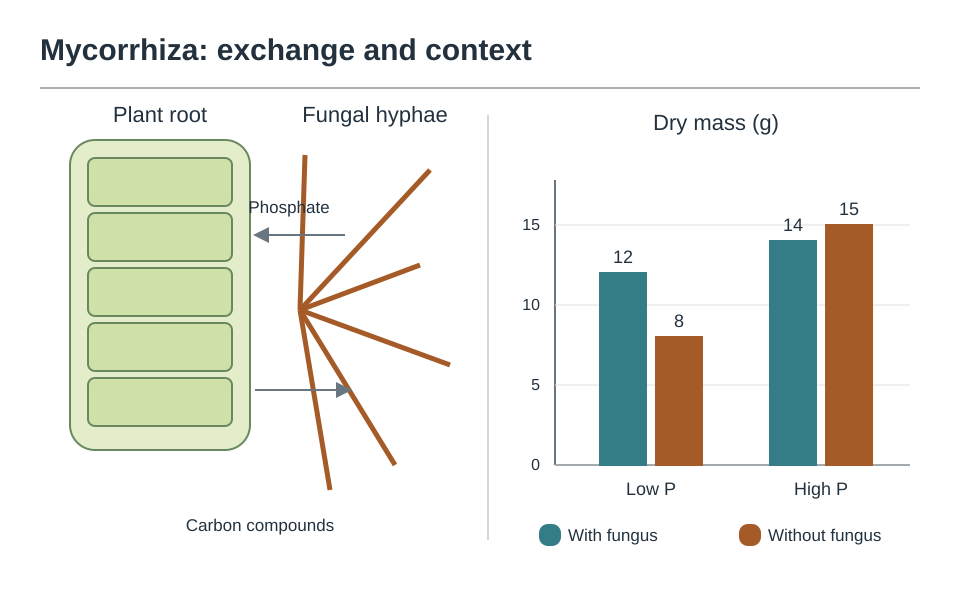

# M7-L5 – Fungi and symbioses {#L5}

**Course area:** M7 – Botany and Plant Diversity

**Level:** Bachelor

**Prerequisites:** [M5-L3](M5-L3.md): polysaccharides; [M7-L1](M7-L1.md): root tissues.

**Learning objective:** Distinguish fungi from plants by nutrition and organisation and assess benefits and costs of symbioses experimentally.

## Introduction {#S1}

A plant root need not explore its habitat alone. Fungal partners can alter nutrient uptake.

## Principles and model {#S2}

### Fungi as a distinct lineage

Fungi are heterotrophic eukaryotes. Their cell walls frequently contain chitin and glucans; they do not use chloroplasts for photosynthesis. Many form hyphae whose branching network is termed a mycelium. Septa may partition hyphae, with pores allowing exchange between compartments. Other fungi grow as unicellular yeasts. Fruiting bodies produce sexual spores in many but not all fungi. A visible fruiting body is not the entire organism. Fungi release enzymes to break down substrates and absorb soluble products. They act as decomposers, parasites or partners of other organisms. In many sexual life cycles, cell fusion and nuclear fusion are separated in time; ploidy and nuclear number must be considered separately.

### Mycorrhizae and lichens

Mycorrhiza refers to a close association between a fungus and plant root. Arbuscular mycorrhizal fungi form branched exchange structures in root cortical cells that remain surrounded by a plant membrane. Ectomycorrhizal fungi commonly form a sheath around fine roots and a network between cells. Fungi can extend the explored soil area and supply nutrients such as phosphate; plants provide carbon compounds. The net effect depends on nutrient supply, species combination and carbon costs, among other factors. Lichens contain a fungus and at least one photosynthetic partner, often green algae or cyanobacteria. Additional microorganisms may participate. Close association does not guarantee reciprocal benefit under all conditions.

*Figure: Conceptual exchange and simulated dry masses at two phosphate levels.*

## Application {#S3}

A fictional controlled experiment compares plants with and without mycorrhiza. At low phosphate availability, mean dry masses are 12 and 8 g, respectively; at high availability they are 14 and 15 g. Relative differences are $100(12-8)/8=50$% and about $100(14-15)/15=-6.7$%. These data illustrate a potential partner-by-environment interaction, but without dispersion, replication and suitable controls do not establish a causal effect.

## Self-assessment {#S4}

### Exercises

1. Are fungi plants without chlorophyll? Explain.
2. Calculate the relative mass difference for 9 versus 10 g.
3. Why does the comparison require multiple independent plants per treatment?

::: {.lc-solutions data-lc-section="S4"}
1. No. They constitute a distinct eukaryotic lineage with heterotrophic nutrition and characteristic cell walls.
2. $100(9-10)/10=-10$%.
3. This permits estimation of biological variation and uncertainty in the group comparison.
:::

## Assumptions and limitations {#S5}

The diagram shows an exchange model, not a micrograph. The example is simulated and is not intended as instructions for culturing unknown fungi. Not all mycorrhizae exchange identical compounds to the same extent.

## Summary and transition {#S6}

Fungi are essential to nutrient cycles and organismal interactions. M7-L6 broadens the perspective to other eukaryotes.

**Continue:** [M7-L6](M7-L6.md)

## Sources {#S7}

- [OpenStax – Biology 2e, 24.1 Characteristics of Fungi](https://openstax.org/books/biology-2e/pages/24-1-characteristics-of-fungi) · Fungal organisation and nutrition · Last accessed: 2026-11-25
- [OpenStax – Biology 2e, 24.3 Ecology of Fungi](https://openstax.org/books/biology-2e/pages/24-3-ecology-of-fungi) · Mycorrhizae and lichens · Last accessed: 2026-11-25

