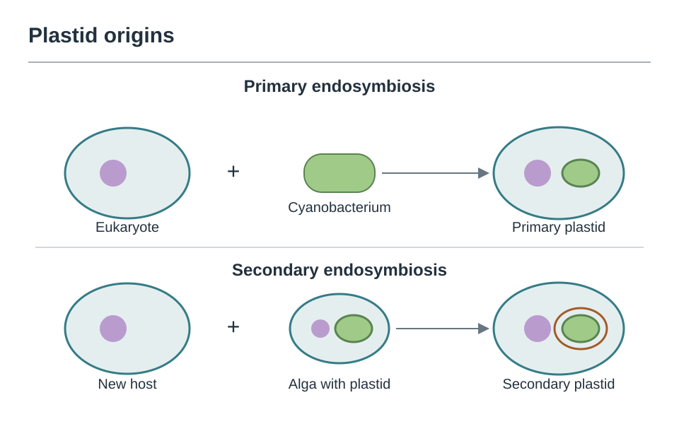

# M7-L6 – Protists, algae and eukaryotic diversity {#L6}

**Course area:** M7 – Botany and Plant Diversity

**Level:** Bachelor

**Prerequisites:** [M4-L1](M4-L1.md): eukaryotes; [M5-L5](M5-L5.md): photosynthesis; [M7-L3](M7-L3.md): systematics.

**Learning objective:** Describe microbial eukaryotic diversity and distinguish primary from secondary endosymbiosis.

## Introduction {#S1}

A drop of water may contain very different eukaryotic organisms. Their similarity under a microscope tells us little about their shared ancestry.

## Principles and model {#S2}

### Not a single group

Protists is a practical collective term for many eukaryotes outside traditionally delimited animals, fungi and land plants; it does not designate a single monophyletic group. Algae likewise do not constitute one lineage. Green and red algae belong with land plants to Archaeplastida, whereas brown algae and diatoms are stramenopiles. Diatoms form silica-containing cell coverings, while brown algae include large multicellular organisms. Ciliates move with cilia and many amoebae with pseudopodia; locomotion or nutrition alone cannot establish relationships unambiguously. Mixotrophs combine photosynthetic and heterotrophic nutritional capacities. Cyanobacteria are prokaryotes despite the historical name blue-green algae.

### Endosymbiosis and plastids

Mitochondria derive from a bacterial endosymbiont. Classical primary plastids of Archaeplastida originated through incorporation of a cyanobacterium into a eukaryotic host lineage. Secondary endosymbiosis instead involves incorporation of an already plastid-bearing eukaryotic alga by another eukaryote. Additional membranes and, in some lineages, a reduced algal nucleus can persist. Gene transfer to the host nucleus and protein import couple organelle and host cell. Organelle DNA, bacteria-like characteristics and molecular phylogenies support this ancestry. Membrane number alone cannot reconstruct every individual history.

### Ecological functions

Photosynthetic microbial eukaryotes contribute to primary production in aquatic ecosystems. Others consume bacteria and smaller eukaryotes, remineralise nutrients or live as symbionts and parasites. Species composition, light, temperature and nutrients affect productivity; high cell abundance does not necessarily imply high biomass.

*Figure: Schematic incorporation of a cyanobacterium and subsequently a plastid-bearing alga; not to scale.*

## Application {#S3}

In a simulated counting volume of 0.2 mL, 80 cells of a morphologically defined algal category are recorded. Estimated density is $80/0.2=400$ cells per mL. If the sample had first been diluted 1:5 (one part sample in five parts total volume), the original density would be 2,000 cells per mL. Clumping, sample heterogeneity and misclassification can bias the estimate.

## Self-assessment {#S4}

### Exercises

1. Why do algae not form a single clade?
2. A 0.5 mL sample contains 150 counted cells. What is the density without dilution?
3. What distinguishes primary from secondary plastid endosymbiosis?

::: {.lc-solutions data-lc-section="S4"}
1. Photosynthetic eukaryotes belong to several lineages, in part through secondary endosymbioses.
2. 300 cells per mL.
3. Primary endosymbiosis incorporates a cyanobacterium; secondary endosymbiosis incorporates an already plastid-bearing eukaryote.
:::

## Assumptions and limitations {#S5}

The figure simplifies complex plastid histories and makes no claim about all membranes or endosymbiotic events. The counting example is fictional, not a culturing protocol or reliable species identification.

## Summary and transition {#S6}

M7 connects plant diversity with other eukaryotic lineages. M8 examines animal diversity and comparative anatomy.

**Continue:** [M8-L1](M8-L1.md)

## Sources {#S7}

- [OpenStax – Biology 2e, 23.1 Eukaryotic Origins](https://openstax.org/books/biology-2e/pages/23-1-eukaryotic-origins) · Endosymbiotic origins of organelles · Last accessed: 2026-11-25
- [OpenStax – Biology 2e, 23.3 Groups of Protists](https://openstax.org/books/biology-2e/pages/23-3-groups-of-protists) · Diversity of microbial eukaryotes · Last accessed: 2026-11-25

