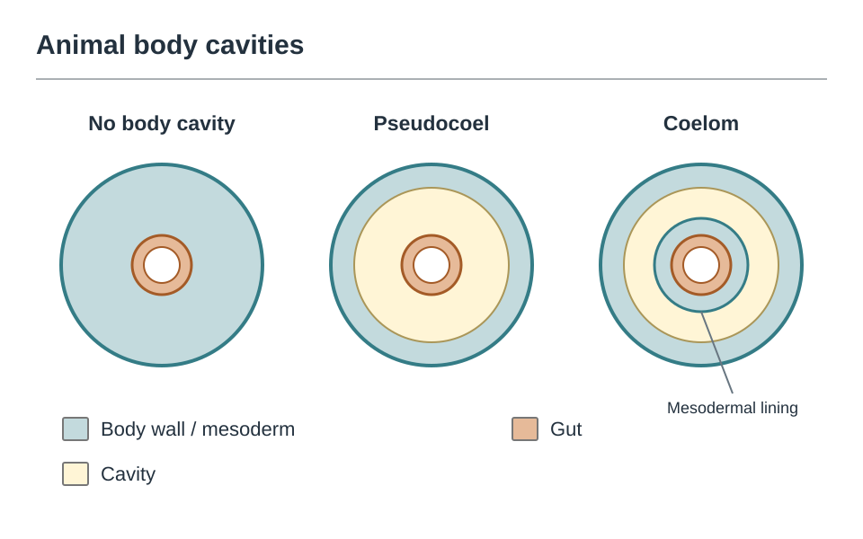

# M8-L1 – Animal body plans {#L1}

**Course area:** M8 – Zoology and Animal Diversity

**Level:** Bachelor

**Prerequisites:** [M4-L1](M4-L1.md): cell organisation; [M7-L6](M7-L6.md): eukaryotic diversity.

**Learning objective:** Compare animal body plans using symmetry, tissues, germ layers and body cavities, and assess their functional consequences.

## Introduction {#S1}

A jellyfish encounters its environment from several directions, whereas an actively crawling worm has a front end. These differences can be described as geometric and functional features without arranging animals in a hierarchy.

## Principles and model {#S2}

### Symmetry and body axes

Sponges frequently lack regular symmetry; many cnidarians have a radial body plan. A conceptual median plane can divide the body of bilateral animals into left and right halves in principle. Anterior and posterior refer to the front and rear, dorsal and ventral to the back and belly. Concentration of sensory organs and nervous tissue at the front is called cephalisation. External symmetry need not match the arrangement of every internal organ. Adult echinoderms, for example, often exhibit secondary fivefold symmetry, whereas their larvae have bilateral characteristics.

### Tissue layers and internal spaces

Ectoderm, endoderm and mesoderm are embryonic precursor layers in triploblastic animals. Mesoderm contributes, among other structures, to muscles and connective tissues. A true body cavity (coelom) has a mesodermal lining; a primary cavity without a complete mesodermal lining is called a pseudocoel. In flatworms, tissue largely fills the space between gut and body wall. Segmentation can permit spatial repetition of body parts but is not homologous across all animal groups. Individual traits alone are insufficient evidence of ancestry.

### Body plan and exchange

Body size affects exchange: longer diffusion distances can increase an organism's dependence on internal transport mechanisms. Flattened shapes, branching and folding can improve exchange. The particular solution also depends on metabolism and habitat.

*Figure: Three idealised sections with gut, tissue and different body cavities; not to scale.*

## Application {#S3}

Two idealised spherical bodies have radii of 1 and 4 mm. With $A=4\pi r^2$ and $V=4\pi r^3/3$, $A/V=3/r$. Values are 3 and 0.75 mm⁻¹ respectively. The larger sphere has one quarter of the surface area per unit volume, although its absolute area is larger. Real animals are not spheres; the model isolates the effect of size alone.

## Self-assessment {#S4}

### Exercises

1. Which body axes can be distinguished in a bilaterally symmetrical animal?
2. What distinguishes a coelom from a pseudocoel?
3. Calculate the surface-area-to-volume ratio of a sphere with radius 2 mm.

::: {.lc-solutions data-lc-section="S4"}
1. Front–rear, dorsal–ventral and left–right directions.
2. The coelom has a complete mesodermal lining, the pseudocoel does not.
3. $3/2=1.5$ mm⁻¹.
:::

## Assumptions and limitations {#S5}

The sections depict idealised organisations rather than complete organisms. Body cavities alone do not establish phylogenetic groups; morphological traits must be combined with other evidence.

## Summary and transition {#S6}

Body plans constrain and enable biological functions. M8-L2 compares specific organ systems.

**Continue:** [M8-L2](M8-L2.md)

## Sources {#S7}

- [OpenStax – Biology 2e, 27.2 Features Used to Classify Animals](https://openstax.org/books/biology-2e/pages/27-2-features-used-to-classify-animals) · Symmetry, germ layers and body cavities · Last accessed: 2026-11-25
- [OpenStax – Biology 2e, 33.1 Animal Form and Function](https://openstax.org/books/biology-2e/pages/33-1-animal-form-and-function) · Body size and exchange surfaces · Last accessed: 2026-11-25

