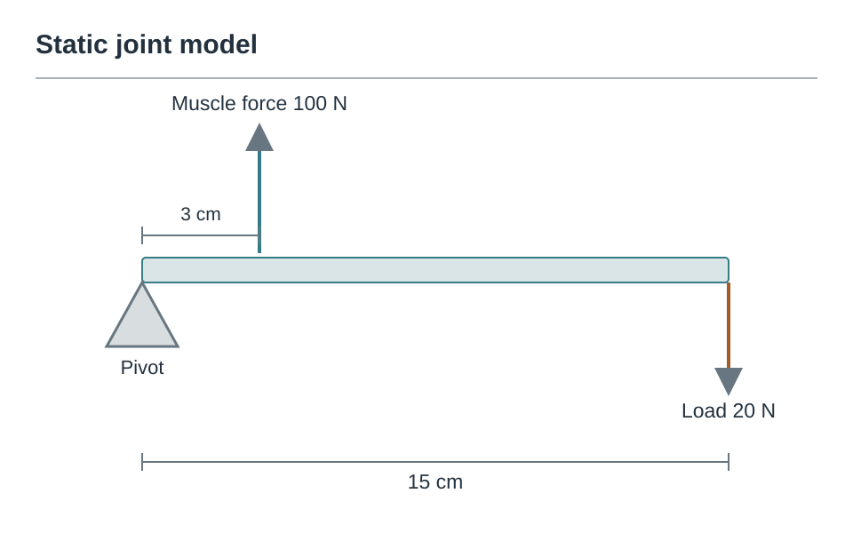

# M8-L2 – Comparative anatomy {#L2}

**Course area:** M8 – Zoology and Animal Diversity

**Level:** Bachelor

**Prerequisites:** [M3-L4](M3-L4.md): mechanics and transport; [M8-L1](M8-L1.md): body plans.

**Learning objective:** Explain support systems, digestion, respiration and circulation comparatively, and distinguish functional similarity from similarity due to common ancestry.

## Introduction {#S1}

An earthworm, a grasshopper and a fish all move using muscles. However, the structures against which those muscles act differ substantially.

## Principles and model {#S2}

### Support and movement

A hydrostatic skeleton uses a fluid-filled space whose volume remains approximately constant during muscle contraction. In earthworms, circular and longitudinal muscles enable segments to change shape. Arthropods possess an external cuticle, with rigid and flexible regions jointly forming an exoskeleton. Growth requires periodic moulting. An internal skeleton of cartilage and/or bone supports many vertebrates and provides muscle attachment sites. Antagonists generate opposite movements because muscles mainly exert active pulling forces.

### Comparison of organ systems

In many cnidarians, one opening to the gastrovascular cavity serves for food intake and release of undigested material. A complete gut with mouth and anus enables directed transport and regional specialisation. Gills provide surfaces for exchange with water; insect tracheae carry air close to tissues, and lungs enable exchange with air across internal surfaces. In open circulatory systems, haemolymph leaves vessels for body spaces. In closed systems, blood normally remains in vessels while substances are exchanged across their walls. These features occur in different combinations; cephalopods, for example, have a closed circulation despite belonging to molluscs.

Homologous structures reflect common ancestry; analogous functions may evolve independently. Bird and bat forelimbs are homologous as tetrapod limbs, whereas their flight apparatus evolved independently.

*Figure: Schematic lever with opposing forces and moment arms of 3 and 15 cm.*

## Application {#S3}

An idealised joint is in equilibrium. An external load of 20 N acts perpendicularly 15 cm from the pivot. Muscle force acts perpendicularly with a 3 cm moment arm. From $F_M\cdot0.03=20\cdot0.15$, $F_M=100$ N. A short muscle moment arm can enable large movement at the end of a limb but requires more force. Real joint forces also depend on angles, tissues and acceleration.

## Self-assessment {#S4}

### Exercises

1. Why can a hydrostatic skeleton change shape without rigid bones?
2. What muscle force would be needed with a 10 N load and the same moment arms?
3. Why is similar wing function alone not evidence of close ancestry?

::: {.lc-solutions data-lc-section="S4"}
1. Muscles change the shape of an almost incompressible fluid compartment.
2. 50 N.
3. Similar selection conditions can favour similar functions independently.
:::

## Assumptions and limitations {#S5}

The lever diagram is a static model, not a complete anatomical joint or a clinical load calculation. Organ comparisons must not be treated as a ladder of progress.

## Summary and transition {#S6}

Organ systems solve shared functional problems in different ways. M8-L3 examines their adjustment to environmental conditions.

**Continue:** [M8-L3](M8-L3.md)

## Sources {#S7}

- [OpenStax – Biology 2e, 38.1 Types of Skeletal Systems](https://openstax.org/books/biology-2e/pages/38-1-types-of-skeletal-systems) · Hydrostatic, external and internal skeletons · Last accessed: 2026-11-25
- [OpenStax – Biology 2e, 34.1 Digestive Systems](https://openstax.org/books/biology-2e/pages/34-1-digestive-systems) · Comparative digestive systems · Last accessed: 2026-11-25
- [OpenStax – Biology 2e, 39.1 Systems of Gas Exchange](https://openstax.org/books/biology-2e/pages/39-1-systems-of-gas-exchange) · Respiratory surfaces · Last accessed: 2026-11-25

