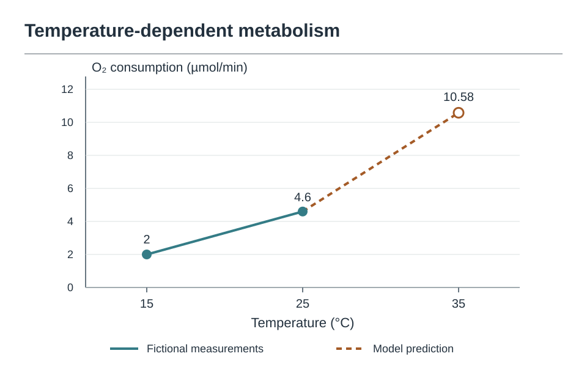

# M8-L3 – Animal physiological adaptations {#L3}

**Course area:** M8 – Zoology and Animal Diversity

**Level:** Bachelor

**Prerequisites:** [M5-L4](M5-L4.md): energy metabolism; [M8-L2](M8-L2.md): organ systems.

**Learning objective:** Explain thermoregulation, gas exchange and water balance as environment-dependent functional problems, and distinguish acclimatisation from evolutionary adaptation.

## Introduction {#S1}

A desert animal must balance heat and water. A fish in cold water faces different demands. No physiological strategy is superior under all conditions.

## Principles and model {#S2}

### Temperature and energy

Endothermic animals generate much of their body heat through metabolism; ectotherms rely primarily on external heat sources. This distinction is not equivalent to constant or variable body temperature. Torpor temporarily lowers metabolism and body temperature in some endotherms. Behaviour, insulation, blood flow and evaporation influence heat exchange. Evaporation consumes water; insulation can hinder heat loss in hot surroundings.

### Exchange and regulation

Under simplified conditions, oxygen transport across an exchange surface depends on area, concentration gradient and diffusion distance. Countercurrent flow in many fish gills preserves a favourable gradient over much of the exchange surface. Water and salt balance are linked to environmental osmotic conditions: many freshwater bony fishes gain water osmotically and excrete dilute urine, whereas many marine bony fishes lose water and actively excrete salts. Other animal groups use other strategies. Negative feedback can keep regulated variables within a suitable range; this requires sensors, signal processing and effectors.

### Temporal scales

Acclimatisation refers to a physiological change during an individual's lifetime under natural environmental conditions. Evolutionary adaptation instead arises across generations through changes in inherited traits in populations. A reversible temperature-dependent change in metabolic activity alone does not demonstrate evolutionary adaptation.

*Figure: Two fictional measurements at 15 and 25 degrees and a model prediction at 35 degrees connected by a dashed line.*

## Application {#S3}

In a fictional dataset, an ectotherm's oxygen consumption is 2 µmol per minute at 15 °C and 4.6 µmol per minute at 25 °C. The temperature coefficient $Q_{10}=(R_2/R_1)^{10/(T_2-T_1)}$ is 2.3. Assuming a constant coefficient, the prediction at 35 °C would be $4.6\cdot2.3=10.58$ µmol/min. This extrapolation is only a model: oxygen supply, stress and enzyme stability can alter the response.

## Self-assessment {#S4}

### Exercises

1. Why are endothermy and constant body temperature not synonymous?
2. What does $Q_{10}=2$ predict from 3 µmol/min after warming by 10 °C?
3. Why can evaporative cooling be costly in dry habitats?

::: {.lc-solutions data-lc-section="S4"}
1. Endotherms can substantially lower body temperature during torpor, whereas ectotherms can attain relatively stable temperatures through behaviour.
2. 6 µmol/min, assuming a constant coefficient.
3. It consumes body water, which may be difficult to replace in dry environments.
:::

## Assumptions and limitations {#S5}

The graph shows fictional data; the third point is a model prediction, not a measurement. Animal physiology explanations are not instructions for stressful animal experiments.

## Summary and transition {#S6}

Physiological functions have limits and trade-offs. M8-L4 connects trait diversity with development and ancestry.

**Continue:** [M8-L4](M8-L4.md)

## Sources {#S7}

- [OpenStax – Biology 2e, 33.3 Homeostasis](https://openstax.org/books/biology-2e/pages/33-3-homeostasis) · Thermoregulation and feedback · Last accessed: 2026-11-25
- [OpenStax – Biology 2e, 39.1 Systems of Gas Exchange](https://openstax.org/books/biology-2e/pages/39-1-systems-of-gas-exchange) · Respiratory surfaces · Last accessed: 2026-11-25
- [OpenStax – Biology 2e, 33.1 Animal Form and Function](https://openstax.org/books/biology-2e/pages/33-1-animal-form-and-function) · Body size and exchange surfaces · Last accessed: 2026-11-25

