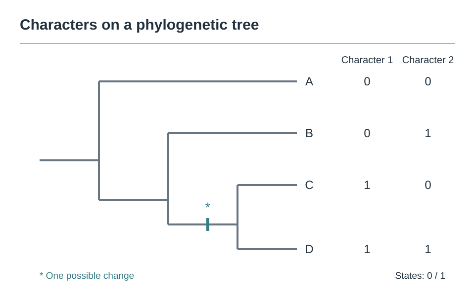

# M8-L4 – Development and evolutionary history {#L4}

**Course area:** M8 – Zoology and Animal Diversity

**Level:** Bachelor

**Prerequisites:** [M6-L6](M6-L6.md): gene regulation; [M8-L1](M8-L1.md): germ layers.

**Learning objective:** Explain fundamental processes of early animal development and their relevance to evolutionary comparisons; reconstruct character changes on a simplified tree.

## Introduction {#S1}

Numerous cell types can arise from a single zygote. Embryonic patterns provide clues to common ancestry without requiring an organism to pass through the adult forms of its ancestors during development.

## Principles and model {#S2}

### Development as a spatial process

Cleavage divides the zygote into smaller cells, often initially without proportional growth in size. The blastula is an early cellular organisation whose precise shape varies among animal groups. During gastrulation, coordinated cell movements and shape changes establish germ-layer organisation and body axes. Organogenesis subsequently differentiates tissues and organ primordia. Cell signalling and position-dependent gene regulation couple development to spatial information. Hox genes are important examples of regulators of regional identity along the body axis in many bilaterians. Changes in regulatory networks can shift developmental traits; a single gene does not specify an entire body plan.

### Developmental data and ancestry

The classical comparison between Protostomia and Deuterostomia includes cleavage patterns and the fate of the blastopore. These textbook traits are not uniform across all members. Molecular data are now used together with anatomy, development and fossils. A synapomorphy is a shared derived character that can support a clade; it must be distinguished from shared ancestral characters. Character losses and convergent innovations can complicate reconstruction. The earliest branching order of animal lineages remains a subject of scientific discussion.

*Figure: Rooted example tree A, B, C, D with two binary characters and one marked change for character 1.*

## Application {#S3}

A fictional rooted tree is $(A,(B,(C,D)))$. For a binary character with states A=0, B=0, C=1 and D=1, one change on the common branch of C and D is sufficient. If a second character occurs only in B and D, its most parsimonious reconstruction requires at least two changes. Parsimony is a modelling assumption, not a guarantee of the true history.

## Self-assessment {#S4}

### Exercises

1. Which developmental stage organises the germ layers?
2. How many changes are minimally required if only D has state 1?
3. Why are Hox genes not an entire body plan?

::: {.lc-solutions data-lc-section="S4"}
1. Gastrulation.
2. A single change on the branch leading to D is sufficient.
3. They operate in the context of other genes, pathways, cellular states and spatial interactions.
:::

## Assumptions and limitations {#S5}

The diagram shows an artificial character tree rather than an actual hypothesis about the ancestry of four animal phyla. Application to natural data requires consideration of uncertainty, models and character definitions.

## Summary and transition {#S6}

Developmental biology supplies part of the evidence for evolutionary history. M8-L5 introduces important animal groups and their diversity.

**Continue:** [M8-L5](M8-L5.md)

## Sources {#S7}

- [OpenStax – Biology 2e, 43.6 Fertilization and Early Embryonic Development](https://openstax.org/books/biology-2e/pages/43-6-fertilization-and-early-embryonic-development) · Cleavage and gastrulation · Last accessed: 2026-11-25
- [OpenStax – Biology 2e, 27.3 Animal Phylogeny](https://openstax.org/books/biology-2e/pages/27-3-animal-phylogeny) · Evidence and unresolved relationships · Last accessed: 2026-11-25
- [OpenStax – Biology 2e, 27.2 Features Used to Classify Animals](https://openstax.org/books/biology-2e/pages/27-2-features-used-to-classify-animals) · Symmetry, germ layers and body cavities · Last accessed: 2026-11-25

