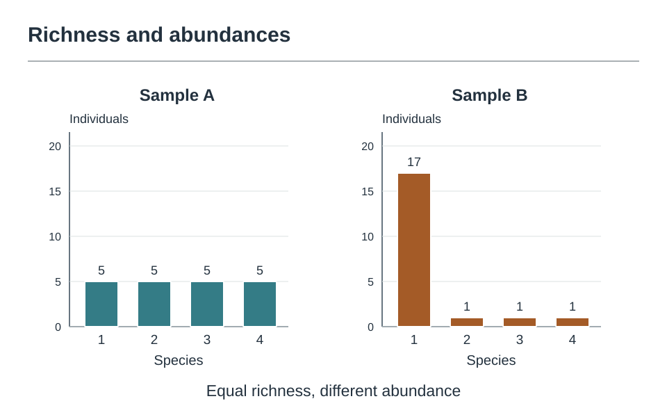

# M8-L5 – Animal groups and biodiversity {#L5}

**Course area:** M8 – Zoology and Animal Diversity

**Level:** Bachelor

**Prerequisites:** [M8-L1](M8-L1.md): body plans; [M8-L4](M8-L4.md): ancestry.

**Learning objective:** Identify major animal phyla using diagnostic features, verify taxonomic names and distinguish species richness from diversity.

## Introduction {#S1}

Animals without a vertebral column account for most described animal species. The term invertebrates is practical but does not denote a single natural clade because it excludes vertebrates from the entirety of animals.

## Principles and model {#S2}

### Orientation within diversity

Porifera (sponges) possess a water-channel system with specialised filtering cells. Cnidaria are characterised by stinging cells. Bilateria includes Spiralia, Ecdysozoa and Deuterostomia, among other groupings. Spiralia includes, for example, Mollusca with a mantle and often a radula, and Annelida with frequently segmented bodies. Ecdysozoa includes Nematoda and Arthropoda; the latter have jointed appendages and a cuticle that is moulted. Echinodermata have a water vascular system. Chordata exhibit, at least temporarily, a notochord, dorsal neural tube, pharyngeal slits or corresponding structures and a post-anal tail; an endostyle or thyroid completes the character combination. Chordates also include tunicates and lancelets. Birds belong to the reptilian lineage within tetrapods; “fishes” excluding tetrapods are not a complete clade.

### Identifying and documenting species

A morphological identification key uses diagnostic characters and alternatives. DNA barcodes can support identification but require appropriate reference sequences and may be ambiguous in closely related species or hybridisation. Taxonomic registers such as WoRMS link accepted marine names to synonyms and stable identifiers. A name revision is not automatically a biological discovery. Combining datasets requires consideration of synonyms and duplicate records.

Species richness is the number of distinguished species; the evenness of their abundances is another dimension. Differences in sampling effort may bias both measures.

*Figure: Two bar charts with four species and 20 individuals each: even and uneven distributions.*

## Application {#S3}

Two fictional samples each comprise 20 animals from four species. A contains 5, 5, 5, 5 individuals; B contains 17, 1, 1, 1. Both have species richness 4. Shannon entropy $H=-\sum p_i\ln p_i$ with relative abundances $p_i$ is approximately 1.386 for A and 0.588 for B. The effective number of species $\exp(H)$ is 4 and approximately 1.80. A rare species may nevertheless be ecologically crucial; the index does not measure its functional value.

## Self-assessment {#S4}

### Exercises

1. Why do invertebrates not constitute a single clade?
2. Calculate $H$ for two equally abundant species.
3. Why are accepted names and taxonomic identifiers important when reconciling data?

::: {.lc-solutions data-lc-section="S4"}
1. The term excludes vertebrates, which evolved within animals.
2. $-2\cdot0.5\ln(0.5)=\ln 2\approx0.693$.
3. They enable matching of synonyms and help detect duplicate or misassigned records.
:::

## Assumptions and limitations {#S5}

The bars represent invented samples. Diversity comparisons require comparable sampling, spatial scale and taxonomic resolution. Advanced phylogenetics and population ecology are covered later in the course.

## Summary and transition {#S6}

Animal diversity can be understood through ancestry, function and data quality. M9 examines microbial systems and immunobiology.

**Continue:** [M9-L1](M9-L1.md)

## Sources {#S7}

- [OpenStax – Biology 2e, 28 Introduction](https://openstax.org/books/biology-2e/pages/28-introduction) · Invertebrate phyla · Last accessed: 2026-11-25
- [OpenStax – Biology 2e, 29.1 Chordates](https://openstax.org/books/biology-2e/pages/29-1-chordates) · Chordate diagnostic characters · Last accessed: 2026-11-25
- [OpenStax – Biology 2e, 27.3 Animal Phylogeny](https://openstax.org/books/biology-2e/pages/27-3-animal-phylogeny) · Evidence and unresolved relationships · Last accessed: 2026-11-25
- [World Register of Marine Species – About](https://www.marinespecies.org/about.php) · Expert-maintained taxonomy, identifiers and synonym relationships · Last accessed: 2026-11-25
- [OpenStax – Biology 2e, 45.6 Community Ecology](https://openstax.org/books/biology-2e/pages/45-6-community-ecology) · Species richness and evenness · Last accessed: 2026-11-25
- [DiversityStats – Reference manual](https://cran.case.edu/web/packages/DiversityStats/refman/DiversityStats.html) · Shannon entropy and effective number of species · Last accessed: 2026-11-25

