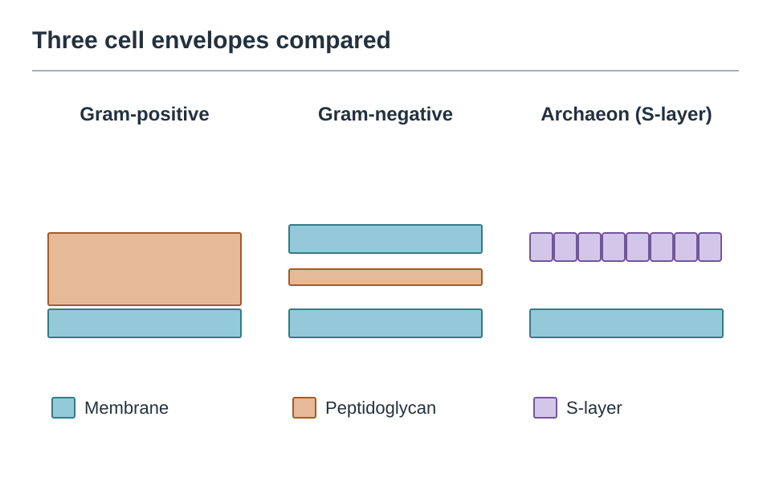

# M9-L1 – Bacteria, archaea and microbial systems {#L1}

**Course area:** M9 – Microbiology and Immunobiology

**Level:** Bachelor

**Prerequisites:** [M4-L1](M4-L1.md): cell organisation; [M5-L3](M5-L3.md): lipids and polysaccharides.

**Learning objective:** Distinguish bacteria and archaea using molecular and structural characteristics and explain the limits of microscopic observations.

## Introduction {#S1}

A micrograph shows two small rod-shaped cells. Similar shapes are insufficient evidence of shared ancestry: similar geometric solutions can arise independently. Microbiology connects morphology with biochemistry, genetics and ecology.

## Principles and model {#S2}

### Organisation and cell envelope

Bacteria and archaea lack a membrane-bound nucleus. DNA occupies a nucleoid; ribosomes translate RNA into proteins. Many species also have plasmids, whose occurrence and properties vary. The absence of a nucleus implies neither a lack of spatial organisation nor low biochemical complexity.

In many bacteria, peptidoglycan stabilises the cell wall. The conventional Gram-positive envelope has a thick peptidoglycan layer; in the conventional Gram-negative type, a thinner layer lies between inner and outer membranes. Exceptions include wall-less bacteria. Archaea lack bacterial peptidoglycan; protein surface layers often form the outer envelope. Their membrane lipids typically differ through ether bonds and isoprenoid chains from the ester-linked fatty-acid lipids of many bacteria. Some archaea have a lipid monolayer rather than a bilayer.

### Ancestry and functional diversity

Comparisons of ribosomal RNA and conserved genes support evolutionary classification. Archaea are not restricted to extreme habitats. Both groups occur, for example, in aquatic environments and soils. Horizontal gene transfer can make individual gene trees differ from the organismal tree. Functional traits should therefore not be generalised to an entire domain without evidence.

*Figure: Schematic envelopes: thick peptidoglycan, thin peptidoglycan between two membranes, and an archaeal S-layer.*

## Application {#S3}

A schematic image contains a scale bar of 80 µm spanning 400 pixels. An object spans 15 pixels. Its length is $15\cdot80/400=3$ µm. This does not establish whether the object is a bacterium, an archaeon or a cell fragment. Independent traits are needed for identification.

## Self-assessment {#S4}

### Exercises

1. Which components occur in both domains?
2. Why is peptidoglycan a useful but non-universal bacterial characteristic?
3. Calculate object length for 25 pixels using the same calibration.

::: {.lc-solutions data-lc-section="S4"}
1. Among others, plasma membrane, DNA and ribosomes.
2. Many bacteria possess it, whereas archaea do not; wall-less bacteria are an exception.
3. $25\cdot80/400=5$ µm.
:::

## Assumptions and limitations {#S5}

The cross-sections are idealised envelope types, not to scale. They do not show complete cell structures. Staining behaviour or shape alone is insufficient for species identification; no laboratory protocols are provided here.

## Summary and transition {#S6}

Cell envelopes and molecular data complement one another in classification. M9-L2 considers the diversity of energy and material flows.

**Continue:** [M9-L2](M9-L2.md)

## Sources {#S7}

- [OpenStax – Biology 2e, 22.2 Structure of Prokaryotes: Bacteria and Archaea](https://openstax.org/books/biology-2e/pages/22-2-structure-of-prokaryotes-bacteria-and-archaea) · Cell envelopes and structural diversity · Last accessed: 2026-11-25

