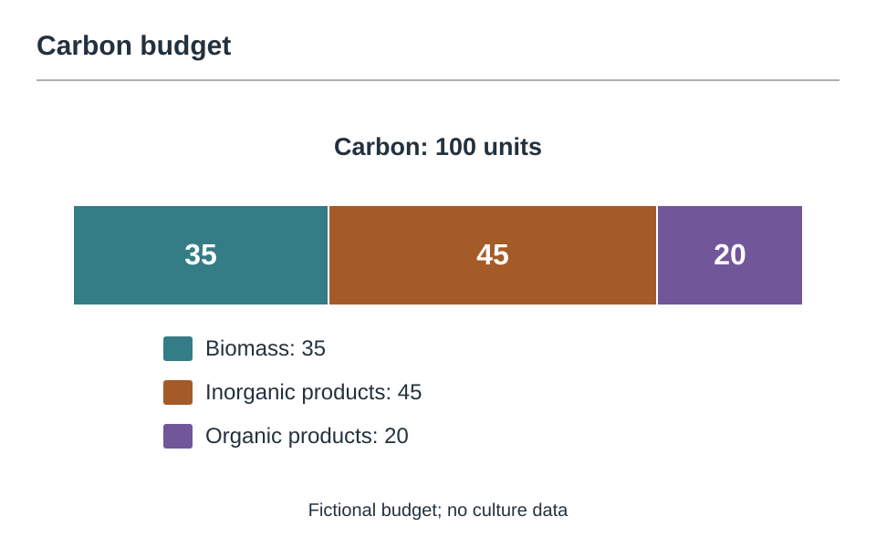

# M9-L2 – Growth and metabolism {#L2}

**Course area:** M9 – Microbiology and Immunobiology

**Level:** Bachelor

**Prerequisites:** [M5-L4](M5-L4.md): energy metabolism; [M2-L1](M2-L1.md): growth models.

**Learning objective:** Classify energy source, carbon source and electron donor independently and interpret an abstract carbon budget.

## Introduction {#S1}

One microbial community can transform organic substances while another uses inorganic compounds. Its metabolism cannot be characterised solely by the presence of oxygen. Three independent properties must be considered separately.

## Principles and model {#S2}

### Three nutritional axes

Phototrophs obtain energy from light; chemotrophs from chemical reactions. Autotrophs obtain cellular carbon predominantly from inorganic carbon, heterotrophs from organic compounds. Lithotrophs use inorganic electron donors, organotrophs organic donors. These terms can be combined and describe functions rather than taxonomic groups. Some organisms switch between metabolic modes depending on their environment.

Aerobic respiration uses oxygen as its terminal electron acceptor; anaerobic respiration uses other acceptors. Fermentation obtains ATP predominantly through substrate-level phosphorylation and balances redox carriers via organic products. Fermentation and anaerobic respiration are thus not synonymous. Microbial metabolic processes connect carbon, nitrogen and other elemental cycles.

### Growth and measurement

Population growth is a change in individual number; biomass growth is a change in mass. These measures are not identical: cell size, viability and composition may change. An exponential model represents idealised relative increase, a logistic model a limited population. In natural communities, resources, competition and loss processes alter dynamics. Optical signals and DNA quantities are indirect measurements and must be interpreted accordingly.

*Figure: A budget bar with three segments: 35, 45 and 20 of 100 carbon units.*

## Application {#S3}

In an invented, non-experimental carbon budget, 100 carbon units are accounted for: 35 in biomass, 45 in inorganic end products and 20 in organic end products. The fraction incorporated into biomass is $35/100=0.35$. The budget closes with $35+45+20=100$. It does not describe an organism's growth conditions or process parameters.

## Self-assessment {#S4}

### Exercises

1. Why is autotrophy not equivalent to phototrophy?
2. What feature distinguishes anaerobic respiration from fermentation?
3. Of 80 carbon units, 24 are in biomass and 40 in inorganic products. How many remain in organic products, assuming no other flows?

::: {.lc-solutions data-lc-section="S4"}
1. Autotrophy describes the carbon source, phototrophy the energy source.
2. Anaerobic respiration uses an electron transport chain with a terminal acceptor other than oxygen; fermentation does not depend on such an external acceptor.
3. $80-24-40=16$ units.
:::

## Assumptions and limitations {#S5}

The example is a bookkeeping budget only, unrelated to a cultivation process. Carbon and energy budgets are distinct quantities; neither predicts cell number or growth rate here.

## Summary and transition {#S6}

Microbial metabolic diversity is described by energy, carbon and redox flows. M9-L3 examines non-cellular viruses.

**Continue:** [M9-L3](M9-L3.md)

## Sources {#S7}

- [OpenStax – Biology 2e, 22.3 Prokaryotic Metabolism](https://openstax.org/books/biology-2e/pages/22-3-prokaryotic-metabolism) · Energy and carbon sources; biogeochemical cycles · Last accessed: 2026-11-25
- [OpenStax – Biology 2e, 45.3 Environmental Limits to Population Growth](https://openstax.org/books/biology-2e/pages/45-3-environmental-limits-to-population-growth) · Exponential and logistic growth · Last accessed: 2026-11-25

