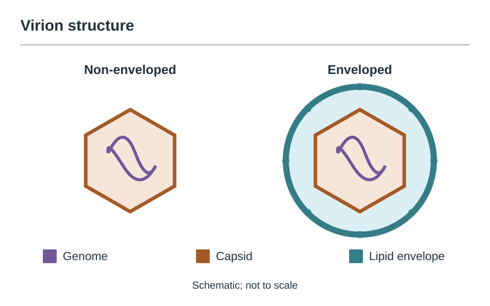

# M9-L3 – Viruses and host relationships {#L3}

**Course area:** M9 – Microbiology and Immunobiology

**Level:** Bachelor

**Prerequisites:** [M6-L1](M6-L1.md): nucleic acids; [M4-L2](M4-L2.md): membranes.

**Learning objective:** Distinguish virions from cells, classify basic virus types and assess limitations of detection data.

## Introduction {#S1}

An illustration of a virus particle shows a protein shell around genetic material. Unlike a cell, the particle has no independent translation machinery or complete energy metabolism. Its biological significance becomes apparent through its relationship with the host cell.

## Principles and model {#S2}

### Genome and particle

Viruses carry DNA or RNA as their genome, with different structures and numbers of segments. The capsid protects the genome; some viruses also possess a lipid-containing envelope with viral proteins. A virion is the extracellular virus particle. Viruses are not bacteria and ordinary cellular structural features do not apply to them. The Baltimore classification groups viruses by genome type and the general route to messenger RNA; it does not replace evolutionary taxonomy.

### Host dependence and outcomes

Viral reproduction depends on cellular resources. The relationship can involve cell damage, long-term persistence or temporary absence of detectable activity. Detection of a genome alone proves neither productive infection nor particle infectivity. Bacteriophages are viruses of bacteria; they also occur in natural microbial communities. Virus and host evolution are interconnected.

### Levels of detection

Morphological, molecular and immunological data measure different targets. Antibodies can indicate an immune response, genetic signals the presence of nucleic acid. Context, measurement limits and the timing of observations matter. A single measurement cannot establish all other properties.

*Figure: Two schematic virus particles with genome and capsid; the right one has an additional lipid envelope.*

## Application {#S3}

A fictional dataset contains 200 anonymised observations. A molecular signal is positive in 50; 30 of these 50 also show an independent antibody signal. The proportion of molecular-positive observations is $50/200=25\%$; among these, $30/50=60\%$ are also antibody-positive. Without further information, infectivity and diagnostic performance cannot be inferred.

## Self-assessment {#S4}

### Exercises

1. What distinguishes a virion from a bacterial cell?
2. Does genome detection prove active infection?
3. What fraction of all observations shows both signals?

::: {.lc-solutions data-lc-section="S4"}
1. A virion is acellular and lacks independent translation and complete energy metabolism.
2. No; nucleic acid can be detectable without productive infection.
3. $30/200=15\%$.
:::

## Assumptions and limitations {#S5}

The figure represents abstract particles, not a specific virus species; sizes and geometries are not to scale. The data are invented and do not support medical interpretation or experimental recommendations.

## Summary and transition {#S6}

Virus structure, host dependence and detection signals are distinct levels. M9-L4 explains the immune response.

**Continue:** [M9-L4](M9-L4.md)

## Sources {#S7}

- [OpenStax – Biology 2e, 21.1 Viral Evolution, Morphology, and Classification](https://openstax.org/books/biology-2e/pages/21-1-viral-evolution-morphology-and-classification) · Genome, capsid and envelope · Last accessed: 2026-11-25
- [OpenStax – Biology 2e, 21.2 Virus Infections and Hosts](https://openstax.org/books/biology-2e/pages/21-2-virus-infections-and-hosts) · Host dependence and infection outcomes · Last accessed: 2026-11-25

