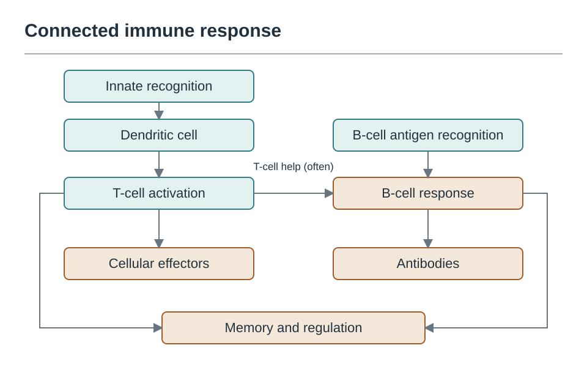

# M9-L4 – Innate and adaptive immunity {#L4}

**Course area:** M9 – Microbiology and Immunobiology

**Level:** Bachelor

**Prerequisites:** [M4-L5](M4-L5.md): cell communication; [M6-L4](M6-L4.md): proteins and regulation.

**Learning objective:** Connect innate and adaptive immunity functionally and explain antigen presentation and immunological memory.

## Introduction {#S1}

Skin and mucosa are more than mechanical boundaries. Together with antimicrobial substances, resident cells and other defences, they form an interface between the organism and the environment. When these barriers are breached, several immune mechanisms act together.

## Principles and model {#S2}

### Innate defence

Pattern recognition receptors recognise conserved microbial structures and signals from damaged cells. Neutrophils and macrophages can engulf foreign material; soluble complement proteins support tagging, inflammation and, in some cases, membrane damage. Cytokines mediate communication between cells. Natural killer cells respond to certain changes in host cells. Inflammation can protect but may also damage tissue.

### Adaptive defence and cooperation

B cells recognise antigens with their receptors and, following appropriate activation signals, can develop into antibody-secreting plasma cells and memory cells. T-cell receptors predominantly recognise peptides associated with MHC molecules. CD4 helper T cells coordinate responses; CD8 T cells can kill altered target cells. Dendritic cells link pattern recognition and antigen presentation to activation of naive T cells. Clonal selection expands appropriate lymphocytes rather than generating a suitable receptor on demand.

### Memory, regulation and tolerance

Memory B and T cells often enable a faster response on re-exposure. Vaccination exploits immunological memory, but protection need not be complete or permanent. Tolerance mechanisms normally prevent damaging reactions against the body's own structures. Allergy, autoimmunity and immunodeficiency illustrate that the appropriateness, not merely the strength, of an immune response matters.

*Figure: Simplified network: innate recognition and antigen presentation connect to T-cell responses; T-cell help supports many B-cell responses.*

## Application {#S3}

A purely educational cell-count dataset comprises 400 lymphocytes: 240 T cells, 100 B cells and 60 other lymphocytes. Their proportions are 60%, 25% and 15%. A second dataset with 120 T cells among 200 lymphocytes has the same T-cell proportion despite half the absolute count. The example contains no clinical reference values.

## Self-assessment {#S4}

### Exercises

1. Which function connects dendritic cells with adaptive immunity?
2. How do plasma cells and memory B cells differ functionally?
3. What proportion are B cells if 90 of 300 lymphocytes are B cells?

::: {.lc-solutions data-lc-section="S4"}
1. They present antigens and provide activation signals to T cells.
2. Plasma cells secrete antibodies; memory B cells support subsequent responses.
3. $90/300=30\%$.
:::

## Assumptions and limitations {#S5}

The diagram reduces a dynamic network to central connections. Not every activation follows the same sequence; innate and adaptive processes can act in parallel. The example data are not a basis for diagnosis or treatment.

## Summary and transition {#S6}

Defence relies on coordinated recognition, effector and regulatory mechanisms. M9-L5 extends the perspective to microbial communities.

**Continue:** [M9-L5](M9-L5.md)

## Sources {#S7}

- [OpenStax – Biology 2e, 42.1 Innate Immune Response](https://openstax.org/books/biology-2e/pages/42-1-innate-immune-response) · Barriers, immune cells and complement · Last accessed: 2026-11-25
- [OpenStax – Biology 2e, 42.2 Adaptive Immune Response](https://openstax.org/books/biology-2e/pages/42-2-adaptive-immune-response) · B and T cells, antigen recognition and memory · Last accessed: 2026-11-25

