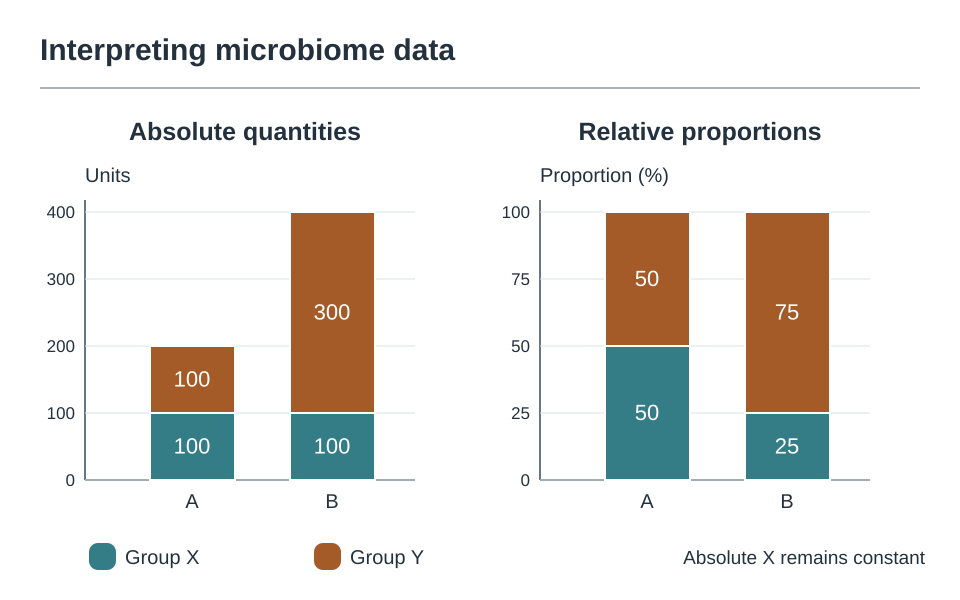

# M9-L5 – Microbiomes and biological interactions {#L5}

**Course area:** M9 – Microbiology and Immunobiology

**Level:** Bachelor

**Prerequisites:** [M7-L5](M7-L5.md): symbiosis; [M8-L5](M8-L5.md): diversity.

**Learning objective:** Distinguish microbiota, microbiome and microbial interactions, and critically interpret compositional data.

## Introduction {#S1}

A root is surrounded by microorganisms exchanging substances with the plant and with each other. The community changes with site, host and developmental stage. Similar relationships exist on animal surfaces and in aquatic environments.

## Principles and model {#S2}

### Community, function and interaction

Microbiota denotes the organisms in a microbial community; microbiome is often defined more broadly to include genetic information and ecological context. Usage is not entirely consistent across the literature. Mutualism refers to interactions benefiting both partners; commensalism benefits one without a demonstrated substantial effect on the other; competition constrains both. Classification depends on the environment and outcome under consideration. Biofilms are spatially structured communities, often embedded in an extracellular matrix.

### Measurement and composition

Sequence data can capture taxonomic markers or a broader genetic repertoire. Detecting a gene does not establish its activity. DNA extraction, marker copy numbers and reference databases influence observed abundances. Sequence proportions sum to a constant total and are therefore compositional: a relative increase can result from a decrease in other groups. Absolute quantities require independent quantitative information; appropriate log-ratios can help comparisons if treatment of zeros is also justified.

### Causality and stability

Associations between microbiomes and host characteristics may arise from diet, environment, age or other shared influences. Community function cannot be inferred uniquely from taxonomic diversity: different organisms may perform similar functions. Longitudinal data, suitable controls and independent functional measurements help distinguish explanations.

*Figure: Stacked bars: X remains at 100 units, Y increases from 100 to 300; the proportion of X falls from 50 to 25 percent.*

## Application {#S3}

Two simulated communities contain 100 units each of groups X and Y in A, but 100 X and 300 Y in B. The relative abundance of X falls from $100/200=50\%$ to $100/400=25\%$. Its absolute quantity remains unchanged. The X/Y ratio falls from 1 to $1/3$. Without absolute totals, the unchanged X quantity could not be inferred from proportions alone.

## Self-assessment {#S4}

### Exercises

1. Why does detecting a gene not prove metabolic activity?
2. Why need a relative decrease not be an absolute decrease?
3. What is the relative abundance of X with 80 units X and 120 Y?

::: {.lc-solutions data-lc-section="S4"}
1. The gene may be present but not expressed or functionally inactive.
2. The denominator changes with the quantities of other groups.
3. $80/(80+120)=40\%$.
:::

## Assumptions and limitations {#S5}

The graphic uses invented, exactly known absolute quantities. Real sequence counts are not direct cell counts. No health evaluation or treatment is inferred here from an observed microbiome profile.

## Summary and transition {#S6}

Relative and absolute quantities must be kept separate. M9-L6 examines parasitic relationships and host roles.

**Continue:** [M9-L6](M9-L6.md)

## Sources {#S7}

- [OpenStax – Microbiology, 4.1 Prokaryote Habitats, Relationships, and Microbiomes](https://openstax.org/books/microbiology/pages/4-1-prokaryote-habitats-relationships-and-microbiomes) · Microbial ecology and symbiotic relationships · Last accessed: 2026-11-25
- [Gloor et al. (2017), Microbiome Datasets Are Compositional: And This Is Not Optional](https://pubmed.ncbi.nlm.nih.gov/29187837/) · Abstract; relative abundance and compositional inference · Last accessed: 2026-11-25

