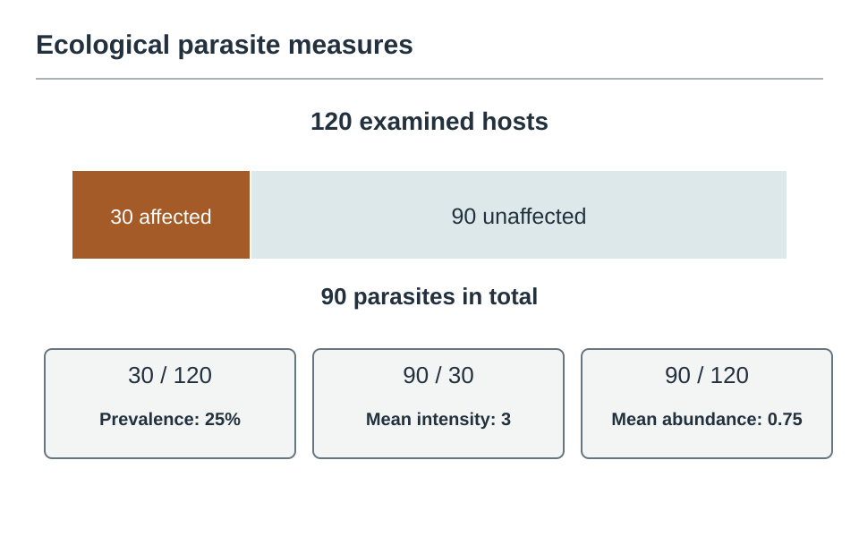

# M9-L6 – Parasites and host life cycles {#L6}

**Course area:** M9 – Microbiology and Immunobiology

**Level:** Bachelor

**Prerequisites:** [M8-L5](M8-L5.md): animal groups; [M9-L4](M9-L4.md): immunity.

**Learning objective:** Classify parasites by biological characteristics, distinguish host roles and separate prevalence from infection intensity.

## Introduction {#S1}

A parasite uses another organism as a resource or habitat at a cost to the host. Parasitism is an ecological lifestyle, not a single lineage. Its diversity ranges from unicellular eukaryotes to multicellular animals.

## Principles and model {#S2}

### Parasites and host roles

Ectoparasites live on external surfaces, endoparasites inside a host. Unicellular parasites belong to different eukaryotic lineages. Helminth is a collective term for parasitic worms, including members of flatworms and roundworms. These groups differ in body plan, development and physiological requirements. The term parasite alone does not indicate disease severity.

In relevant life cycles, a definitive host is the host of sexual reproduction or sexual maturity; an intermediate host harbours other necessary developmental stages. A paratenic host may harbour a parasite without necessary further development. A vector mediates transmission and, depending on the system, may also be a developmental host. A reservoir is a population or ecological system in which an infectious agent is maintained. These roles are not interchangeable. Direct cycles require no obligatory intermediate host, whereas indirect cycles require at least one other necessary host. Host roles are described abstractly here, without concrete agent life cycles.

### Ecological measures

Prevalence is the proportion of affected individuals in a sampled population at a defined time or over a defined period. Mean intensity expresses parasite number per affected host; mean abundance refers to all examined hosts. These measures can change independently. Host age, environment, behaviour and detection methods influence observations. Field studies must document selection methods and potential confounders.

*Figure: Fictional survey: 30 of 120 hosts are affected; 90 parasites yield mean intensity 3 and mean abundance 0.75.*

## Application {#S3}

An invented ecological-statistical survey counts 30 affected individuals among 120 examined hosts and 90 parasites in total. Prevalence: $30/120=25\%$. Mean intensity: $90/30=3$ parasites per affected host. Mean abundance: $90/120=0.75$ per examined host. The data refer to no real species.

## Self-assessment {#S4}

### Exercises

1. Why do helminths not constitute a single natural lineage?
2. What distinguishes a definitive host from an intermediate host in the relevant cycle?
3. Calculate prevalence and mean intensity if 20 of 100 hosts harbour 50 parasites in total.

::: {.lc-solutions data-lc-section="S4"}
1. They include parasitic members of different animal lineages, such as flatworms and roundworms.
2. Sexual reproduction or maturity occurs in the definitive host; another necessary developmental stage occurs in the intermediate host.
3. $20/100=20\%$ and $50/20=2.5$ parasites per affected host.
:::

## Assumptions and limitations {#S5}

The graphic shows fictional parasite measures only. The lesson contains no instructions for maintenance, propagation or transmission. Prevalence estimates depend on sampling and detection probability; the example does not replace an epidemiological investigation.

## Summary and transition {#S6}

Parasitism connects development, ecology and host biology. M10 turns to plant physiology.

**Continue:** [M10-L1](M10-L1.md)

## Sources {#S7}

- [OpenStax – Microbiology, 5.1 Unicellular Eukaryotic Parasites](https://openstax.org/books/microbiology/pages/5-1-unicellular-eukaryotic-parasites) · Eukaryotic parasites and biological diversity · Last accessed: 2026-11-25
- [OpenStax – Microbiology, 5.2 Parasitic Helminths](https://openstax.org/books/microbiology/pages/5-2-parasitic-helminths) · Parasitic animal groups and host relationships · Last accessed: 2026-11-25
- [Rózsa, Reiczigel & Majoros (2000), Quantifying parasites in samples of hosts](https://pubmed.ncbi.nlm.nih.gov/10780537/) · Abstract: prevalence, intensity and abundance · Last accessed: 2026-11-25

